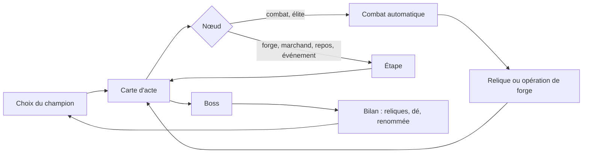

# Campagne : réflexion sur un mode aventure

_Réflexion ouverte le 2026-10-21, sur la version 0.84.1. **Rien n'est décidé ni engagé** : c'est un plan de travail pour la discussion. À la demande de l'utilisateur, ce document reste **isolé** : il n'est pas encore relié à `README.md`, `TODO.md`, `INTENTION.md` ni `ETAT.md`, pour ne pas mêler ces pistes aux chantiers en cours._

---

## 0. En bref

**L'idée** : un mode où l'on mène **un champion** le long d'une carte à embranchements, de combat en combat, jusqu'à un boss. Les combats restent **entièrement automatiques**. Le joueur agit **entre** les combats : il choisit son itinéraire, ses reliques, et il **forge son dé**, qui est son arme.

**Ce qui est retenu** :
- **le dé qui se forge** est le cœur de la progression et de l'action (§ 4) ;
- **l'équipement, ce sont les reliques**, de tous types, sans inventaire (§ 5) ;
- **le spectacle n'est pas que le combat serré** : une campagne doit aussi laisser le champion écraser, et que ce soit beau à voir (§ 6) ;
- **une partie perdue doit quand même ouvrir des perspectives** : la forme reste à trouver ; l'héritage d'une face est gardé en réserve (§ 8) ;
- **un levier immédiat, hors campagne** : le bilan des reliques sur l'écran de victoire (§ 9).

---

## 1. Décisions de l'utilisateur (2026-10-21)

| Question | Décision |
| --- | --- |
| Rôle de l'observateur | Il agit **en dehors des combats** : choix de relique, de compétence, d'équipement, d'itinéraire. La résolution reste automatique. |
| Paris | Un jeu entre amis, **plus une fonctionnalité centrale**. Ils restent dans le mode tournoi ; les nouveaux modes s'en passent. |
| Solo ou à plusieurs | **Solo d'abord.** Une coopération serait « incroyable » si elle est possible (§ 11). |
| Durée d'une partie | Inconnue ; on trouvera un moyen d'enregistrer (§ 13). |
| Images | Tentation forte d'un essai de squelette 2D sur Gorak, mais **d'abord savoir jusqu'où vont les images fixes** (§ 12). |
| Mémoire des personnages (chronique) | Pourquoi pas, mais sans objet en duel ou en tournoi : selon ce qu'on développe. |
| Le dé qui se forge | **Retenu.** Progression et action passent par le dé. **Le dé, c'est l'arme.** |
| Équipement | **Les reliques**, au total, de tout type. **Pas d'inventaire.** Le système de relique est déjà en place dans l'interface. |
| Spectacle | En campagne, trouver le moyen de **s'émanciper des règles qui favorisent le combat serré**, au profit du spectacle. |
| Partie perdue | À trouver. L'héritage d'une face forgée est **gardé en réserve**, pour un moment opportun. Les « saisons » évoquées ici étaient en fait une extension du **tournoi** (§ 8), pas de la campagne. |
| Bilan des reliques | À afficher sur l'écran de victoire : **levier facile d'accès.** |
| Présence (effets visuels) | Bonnes pistes, **à creuser plus tard**. Tous les personnages ont déjà une aura : il faudra d'autres effets. |
| Revanche | Abandonnée. |
| Hub entre les parties | Séduisant, mais il faut d'abord une montée en puissance qui ait du sens : **plus tard**. |

**Réponses aux questions ouvertes (2026-10-21, deuxième passe)** :

| Question | Décision |
| --- | --- |
| Opérations de forge | **Les cinq** : Graver, Dorer, Agrandir, Retailler, Aiguiser (§ 4.2). |
| Contrepoids de plomb | **Il devient une opération de forge** (Agrandir) : la relique quitte le tirage, il en reste onze. |
| La barde et l'ogre | **Une forge adaptée à chacun** (§ 4.4). |
| Nombre de reliques portées | **Sans limite, pour le moment.** |
| Longueur d'une partie | **Un acte, environ huit nœuds.** |
| Réglage des rencontres | **Le mélange** : combats ordinaires réglés sur le champion de référence ; élites et boss écrits à la main, comme des personnages précis (§ 6.3). |
| Choix du champion | **Tiré au sort parmi trois.** |

**Réponses de la troisième passe (2026-10-22)** :

| Question | Décision |
| --- | --- |
| Forge de la barde et de l'ogre | **Oui** à la piste du § 4.4 : doubles pour la barde, faces d'Attente pour l'ogre. |
| Compétences d'origine | **Un personnage ne déplace pas ses compétences d'origine.** |
| Nombre maximal de faces | « Il correspond au dé du personnage » (formulation de l'utilisateur, interprétation à confirmer : § 17). L'occasion, le rythme et le contexte de chaque proposition de forge restent à voir. |
| Reliques en campagne | **La règle « jamais de malus sur l'adversaire » ne s'applique pas** en campagne. |
| Champion de référence | Laissé à l'agent : voir § 6.3. |
| Nœuds du prototype | **Une forge de dé et une relique tous les deux combats normaux.** Rien d'autre pour le moment : ni marchand, ni repos, ni événement, ni trésor. |

---

## 2. Le point de départ

### 2.1 Les atouts du projet

| Atout | Pourquoi il compte pour une campagne |
| --- | --- |
| **Simulation instantanée** : coter un match, c'est 400 combats en 36 à 150 ms ([PARIS.md](PARIS.md) § 3.2) | Une rencontre se règle **par simulation**, pas à la main (§ 6.3). |
| **Spectacle mesuré** : changements de meneur, retours, fins serrées (`scripts/lab/spectacle.ts`) | On peut évaluer une rencontre, une relique ou une face du dé sur le spectacle, pas seulement sur la victoire (§ 7). |
| **Contenu en données** : reliques (`RELICS`, `validateRelics`, `npm run relics`), compétences (roster), `adjusted()` qui simule un personnage modifié sans toucher au roster | Une récompense de campagne n'est qu'une donnée de plus. |
| **Moteur v2** : chaque étape porte sa cause et son auteur, et la mise en scène est pure | Un nouvel effet n'est qu'une nouvelle étape à mettre en scène. |
| **Choix automatique modifiable** : la relique de récompense du tournoi est choisie au hasard, et le joueur peut la changer | Chaque décision de campagne peut avoir un choix par défaut : la partie se regarde en pilote automatique, ou se joue. |

### 2.2 Les freins

- **Le duel est écrit en dur** : `Pair<` apparaît 110 fois dans 20 fichiers, `Side` dans 22 fichiers. Une équipe en combat demande une refonte (§ 11).
- **Les images sont peintes entières** : la garde et cinq postures, soit environ cinq générations par personnage ([POSTURES.md](POSTURES.md)). Sans calque, pas d'équipement modulaire (§ 12).
- **Rien n'est sauvegardé** : le tournoi vit en mémoire, et c'est voulu. Une campagne ne peut pas s'en passer (§ 13).
- **L'historique `battler:history:v1` doit rester rétrocompatible** : toute mémoire nouvelle se range à côté.
- **Un constat mesuré pèse sur toute la montée en puissance : « la puissance tue le spectacle »** ([SORTS.md](SORTS.md) § 5). Avec la Colère, les retournements passent de 62 à 50 % ; avec le Contre-tir, de 51 à 43 %. Un combattant trop fort gagne sans suspense. Le § 6 propose une réponse.

---

## 3. Les jeux de référence

| Jeu | Ce qui fait le plaisir sans contrôler le combat | Ce qu'on peut lui prendre |
| --- | --- | --- |
| **Slay the Spire** | carte à embranchements ; combats, élites, marchand, feu de camp, événements, boss ; reliques | la carte d'acte courte, des nœuds lisibles, des rencontres fixées par acte (§ 6.3) |
| **Tape to Tape** ([entretien](https://www.shacknews.com/article/135007/tape-to-tape-interview-with-lead-game-designer-hugo-julien)) | carte du monde, recrues, synergies ; entre les saisons, on devient plus fort pour de bon ; des joueurs croisés rejoignent l'équipe ; sprites dessinés animés sur squelette 2D | les saisons et la progression entre les parties (§ 8), le squelette 2D (§ 12) |
| **Loop Hero** ([analyse](https://hayao.dev/docs/codex/anchor-loop-hero)) | le héros avance seul ; chaque tuile posée apporte du butin **et** du danger ; on rentre au camp pour garder ses gains | la règle qui lie tout le jeu ; le choix « rentrer ou pousser » |
| **Darkest Dungeon** ([site](https://www.darkestdungeon.com/darkest-dungeon/about)) | escouade, stress, hameau entre les expéditions | les cicatrices qu'un héros garde, le camp |
| **Slice & Dice, Dice Forge** [mémoire] | le dé est la fiche du personnage ; progresser, c'est changer ses faces | la forge du dé (§ 4) |
| **Balatro** [mémoire] | le calcul est le spectacle : chaque modificateur s'empile à l'écran | la puissance comme spectacle (§ 6.1) |
| **Rogue Legacy, Hades** [mémoire] | une partie perdue rapporte quand même : héritage, déblocages | la progression après une défaite (§ 8) |
| **Super Auto Pets, The Bazaar** [mémoire] | les adversaires sont des « fantômes » d'autres joueurs | des fantômes locaux : tes anciens champions comme boss (§ 8) |

« [mémoire] » : cité de mémoire, sans source vérifiée pendant cette réflexion.

---

## 4. Le dé qui se forge : l'arme

### 4.1 Le principe

**Le dé, c'est l'arme.** Le couperet de Gorak est un d9 : forger le dé, c'est forger l'arme. Progresser et agir passent par le même objet, celui qui fait déjà tout le combat.

**La règle de base ne change pas** : un jet, une face, et cette face porte soit une compétence, soit un coup. La forge ne change que **ce que portent les faces**. C'est moins intimidant qu'il n'y paraît : le moteur sait déjà presque tout faire.

| Besoin | Ce qui existe déjà |
| --- | --- |
| Une compétence sur n'importe quelle face | les déclencheurs `naturalOne`, `naturalTwo`, `naturalThree` et `naturalMax` (`events.ts`) ; il faut les généraliser en « sur la face n » |
| Un bonus de dégâts sur une face précise | le bonus `onFace` des reliques de type Coup (`relics.ts`) |
| Changer la taille du dé | `stats.damageDie` ; la relique Contrepoids de plomb donne déjà +2 faces |
| Simuler un personnage modifié | `adjusted()` |

### 4.2 Une grammaire de la forge

Sur le modèle des quatre types de relique : un petit nombre d'**opérations**, chacune avec sa règle écrite une fois, et des récompenses qui ne sont que des instances de ces opérations. Les calculs portent sur Gorak (d9, compétences sur 1, 2 et 3), sans compter critiques ni esquives :

| Opération | Effet | Ce que voit le spectateur | Gorak |
| --- | --- | --- | --- |
| **Graver** | une compétence gagnée prend la place d'une face qui frappait | une rune sur la face | une compétence de plus, à 11 % des tours ; une face qui frappe en moins |
| **Dorer** | +2 aux dégâts d'une face qui frappe | une face en or | un 9 qui vaut 11 |
| **Agrandir** | le dé gagne deux faces | le dé grossit | compétences : 33 → 27 % des tours ; coup moyen hors compétences : 6,5 → 7,5 |
| **Retailler** | le dé perd une face | le dé rapetisse | compétences : 33 → 37,5 % des tours ; coup moyen hors compétences : 6,5 → 6 |
| **Aiguiser** | une compétence monte d'un rang (Épines 6 → 8) | un chiffre romain sur la face | — |

**Gagner une compétence**, c'est **la graver** : il n'y a pas de catégorie « compétence » à côté de la forge.

### 4.3 Les règles de conception

- **Des échanges autant que des gains.** Agrandir et Retailler troquent des compétences contre des dégâts, ou l'inverse. Ces choix protègent le spectacle et gardent les personnages typés.
- **Tout se mesure en lot** : 10 personnages × 5 opérations, en une passe de laboratoire (valeur nette et spectacle).
- **Une face reste lisible de loin** : rune, or, chiffre romain ; jamais un texte.
- **Le kit d'origine reste l'identité** : les trois compétences d'un personnage restent les siennes ; la forge ajoute, déplace ou renforce, elle ne réécrit pas qui il est.

### 4.4 Questions ouvertes

- **Décidé** : Contrepoids de plomb devient l'opération Agrandir ; la relique quitte le tirage.
- **Décidé : une forge adaptée à chacun.** La barde grave et dore ses **doubles** (une compétence sur le double 4, un double doré), l'ogre grave sur ses **faces d'Attente** (1 à 3 sur son d14), qui ne font rien aujourd'hui. À mesurer.
- **Décidé : un personnage ne déplace pas ses compétences d'origine.**
- **Décidé, à préciser** : le nombre maximal de faces « correspond au dé du personnage » (§ 17).
- **À voir** : à quelle occasion, à quel rythme et dans quel contexte la forge est proposée. Pour le prototype : une forge tous les deux combats normaux (§ 6.3).

---

## 5. Les reliques : l'équipement

- **L'équipement, ce sont les reliques**, de tous types (Caractéristique, Coup, Tour, Seuil : [RELIQUES.md](RELIQUES.md)).
- **Pas d'inventaire** : une relique gagnée est portée tout de suite. Le système est déjà en place dans l'interface : sceaux en combat, à l'affrontement, dans l'arbre et sur l'écran du champion ; menu Récompense.
- **Où on les gagne** : élites, boss, trésors, marchand.
- **Les douze reliques mesurées** vont de +6,1 à +21,4 points ([RELIQUES.md](RELIQUES.md) § 7). En campagne, cet écart devient une rareté plutôt qu'un défaut.

**Décisions** :
- **sans limite, pour le moment.** L'en-tête du combat devra pouvoir montrer beaucoup de sceaux ;
- **en campagne, une relique peut poser un malus sur l'adversaire** : la règle du tournoi ne s'applique pas ici.

---

## 6. Le spectacle en campagne : s'émanciper du combat serré

### 6.1 Trois registres de spectacle, pas un seul

Aujourd'hui, les mesures récompensent la **tension** : fin serrée, retournement, changement de meneur. Une campagne a besoin de deux autres registres :

| Registre | Ce qu'on regarde | Où il sert dans un acte |
| --- | --- | --- |
| **Démonstration** | le champion écrase : gros chiffres, combinaisons de faces et de reliques, overkill, record personnel | les combats ordinaires, une fois la construction réussie |
| **Tension** | le combat serré, l'issue incertaine | les élites |
| **Drame** | le retournement, la victoire à 2 PV, la chute d'un favori | le boss |

Un acte bien rythmé alterne les trois, comme un film. **La démonstration est un spectacle à part entière** : Balatro en fait tout son plaisir [mémoire]. On ne cherche donc pas que des combats serrés : on cherche des combats **qui racontent quelque chose**.

### 6.2 Deux régimes d'équilibre

| Régime | Règle | Où |
| --- | --- | --- |
| **Roster nu** | chaque personnage gagne entre 42 et 58 %, aucun duel au-delà de 65/35 ([EQUILIBRAGE.md](EQUILIBRAGE.md)) | duel et tournoi, inchangés |
| **Campagne** | une **courbe nominale** de difficulté par acte (§ 6.3) ; le champion peut la dépasser largement | campagne |

La tolérance de 42 à 58 % reste la règle du roster. Elle ne s'applique pas à un champion forgé contre les adversaires d'un acte.

### 6.3 Régler les rencontres sur une courbe nominale, pas sur le champion

**Correction d'une première idée** (le « Directeur » qui visait une probabilité de victoire **pour le champion réel**) : s'il compense chaque gain de puissance, la puissance ne se sent plus jamais.

**La règle proposée** : chaque nœud est réglé par simulation **contre un champion de référence**, celui qu'on attend à ce stade de l'acte (par exemple : le personnage nu au premier nœud, plus deux opérations de forge et une relique à mi-acte, etc.). Ensuite :
- un champion **bien construit** dépasse la courbe : il écrase, et c'est la démonstration ;
- un champion **mal construit** reste en dessous : il souffre, et c'est la tension ;
- les élites et le boss sont réglés plus haut que la courbe : ils restent un défi même pour un bon champion.

Slay the Spire fonctionne ainsi : des rencontres fixées par acte, pas ajustées au joueur [mémoire]. Battler peut faire mieux : régler chaque rencontre **par simulation**, au lieu de la régler à la main.

**Décidé : le mélange.** Les combats ordinaires sont réglés automatiquement sur le champion de référence ; les **élites et le boss sont écrits à la main**, comme des personnages précis (un adversaire, ses reliques, éventuellement son dé forgé), puis vérifiés par simulation.

**Le prototype (décisions du 2026-10-22, et choix de l'agent pour le champion de référence)** :
- **huit nœuds** : sept combats normaux, puis le boss. Les élites sont mises de côté pour le prototype. L'itinéraire reste un choix : à chaque étape, plusieurs adversaires possibles, avec leur bande de danger (§ 6.4) ;
- **récompenses** : après les combats normaux 2, 4 et 6, **une forge de dé et une relique**, soit trois forges et trois reliques avant le boss. Rien d'autre ;
- **le champion de référence** suit exactement ce rythme : le personnage tiré, nu au départ, qui reçoit aux mêmes moments une opération de forge et une relique **choisies au hasard dans l'offre**, comme le choix automatique du tournoi. On en simule un grand nombre, pour lisser le hasard des choix ;
- **cibles de départ**, à mesurer avant d'être fixées : un combat normal se règle pour que le champion de référence le gagne **environ 70 %** du temps (65 à 75 %) ; le boss, écrit à la main, se vérifie autour de **45 %** (40 à 50 %) contre lui. Un champion mieux forgé que la moyenne fait mieux : c'est la démonstration.

### 6.4 Montrer le danger sans dévoiler les cotes

Sur la carte, le danger s'affiche **en bandes** (Sûr, Risqué, Mortel), calculées **contre le champion réel**. Les chiffres exacts restent cachés.

---

## 7. Mesurer le spectacle

La mesure se fait toujours **sur un combat**, en lisant sa chronologie. Aujourd'hui, `spectacleOf` compte les changements de meneur (avec 15 % de PV d'écart au moins), le retour (le vainqueur est passé sous 30 % de ses PV) et la fin serrée (il finit sous 20 %). `momentsOf` compte les fois où une brique surveillée agit. On regroupe ensuite selon la question posée :

| Niveau | La question | Comment | Outil |
| --- | --- | --- | --- |
| **Combat** | ce combat était-il bon ? | meneur, retour, fin serrée, durée, moments | `spectacleOf` (existe) |
| **Rencontre** (A équipé contre B équipé) | ce match promet-il ? | moyenne sur 200 à 400 graines | le calcul des cotes (existe) ; c'est la base du réglage du § 6.3 |
| **Brique** (relique, compétence, face) | rend-elle les combats meilleurs ? | écart avec et sans elle, comme la valeur nette ; présence : part des combats où elle agit, moments par combat | le laboratoire (existe) ; pas encore `npm run relics` |
| **Personnage** | ses combats sont-ils bons ? | regroupement sur tout le roster | prévu ([SORTS.md](SORTS.md) § 6, point 2), pas fait |

**Mesures à ajouter pour les registres du § 6.1** :
- **coup d'éclat** : une seule étape qui retire une grosse part des PV (une rafale de Rétribution, un critique doré) ;
- **démonstration** : overkill, nombre de modificateurs empilés sur un coup, record personnel du champion ;
- **temps mort** : une suite de tours sans rien d'autre que de petits coups.

**Mises en garde** :
- la tension d'une rencontre suit d'abord sa proximité de 50 % : il faut la comparer à difficulté égale ;
- ces chiffres sont des indices, pas des preuves : ni la lisibilité ni le son ne se mesurent. Le jugement de l'utilisateur, en jeu, reste final.

---

## 8. Progresser malgré une partie perdue

**Le besoin** : même une défaite au premier combat doit ouvrir des perspectives.

| Piste | Ce qu'on garde après une partie | Référence | Risque |
| --- | --- | --- | --- |
| **Renommée** | des points gagnés selon la profondeur atteinte et le spectacle produit, même en cas de défaite ; dépensés en **déblocages** : nouvelles opérations de forge, reliques ajoutées au tirage, nouveaux champions, choix de la relique de départ | Hades, Slay the Spire [mémoire] | faible : ça élargit les choix, sans ajouter de puissance brute |
| **Héritage de l'arme** | le prochain champion reprend **une face forgée** du précédent : l'arme passe de main en main, et elle a une histoire | Rogue Legacy [mémoire] | moyen : de la puissance permanente, à borner (une face, pas plus) |
| **Saison** | une suite de parties avec un classement et un bilan de saison ; entre deux saisons, on devient plus fort pour de bon | Tape to Tape (vérifié : « grow permanently stronger » entre les saisons) | moyen : la puissance accumulée fausse la courbe |
| **Paliers de difficulté** | après une victoire, la campagne suivante est plus dure | Ascension de Slay the Spire [mémoire] | faible |
| **Fantômes** | tes anciens champions deviennent les boss des parties suivantes | Super Auto Pets, The Bazaar [mémoire] | faible |

**Contrainte** : la courbe nominale (§ 6.3) ne connaît pas la puissance permanente. Si elle grossit trop, le premier acte n'est plus qu'une démonstration. D'où une préférence pour les **déblocages** (des choix nouveaux) plutôt que les **bonus bruts** (des stats permanentes), et un héritage borné.

**Correction (2026-10-22)** : les « saisons » de l'utilisateur ne sont pas une progression de la campagne, mais une **extension du tournoi** : une phase de championnat aller-retour avec plus de combattants, dont les seize premiers passent dans l'arbre actuel, sans relique ni forge pendant cette phase. Elle est confiée à un chantier à part, hors de ce document. **Pour la campagne, la progression après une défaite reste à trouver** parmi les pistes du tableau ci-dessus ; l'**héritage d'une face** est gardé en réserve, pour un moment opportun.

---

## 9. Levier immédiat : le bilan des reliques sur l'écran de victoire

**Utile dès aujourd'hui en tournoi, sans attendre la campagne.** C'est de la présentation pure : les données sont déjà dans la chronologie, aucune règle ne change.

| Type de relique | Ce qu'on peut afficher | D'où vient le chiffre |
| --- | --- | --- |
| **Tour, Seuil** | nombre de déclenchements, et ce qu'ils ont fait (« 1 fois, +6 PV ») | les étapes `relic` (`uses`, `effects`) |
| **Coup** | nombre de coups renforcés, et le total ajouté | `relicBonus` sur chaque coup |
| **Caractéristique** | ce qui n'aurait pas existé sans elle : avec le Contrepoids de plomb (+2 faces), chaque jet au-dessus de l'ancien maximum (« 3 jets impossibles sans lui ») | les jets du combat, comparés aux stats d'origine |

**Plus tard, ce qu'elle vaut**, et plus seulement ce qu'elle a fait :
- par simulation : « avec elle 64 %, sans elle 51 % » (chiffres pour l'exemple), environ 0,1 s, comme une cote ;
- rejouer « ce combat-ci, sans elle » à l'identique demande de séparer les suites de hasard ([TODO.md](TODO.md) § 16).

Aujourd'hui, rien de tout ça n'est affiché : `stats.ts` ne compte pas les reliques.

---

## 10. La présence (à creuser plus tard)

**La contrainte** : tous les personnages ont déjà une aura (halo, anneau au sol, particules qui montent, `Fighter.tsx`). Ce canal veut dire « état du combat ». La puissance acquise doit passer par **d'autres canaux**, avec la même discipline que les sons ([SONS.md](SONS.md)) : **un canal, un sens**. Elle se voit avant même le premier coup.

| Canal | Sens | Pourquoi il ne se confond pas avec l'aura |
| --- | --- | --- |
| Emblème gravé au sol | le rang du champion | dessin net et fixe, pas une lueur qui pulse |
| Liseré lumineux sur la silhouette | la qualité de l'arme (du dé) | un trait de contour, pas un halo |
| Trophées : sceaux hexagonaux portés près du personnage | ses reliques | des objets, pas de la lumière |
| Entrée en scène (pas, impact au sol, poussière) | la réputation | un moment avant le combat |
| Lumière d'arène (projecteur, décor qui s'assombrit autour de lui) | la célébrité | agit sur le décor (son `filter`), pas sur le personnage |
| Braises qui tombent, éclats | un palier franchi | un autre sens et une autre couleur que les particules de l'aura |

À écrire comme une règle avant d'en produire. Le dé forgé (§ 4.2 : runes, or, taille) est lui-même un canal de présence, déjà dessiné par le code (`Die.tsx`).

---

## 11. La coopération

Comme on ne décide qu'entre les combats, il n'y a aucune contrainte de temps réel : deux joueurs sur la même télé, chacun son tour, suffisent.

| Formule | Ce que fait chacun | Moteur | Ce qu'elle apporte |
| --- | --- | --- | --- |
| **Deux champions, une route** | chacun a son champion ; la carte est commune ; à chaque nœud, chacun livre son duel, l'un après l'autre ; le butin se partage, en choisissant tour à tour | aucun changement | la décision commune, c'est le partage : « qui prend la relique ? » |
| **Le mécène et le guide** | l'un forge le dé et choisit les reliques, l'autre choisit la route | aucun changement | des rôles qui se complètent, sur un seul champion |
| **Le relais** | les deux champions dans le même combat, en 2 contre 2 : un seul en scène, l'autre entre quand le premier tombe ou sur un relais | une file par camp, des déclencheurs « entrée en jeu » et « allié tombé » | un vrai combat en commun |

**Conseil** : concevoir le solo comme « deux champions, une route » avec un seul champion. La coopération coûtera alors peu, et le relais pourra venir plus tard.

**Plus loin, et plus cher** : une escouade à rangs, à la Darkest Dungeon (cible prioritaire, sorts de zone, positions). C'est la refonte de `Pair` et de `Side`, une scène à quatre par camp (chaque combattant n'a plus qu'un quart de la largeur), des images réduites et un équilibre à refaire. Seulement si la campagne prouve qu'on veut composer une équipe.

---

## 12. Les images fixes avant le squelette

**La question** : jusqu'où vont les images peintes entières avant qu'un squelette 2D devienne nécessaire ?

Puisque l'équipement, ce sont les reliques, et l'arme, le dé, **rien n'oblige à changer l'arme dans les mains**. Les images fixes suffisent peut-être.

**Un test du plafond, sur Gorak, en trois temps** :
1. les canaux de présence du § 10, en CSS ;
2. un objet accroché sur ses six postures (une relique pendue à la ceinture, par exemple), placé par des points d'ancrage ;
3. un rang repeint : une nouvelle garde et quatre planches, avec le pipeline actuel ([POSTURES.md](POSTURES.md)).

Si ces trois essais suffisent, pas besoin de squelette. Si l'on veut voir l'arme évoluer dans les mains, ou un mouvement continu au lieu de six postures, le squelette est la seule voie : découpe en calques, parties cachées à repeindre, un squelette par personnage, un moteur d'animation web (Spine, Rive, DragonBones) et sa licence. Tape to Tape anime ainsi des personnages dessinés.

---

## 13. La sauvegarde

Le moteur est déterministe : une partie, c'est **une graine plus la liste des décisions**, et chaque combat se recalcule à l'identique. C'est minuscule à stocker.

**Limite** : tant que les règles changent en développement, une ancienne graine ne rejoue plus le même combat. Il faut donc aussi enregistrer l'**état** : le champion (dé forgé, reliques, PV), la carte et la position. La sauvegarde se range à côté de `battler:history:v1`, sans le toucher.

---

## 14. Le processus créatif

| Contenu | Méthode | Déjà fait dans le projet |
| --- | --- | --- |
| **Le kit d'un personnage** (son identité) | au cas par cas, en partant de son caractère : « le roc qu'un coup manqué énerve » → la Colère | [SORTS.md](SORTS.md) : 27 idées mesurées au laboratoire, 3 prêtes à proposer |
| **Les récompenses de campagne** (opérations de forge, compétences à graver, reliques) | une grammaire d'abord, puis un plan (combien par type et par rareté), puis un lot, puis une mesure, puis la revue de l'utilisateur | les reliques : 4 types fixés (0.75.0), puis 12 reliques d'un coup (0.77.0), refusées par `validateRelics` si elles sortent du cadre, mesurées par `npm run relics` dans une cible de 5 à 15 points |
| **Une nouvelle règle du moteur** (un nouveau verbe) | rare, choisie selon le nombre d'idées qu'elle débloque | [SORTS.md](SORTS.md) § 6 recommande « l'effet à l'expiration d'un statut » pour cette raison |

Seule une idée sur cinq ou six survit à la mesure. **Créer en lot dans un cadre, puis couper sans regret**, coûte moins cher que de peaufiner chaque idée une par une.

**Les statuts** : une compétence de forge puise d'abord dans les familles existantes ([FAMILLES.md](FAMILLES.md)). Un nouveau statut est une décision explicite, pas un effet secondaire d'une nouvelle compétence.

---

## 15. Ce qu'on évite

- **Tout contrôle pendant le combat** : le combat est le verdict des choix faits avant.
- **Une escouade à rangs avant d'avoir une boucle de décision** : sans choix de composition, ce ne seraient que des duels plus longs.
- **Des événements à lire** : sur une télé, deux ou trois tuiles illustrées et une ligne de texte.
- **Un inventaire** (décision de l'utilisateur) et **plusieurs monnaies**.
- **Une puissance permanente sans borne** d'une partie à l'autre (§ 8).
- **Le jeu en ligne** : le projet reste local et sans serveur ; les fantômes locaux le remplacent.
- **Un habillage modulaire complet** avant d'avoir validé la boucle de jeu (§ 12).

---

## 16. Une boucle possible et un ordre possible

**Si l'on démarre un jour, dans cet ordre** :
1. **Tout de suite, hors campagne** : le bilan des reliques sur l'écran de victoire (§ 9).
2. **La base** : faces généralisées (« sur la face n ») et grammaire de la forge (§ 4), mesurée au laboratoire ; sauvegarde (§ 13) ; suites de hasard séparées (TODO § 16).
3. **Un acte jouable de bout en bout** : huit nœuds (sept combats normaux, puis le boss), une forge et une relique tous les deux combats normaux, un champion tiré parmi trois, la courbe nominale et un boss écrit à la main (§ 6.3), les mesures de démonstration (§ 7).
4. **La progression entre les parties** : à choisir parmi les pistes du § 8.
5. **La présence** (§ 10), puis le test du plafond des images fixes sur Gorak (§ 12).
6. **La coopération** : deux champions, une route ; puis le relais (§ 11).

---

## 17. Questions ouvertes

_Questions réglées les 2026-10-21 et 2026-10-22 : voir § 1. Restent :_

1. **Le nombre maximal de faces** « correspond au dé du personnage » : est-ce (a) le dé ne dépasse jamais sa taille d'origine, et Agrandir ne fait que rendre les faces perdues par Retailler ; (b) chaque personnage a sa propre taille maximale (Gorak : d9 au départ, d12 au plus, par exemple) ; ou (c) on peut graver au plus autant de faces que le dé en compte ?
2. **La forge proposée** : combien d'opérations dans l'offre (trois, comme les reliques ?), et qui choisit la face visée : le joueur, ou l'opération elle-même ?
3. **Après une défaite** : quelle progression pour la campagne (§ 8) ?
4. **Le boss** : un personnage précis par champion tiré, ou un boss commun à tous ?
