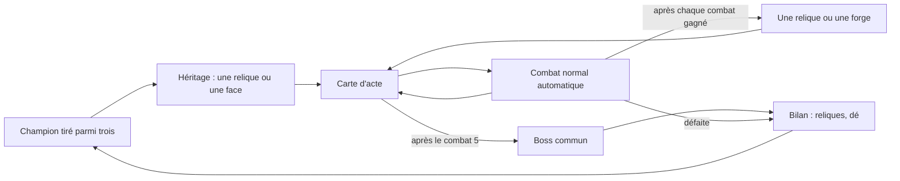

# Campagne : réflexion sur un mode aventure

_Réflexion ouverte le 2026-10-21, sur la version 0.84.1. **Les règles du prototype sont fixées** (§ 1, six passes de questions jusqu'au 2026-10-22) ; **le prototype est livré en 0.88.0** (§ 18 : ce qui est codé, les choix de l'agent, les premières mesures). Les règles en vigueur sont aussi dans [FEATURES.md](FEATURES.md) § 11._

---

## 0. En bref

**L'idée** : un mode où l'on mène **un champion** le long d'une carte à embranchements, de combat en combat, jusqu'à un boss. Les combats restent **entièrement automatiques**. Le joueur agit **entre** les combats : il choisit son itinéraire, ses reliques, et il **forge son dé**, qui est son arme.

**Ce qui est retenu** :
- **le dé qui se forge** est le cœur de la progression et de l'action (§ 4) ;
- **l'équipement, ce sont les reliques**, de tous types, sans inventaire (§ 5) ;
- **le spectacle n'est pas que le combat serré** : une campagne doit aussi laisser le champion écraser, et que ce soit beau à voir (§ 6) ;
- **une défaite met fin à la partie, mais laisse un héritage** : la prochaine partie du même personnage commence avec une amélioration gagnée dans la précédente, choisie parmi trois. Première version, exploratoire, qui sert aussi le développement (§ 8) ;
- **un levier immédiat, hors campagne** : le bilan des reliques sur l'écran de victoire (§ 9).

---

## 1. Décisions de l'utilisateur (2026-10-21)

| Question | Décision |
| --- | --- |
| Rôle de l'observateur | Il agit **en dehors des combats** : choix de relique, de compétence, d'équipement, d'itinéraire. La résolution reste automatique. |
| Paris | Un jeu entre amis, **plus une fonctionnalité centrale**. Ils restent dans le mode tournoi ; les nouveaux modes s'en passent. |
| Solo ou à plusieurs | **Solo d'abord.** Une coopération serait « incroyable » si elle est possible (§ 11). |
| Durée d'une partie | Inconnue ; on trouvera un moyen d'enregistrer (§ 13). |
| Images | Tentation forte d'un essai de squelette 2D sur Gorak, mais **d'abord savoir jusqu'où vont les images fixes** (§ 12). |
| Mémoire des personnages (chronique) | Pourquoi pas, mais sans objet en duel ou en tournoi : selon ce qu'on développe. |
| Le dé qui se forge | **Retenu.** Progression et action passent par le dé. **Le dé, c'est l'arme.** |
| Équipement | **Les reliques**, au total, de tout type. **Pas d'inventaire.** Le système de relique est déjà en place dans l'interface. |
| Spectacle | En campagne, trouver le moyen de **s'émanciper des règles qui favorisent le combat serré**, au profit du spectacle. |
| Partie perdue | À trouver. L'héritage d'une face forgée est **gardé en réserve**, pour un moment opportun. Les « saisons » évoquées ici étaient en fait une extension du **tournoi** (§ 8), pas de la campagne. |
| Bilan des reliques | À afficher sur l'écran de victoire : **levier facile d'accès.** |
| Présence (effets visuels) | Bonnes pistes, **à creuser plus tard**. Tous les personnages ont déjà une aura : il faudra d'autres effets. |
| Revanche | Abandonnée. |
| Hub entre les parties | Séduisant, mais il faut d'abord une montée en puissance qui ait du sens : **plus tard**. |

**Réponses aux questions ouvertes (2026-10-21, deuxième passe)** :

| Question | Décision |
| --- | --- |
| Opérations de forge | **Les cinq** : Graver, Dorer, Agrandir, Retailler, Aiguiser (§ 4.2). |
| Contrepoids de plomb | **Il devient une opération de forge** (Agrandir) : la relique quitte le tirage, il en reste onze. |
| La barde et l'ogre | **Une forge adaptée à chacun** (§ 4.4). |
| Nombre de reliques portées | **Sans limite, pour le moment.** |
| Longueur d'une partie | **Un acte, environ huit nœuds.** |
| Réglage des rencontres | **Le mélange** : combats ordinaires réglés sur le champion de référence ; élites et boss écrits à la main, comme des personnages précis (§ 6.3). |
| Choix du champion | **Tiré au sort parmi trois.** |

**Réponses de la troisième passe (2026-10-22)** :

| Question | Décision |
| --- | --- |
| Forge de la barde et de l'ogre | **Oui** à la piste du § 4.4 : doubles pour la barde, faces d'Attente pour l'ogre. |
| Compétences d'origine | **Un personnage ne déplace pas ses compétences d'origine.** |
| Nombre maximal de faces | « Il correspond au dé du personnage » (formulation de l'utilisateur, interprétation à confirmer : § 17). L'occasion, le rythme et le contexte de chaque proposition de forge restent à voir. |
| Reliques en campagne | **La règle « jamais de malus sur l'adversaire » ne s'applique pas** en campagne. |
| Champion de référence | Laissé à l'agent : voir § 6.3. |
| Nœuds du prototype | **Une forge de dé et une relique tous les deux combats normaux.** Rien d'autre pour le moment : ni marchand, ni repos, ni événement, ni trésor. |

**Réponses de la quatrième passe (2026-10-22)** :

| Question | Décision |
| --- | --- |
| Nombre maximal de faces | **Seules les faces libres se forgent**, celles qui ne portent pas une compétence d'origine. Ysolde (d7, compétences sur 1, 2 et 3) ne forge que ses faces 4 à 7. **Agrandir est le seul moyen de gagner de la place** (§ 4.4). |
| Offre de forge | **Trois opérations**, comme les reliques. **Le joueur choisit la face visée** ; un choix automatique par défaut permet de regarder la partie en pilote automatique. |
| Progression après une partie | **L'héritage** : le champion suivant reprend **une relique ou une face forgée** de la partie précédente. Plus simple à mettre en place que la renommée ; c'est une exploration, qui aide aussi le développement (commencer plus fort pour tester la fin d'un acte), et elle pourra changer (§ 8). |
| Boss | **Un boss commun** à tous les champions (§ 6.3). |

**Réponses de la cinquième passe (2026-10-22)** :

| Question | Décision |
| --- | --- |
| Élites, marchand, trésors | **Gardés pour plus tard**, pas abandonnés : le prototype n'en intègre aucun. |
| Fin d'une partie | **Une défaite met fin à la partie.** |
| Qui hérite | **Le même personnage seulement**, pour le moment : on n'hérite pas d'une partie jouée avec un autre. |
| Ce qu'on hérite | **Un choix parmi trois** améliorations (reliques ou faces forgées) **gagnées pendant la dernière partie** de ce personnage. |
| Plafond d'Agrandir | **Aucun.** La taille du dé n'est bornée que par le nombre d'occasions de forger. |
| Agrandir et Retailler | **Ils agissent sur le haut du dé** : Agrandir ajoute des faces au-dessus de la plus haute, Retailler retire la plus haute. |

**Réponses de la sixième passe (2026-10-22)** :

| Question | Décision |
| --- | --- |
| Face héritée au-dessus du dé d'origine | **Le plus simple** : on ne propose que les faces qui existent dans le dé d'origine. |
| Partie sans gain | **Elle n'efface pas l'héritage** : on hérite de la dernière partie qui a rapporté quelque chose. |
| Victoire contre le boss | **Elle laisse aussi un héritage.** |
| Retailler et compétences d'origine | **Une réduction ne retire jamais une compétence d'origine** : les faces d'origine sont irréductibles. |

**Septième passe, après le prototype (2026-10-22)** :

| Question | Décision |
| --- | --- |
| Longueur de l'acte | **Cinq combats normaux avant le boss**, pour trois reliques et deux forges. |
| Récompenses | **Une par combat normal gagné**, d'un seul type : une relique ou une forge. L'écran de victoire y mène. Ordre retenu par l'agent : relique, forge, relique, forge, relique. |
| Piste de l'acte | **Un losange par récompense**, quel que soit son type, comme avant. |
| Difficulté | **La courbe montante recommandée** (§ 18.3), recalculée pour cinq combats : 95, 90, 87, 84, 81 %, boss 45 %. |

**Huitième passe, réflexion sur la progression (2026-10-23)** ([PROGRESSION.md](PROGRESSION.md) § 1, rien de codé) :

| Question | Décision |
| --- | --- |
| Le dé | **Un d6 pour tous, aux faces imprimées**, socle de tous les modes ; kit de référence de deux compétences. **Copier et Refondre remplacent Agrandir et Retailler** ([PROGRESSION.md](PROGRESSION.md) § 6). |
| Compétences d'origine | **La règle « un personnage ne déplace pas ses compétences d'origine » (§ 4.3, § 4.4) est obsolète** : chaque mode a ses règles. **En campagne, le champion part de sa signature seule** ; il grave dans son répertoire ([PROGRESSION.md](PROGRESSION.md) § 7, § 11). |
| Longueur de l'acte | **Un acte de 10 combats** : avec cinq récompenses, un build reste très incomplet. Avec six faces seulement, **les forges sont plus rares que les reliques** : on commence avec 4 forges et 6 reliques (forge, relique, relique, forge, relique, forge, relique, relique, forge, relique), et **quatre faces de compétence au plus**, signature comprise. **Le système de difficulté actuel plaît et se garde**, adapté à la nouvelle longueur ([PROGRESSION.md](PROGRESSION.md) § 11, plan au § 18). |
| Partie perdue | « Une partie, une vie » peut être revue si elle sert le jeu, **mais pas plusieurs vies pour le moment**. |
| Spectacle | Le combat serré perd de sa force face aux conséquences des builds : en campagne, la démonstration prend le pas ([PROGRESSION.md](PROGRESSION.md) § 2). |

**Neuvième passe, après avoir joué la 0.104.x (2026-10-23)** ([PROGRESSION.md](PROGRESSION.md) § 1.5, livrée en 0.105.0) :

| Question | Décision |
| --- | --- |
| Adversaires | **Plus sérieux, et ils grandissent avec l'acte**, « si on arrive à équilibrer » : chaque adversaire est construit comme un champion (§ 6.3). |
| Le d6 | **Intégré** : la campagne passe au d6 imprimé, avec Copier une face et Refondre (§ 4.2). Refondre est remplacée par Tremper l'arme en 0.106.0, avec l'attaque de base. |
| Signature | **Montrée à l'écran** : au choix du champion et sur la carte. |

---

## 2. Le point de départ

### 2.1 Les atouts du projet

| Atout | Pourquoi il compte pour une campagne |
| --- | --- |
| **Simulation instantanée** : coter un match, c'est 400 combats en 36 à 150 ms ([PARIS.md](PARIS.md) § 3.2) | Une rencontre se règle **par simulation**, pas à la main (§ 6.3). |
| **Spectacle mesuré** : changements de meneur, retours, fins serrées (`scripts/lab/spectacle.ts`) | On peut évaluer une rencontre, une relique ou une face du dé sur le spectacle, pas seulement sur la victoire (§ 7). |
| **Contenu en données** : reliques (`RELICS`, `validateRelics`, `npm run relics`), compétences (roster), `adjusted()` qui simule un personnage modifié sans toucher au roster | Une récompense de campagne n'est qu'une donnée de plus. |
| **Moteur v2** : chaque étape porte sa cause et son auteur, et la mise en scène est pure | Un nouvel effet n'est qu'une nouvelle étape à mettre en scène. |
| **Choix automatique modifiable** : la relique de récompense du tournoi est choisie au hasard, et le joueur peut la changer | Chaque décision de campagne peut avoir un choix par défaut : la partie se regarde en pilote automatique, ou se joue. |

### 2.2 Les freins

- **Le duel est écrit en dur** : `Pair<` apparaît 110 fois dans 20 fichiers, `Side` dans 22 fichiers. Une équipe en combat demande une refonte (§ 11).
- **Les images sont peintes entières** : la garde et cinq postures, soit environ cinq générations par personnage ([POSTURES.md](POSTURES.md)). Sans calque, pas d'équipement modulaire (§ 12).
- **Rien n'est sauvegardé** : le tournoi vit en mémoire, et c'est voulu. Une campagne ne peut pas s'en passer (§ 13).
- **L'historique `battler:history:v1` doit rester rétrocompatible** : toute mémoire nouvelle se range à côté.
- **Un constat mesuré pèse sur toute la montée en puissance : « la puissance tue le spectacle »** ([SORTS.md](SORTS.md) § 5). Avec la Colère, les retournements passent de 62 à 50 % ; avec le Contre-tir, de 51 à 43 %. Un combattant trop fort gagne sans suspense. Le § 6 propose une réponse.

---

## 3. Les jeux de référence

| Jeu | Ce qui fait le plaisir sans contrôler le combat | Ce qu'on peut lui prendre |
| --- | --- | --- |
| **Slay the Spire** | carte à embranchements ; combats, élites, marchand, feu de camp, événements, boss ; reliques | la carte d'acte courte, des nœuds lisibles, des rencontres fixées par acte (§ 6.3) |
| **Tape to Tape** ([entretien](https://www.shacknews.com/article/135007/tape-to-tape-interview-with-lead-game-designer-hugo-julien)) | carte du monde, recrues, synergies ; entre les saisons, on devient plus fort pour de bon ; des joueurs croisés rejoignent l'équipe ; sprites dessinés animés sur squelette 2D | les saisons et la progression entre les parties (§ 8), le squelette 2D (§ 12) |
| **Loop Hero** ([analyse](https://hayao.dev/docs/codex/anchor-loop-hero)) | le héros avance seul ; chaque tuile posée apporte du butin **et** du danger ; on rentre au camp pour garder ses gains | la règle qui lie tout le jeu ; le choix « rentrer ou pousser » |
| **Darkest Dungeon** ([site](https://www.darkestdungeon.com/darkest-dungeon/about)) | escouade, stress, hameau entre les expéditions | les cicatrices qu'un héros garde, le camp |
| **Slice & Dice, Dice Forge** [mémoire] | le dé est la fiche du personnage ; progresser, c'est changer ses faces | la forge du dé (§ 4) |
| **Balatro** [mémoire] | le calcul est le spectacle : chaque modificateur s'empile à l'écran | la puissance comme spectacle (§ 6.1) |
| **Rogue Legacy, Hades** [mémoire] | une partie perdue rapporte quand même : héritage, déblocages | la progression après une défaite (§ 8) |
| **Super Auto Pets, The Bazaar** [mémoire] | les adversaires sont des « fantômes » d'autres joueurs | des fantômes locaux : tes anciens champions comme boss (§ 8) |

« [mémoire] » : cité de mémoire, sans source vérifiée pendant cette réflexion.

---

## 4. Le dé qui se forge : l'arme

### 4.1 Le principe

**Le dé, c'est l'arme.** Le couperet de Gorak est un d9 : forger le dé, c'est forger l'arme. Progresser et agir passent par le même objet, celui qui fait déjà tout le combat.

**La règle de base ne change pas** : un jet, une face, et cette face porte soit une compétence, soit un coup. La forge ne change que **ce que portent les faces**. C'est moins intimidant qu'il n'y paraît : le moteur sait déjà presque tout faire.

| Besoin | Ce qui existe déjà |
| --- | --- |
| Une compétence sur n'importe quelle face | les déclencheurs `naturalOne`, `naturalTwo`, `naturalThree` et `naturalMax` (`events.ts`) ; il faut les généraliser en « sur la face n » |
| Un bonus de dégâts sur une face précise | le bonus `onFace` des reliques de type Coup (`relics.ts`) |
| Changer la taille du dé | `stats.damageDie` ; la relique Contrepoids de plomb donne déjà +2 faces |
| Simuler un personnage modifié | `adjusted()` |

### 4.2 Une grammaire de la forge

Sur le modèle des quatre types de relique : un petit nombre d'**opérations**, chacune avec sa règle écrite une fois, et des récompenses qui ne sont que des instances de ces opérations. Les calculs portent sur Gorak (d9, compétences sur 1, 2 et 3), sans compter critiques ni esquives :

| Opération | Effet | Ce que voit le spectateur | Gorak |
| --- | --- | --- | --- |
| **Graver** | une compétence gagnée prend la place d'une face qui frappait | une rune sur la face | une compétence de plus, à 11 % des tours ; une face qui frappe en moins |
| **Dorer** | +2 aux dégâts d'une face qui frappe | une face en or | un 9 qui vaut 11 |
| **Agrandir** | le dé gagne deux faces | le dé grossit | compétences : 33 → 27 % des tours ; coup moyen hors compétences : 6,5 → 7,5 |
| **Retailler** | le dé perd une face | le dé rapetisse | compétences : 33 → 37,5 % des tours ; coup moyen hors compétences : 6,5 → 6 |
| **Aiguiser** | une compétence monte d'un rang (Épines 6 → 8) | un chiffre romain sur la face | — |

**Sur le d6 (0.105.0), puis sur l'attaque de base (0.106.0)** : Agrandir et Retailler sont retirés, le dé garde six faces, et le dé ne fait plus de dégâts : chaque jet porte le coup de base de l'attaque ([PROGRESSION.md](PROGRESSION.md) § 6.5 et § 6 bis). Deux opérations les remplacent :

| Opération | Effet | Ce que dit sa carte |
| --- | --- | --- |
| **Copier une face** | la compétence d'une face, telle qu'elle est (rang compris), est copiée sur une face libre (nue, non dorée) ; une compétence sur deux faces au plus. Depuis la 0.111.0, le joueur choisit la destination (voir plus bas) ; jusque-là, la copie allait seule sur la face nue de plus petit numéro, non dorée d'abord. Depuis la 0.106.0, seule une face de compétence se copie. Depuis la 0.107.0, une copie qui ne gagne rien n'est pas proposée (ni valide au rejeu) : une compétence qui ne fait que poser sur son porteur, sans durée, une aura plafonnée à une charge, sans toucher au coup (lu dans le registre ; aujourd'hui l'Aura de puissance, non cumulable) | « Copie sa compétence sur une face libre » |
| **Tremper l'arme** (0.106.0, remplace Refondre) | +1 à l'attaque (au minimum et au maximum), sans face visée, cumulable | « +1 à l'attaque » |

Refondre (0.105.0 : les faces de coup frappaient toutes pour leur moyenne) disparaît avec les valeurs imprimées. Une gravure, une dorure, une copie ou un Tremper l'arme vaut sur le dé d'origine : toutes s'héritent (§ 8). Le druide, dont la forme humaine porte un sort sur chaque face, ne peut qu'Aiguiser ou Tremper l'arme (limite connue).

**Dorure et compétence ne se cumulent plus, la copie choisit sa face** (0.111.0, retours de partie de l'utilisateur du 2026-10-24) :
- **Dorer** ne vise qu'une face sans compétence, et **une compétence ne se grave ni ne se copie sur une face dorée** : seules les faces *libres* (nues et non dorées) reçoivent une gravure, une dorure ou une copie (`isFree`, `forge.ts`). La règle vaut partout où l'on forge : l'offre (`drawForgeOffer`), le choix automatique (`autoForge` : champion de référence, adversaire construit, saison), l'héritage (`validOnOrigin`). Conséquence : quand toutes les faces nues d'un dé sont dorées, ni Graver ni Copier ne sont proposées.
- **Copier une face** se joue en deux temps sur le dé de l'écran de forge : la face à copier, puis la face libre où la poser (« Choisissez la face à copier », « Choisissez où la copier », puis « Copier le 2 sur le 5 ») ; recliquer une face de compétence change l'origine. L'adversaire et l'auto-forge posent la copie sur la plus petite face libre. L'étape s'écrit `copy <origine> <destination>` (trace : « Forge (…) : copy 2 5 »).
- **Compatibilité** : une copie enregistrée avant (trace « copy 2 », partie en cours, héritage, saison) n'a pas de destination ; elle se relit et se rejoue avec celle que la règle d'alors prenait, la plus petite face libre (`parseForge`, `writtenFace`). Un journal que la règle refuse désormais (une gravure ou une copie posée sur une face dorée avant la 0.111.0) est refusé en entier par `forgeState`, comme toute opération impossible : la partie en cours est oubliée (`loadRun`), l'opération sort des héritages (`loadHeritage`), une trace ne se reconstruit plus (`npm run logs` la met de côté, « forge refusée »). Aucun écran ne plante.
- **À l'écran** : une face dorée n'a plus de chiffre de bonus (« +2 » en cartouche, fiche d'affrontement) : le fond d'or suffit. La zone de compétences du combat (`SkillBar`) montre les six faces du dé, dans l'ordre : une face nue est une case vide, éteinte, qui s'allume tant que le dé est posé dessus (et pendant qu'il roule) ; une face dorée, la même case sur fond d'or (Morgrut, six faces nues, a donc six cases). Une face dont la compétence ne fait que poser une aura garde son médaillon rond, à sa place. Au choix du champion, la rangée de dés sous le nom est retirée : la ligne de la signature suffit.

**Aiguiser sur l'axe de chaque compétence** (0.110.0, décision de l'utilisateur du 2026-10-24, E1 à E3 de [REVUE_CONTENU.md](REVUE_CONTENU.md)) : toutes les compétences s'aiguisent, sans rang maximal ; chacune déclare dans ses données ce qu'un rang lui ajoute (`rankAxis`), choisi dans son esprit (des charges, un montant, une intensité de son statut, un coup ×N, une fois de plus par combat, une part des jauges), et **un rang ajoute moins qu'une gravure** : de +3 à +8 points de victoire, mesurés pour chaque compétence gravée sur la face 3 de chaque hôte (table « un rang de plus », [SORTS.md](SORTS.md) § 8 et § 20). La Furie II ne double plus la rafale ; les Feux follets s'aiguisent (Brûlure +1 : +5,9). Le texte d'un rang se lit en une ligne (`rankText`) et dans l'aperçu « avant → après » de la face visée, pastilles comprises (Peur II : « 1 → 2 fois max. par combat »). **Plus de demi-rang (0.111.0, retour de l'utilisateur : « l'Aura de sainteté rend un chiffre à virgule »)** : chaque rang ajoute une quantité entière, à chaque fois (`validateRoster` refuse un axe à virgule ; la part de la Rétribution se compte en points de pourcentage, +25). Le plus petit pas entier dépasse la bande pour onze compétences, de +8,1 à +10,2 points (Furie II +9,8, Foudre II +8,7 ; détail et propositions : [SORTS.md](SORTS.md) § 20).

**Gagner une compétence**, c'est **la graver** : il n'y a pas de catégorie « compétence » à côté de la forge.

**Ce que dit la carte** (0.95.0, demande de l'utilisateur du 2026-10-23 : une information simple, pas d'explication, le plaisir du joueur est de comprendre seul) : Graver « Nouvelle compétence sur une face libre » (la carte montre la compétence), Dorer « +2 dégâts à la frappe », Agrandir « +2 faces au dé », Retailler « −1 face au dé », Aiguiser « +1 rang à une compétence ». Le vocabulaire est celui des reliques ([RESOLUTION.md](RESOLUTION.md) § 3 : « à la frappe », avant le critique). **Ce que change l'opération se lit sur le dé** : pendant le choix de la face, l'infobulle d'une face visée montre la face après la forge, chaque nombre qui change en « avant → après », l'après en vert (« Épines acérées 2 → 3 », « +2 dégâts à la frappe » en vert sur une face qui se dore, le nom d'une gravure en vert) ; le reste du texte ne bouge pas (`ForgeFaceTooltip`). Une face sans compétence a aussi son infobulle (« Frappe de 7 », sa dorure) à la place de l'info-bulle du navigateur. Une face dorée frappe aussi sur un coup brut de la Furie des vents (2026-10-23, [RELIQUES.md](RELIQUES.md) § 3, règle 4).

### 4.3 Les règles de conception

- **Des échanges autant que des gains.** Agrandir et Retailler troquent des compétences contre des dégâts, ou l'inverse. Ces choix protègent le spectacle et gardent les personnages typés.
- **Tout se mesure en lot** : 10 personnages × 5 opérations, en une passe de laboratoire (valeur nette et spectacle).
- **Une face reste lisible de loin** : rune, or, chiffre romain ; jamais un texte.
- **Le kit d'origine reste l'identité** : les trois compétences d'un personnage restent les siennes, sur leurs faces ; la forge ajoute ou renforce, elle ne déplace rien et ne réécrit pas qui il est.

### 4.4 Décisions

- **Décidé** : Contrepoids de plomb devient l'opération Agrandir ; la relique quitte le tirage.
- **Décidé : une forge adaptée à chacun.** La barde grave et dore ses **doubles** (une compétence sur le double 4, un double doré), l'ogre grave sur ses **faces d'Attente** (1 à 3 sur son d14), qui ne font rien aujourd'hui. À mesurer. **Depuis la 0.106.0**, l'Attente est retirée : les six faces de l'ogre sont nues, et se gravent comme toute face nue. **Depuis la 0.107.0**, la barde n'a plus de doubles (décision de l'utilisateur, 2026-10-24) : ses compétences sont sur ses faces, et elle forge ses **faces nues** comme tous ; une gravure garde sa relation (Pourfendre gravé modifie toujours) ; ses deux dés lisent le même dé forgé. L'exception de la barde au nombre de faces à compétence est retirée.
- **Décidé : un personnage ne déplace pas ses compétences d'origine.**
- **Décidé : seules les faces libres se forgent.** Graver et Dorer ne visent qu'une face qui ne porte pas de compétence d'origine : sur le d7 d'Ysolde, les faces 4 à 7. **Agrandir est le seul moyen d'ouvrir de la place** : deux faces libres de plus.
- **Décidé : l'offre de forge.** Trois opérations proposées ; le joueur choisit la face visée, avec un choix automatique par défaut.
- **Décidé : pas de plafond pour Agrandir.** Le dé n'est borné que par le nombre d'occasions de forger : trois dans le prototype, soit six faces de plus au plus.
- **Décidé : Agrandir et Retailler agissent sur le haut du dé.** Agrandir ajoute deux faces libres au-dessus de la plus haute ; Retailler retire la plus haute face, **forgée ou non** : retailler un dé dont le haut est doré, c'est perdre cette dorure.
- **Décidé : les faces d'origine sont irréductibles.** Une réduction ne retire jamais une compétence d'origine : Retailler n'est plus proposé quand la plus haute face porte une compétence d'origine. Toutes sont sur 1, 2 et 3 (`roster.ts`, aucun `naturalMax`) : avec trois forges au plus, seul le d5 de la barde peut atteindre cette limite.
- **Repère mesuré** : au d6, Ysolde gagnait 63 % de ses combats (`roster.ts`), d'où son d7 ; Retailler peut donc être une opération très forte.
- **Rythme du prototype** : une forge tous les deux combats normaux (§ 6.3).
- **Depuis la 0.105.0 (d6)** : le Contrepoids de plomb n'est plus Agrandir, il devient une relique de critique (+1 au multiplicateur, −4 % de critique) et revient dans toutes les offres. Les décisions sur Agrandir et Retailler ci-dessus sont historiques ; « seules les faces libres se forgent » et « une compétence d'origine ne se déplace jamais » restent. Depuis la 0.106.0, une face libre, c'est une **face nue** (elle ne porte que le coup de base).

---

## 5. Les reliques : l'équipement

- **L'équipement, ce sont les reliques**, de tous types (Caractéristique, Coup, Tour, Seuil : [RELIQUES.md](RELIQUES.md)).
- **Pas d'inventaire** : une relique gagnée est portée tout de suite. Le système est déjà en place dans l'interface : sceaux en combat, à l'affrontement, dans l'arbre et sur l'écran du champion ; menu Récompense.
- **Où on les gagne** : dans le prototype, une relique tous les deux combats normaux (§ 6.3), et l'héritage (§ 8). Élites, trésors et marchand sont **gardés pour plus tard** : le prototype n'en intègre aucun.
- **Les douze reliques mesurées** vont de +6,1 à +21,4 points ([RELIQUES.md](RELIQUES.md) § 7). En campagne, cet écart devient une rareté plutôt qu'un défaut.

**Décisions** :
- **sans limite, pour le moment.** L'en-tête du combat devra pouvoir montrer beaucoup de sceaux ;
- **en campagne, une relique peut poser un malus sur l'adversaire** : la règle du tournoi ne s'applique pas ici.

---

## 6. Le spectacle en campagne : s'émanciper du combat serré

### 6.1 Trois registres de spectacle, pas un seul

Aujourd'hui, les mesures récompensent la **tension** : fin serrée, retournement, changement de meneur. Une campagne a besoin de deux autres registres :

| Registre | Ce qu'on regarde | Où il sert dans un acte |
| --- | --- | --- |
| **Démonstration** | le champion écrase : gros chiffres, combinaisons de faces et de reliques, overkill, record personnel | les combats ordinaires, une fois la construction réussie |
| **Tension** | le combat serré, l'issue incertaine | les élites |
| **Drame** | le retournement, la victoire à 2 PV, la chute d'un favori | le boss |

Un acte bien rythmé alterne les trois, comme un film. **La démonstration est un spectacle à part entière** : Balatro en fait tout son plaisir [mémoire]. On ne cherche donc pas que des combats serrés : on cherche des combats **qui racontent quelque chose**.

### 6.2 Deux régimes d'équilibre

| Régime | Règle | Où |
| --- | --- | --- |
| **Roster nu** | chaque personnage gagne entre 42 et 58 %, aucun duel au-delà de 65/35 ([EQUILIBRAGE.md](EQUILIBRAGE.md)) | duel et tournoi, inchangés |
| **Campagne** | une **courbe nominale** de difficulté par acte (§ 6.3) ; le champion peut la dépasser largement | campagne |

La tolérance de 42 à 58 % reste la règle du roster. Elle ne s'applique pas à un champion forgé contre les adversaires d'un acte.

### 6.3 Régler les rencontres sur une courbe nominale, pas sur le champion

**Correction d'une première idée** (le « Directeur » qui visait une probabilité de victoire **pour le champion réel**) : s'il compense chaque gain de puissance, la puissance ne se sent plus jamais.

**La règle proposée** : chaque nœud est réglé par simulation **contre un champion de référence**, celui qu'on attend à ce stade de l'acte (par exemple : le personnage nu au premier nœud, plus deux opérations de forge et une relique à mi-acte, etc.). Ensuite :
- un champion **bien construit** dépasse la courbe : il écrase, et c'est la démonstration ;
- un champion **mal construit** reste en dessous : il souffre, et c'est la tension ;
- les élites et le boss sont réglés plus haut que la courbe : ils restent un défi même pour un bon champion.

Slay the Spire fonctionne ainsi : des rencontres fixées par acte, pas ajustées au joueur [mémoire]. Battler peut faire mieux : régler chaque rencontre **par simulation**, au lieu de la régler à la main.

**Décidé : le mélange.** Les combats ordinaires sont réglés automatiquement sur le champion de référence ; les **élites et le boss sont écrits à la main**, comme des personnages précis (un adversaire, ses reliques, éventuellement son dé forgé), puis vérifiés par simulation.

**Le prototype (décisions du 2026-10-22, et choix de l'agent pour le champion de référence)** :
- **six nœuds** (0.89.0 ; huit en 0.88.0) : cinq combats normaux, puis le boss. Les élites sont gardées pour plus tard, hors du prototype. L'itinéraire reste un choix : à chaque étape, plusieurs adversaires possibles, avec leur bande de danger (§ 6.4). **Une défaite met fin à la partie** ;
- **récompenses** (0.89.0) : après chaque combat normal gagné, **une relique ou une forge**, dans l'ordre relique, forge, relique, forge, relique : trois reliques et deux forges avant le boss. Rien d'autre ;
- **le champion de référence** suit exactement ce rythme : le personnage tiré, nu au départ, qui reçoit aux mêmes moments les mêmes récompenses, **choisies au hasard dans l'offre**, comme le choix automatique du tournoi. On en simule un grand nombre, pour lisser le hasard des choix ;
- **cibles** (0.89.0, courbe montante, § 18.3) : le champion de référence gagne **95, 90, 87, 84 puis 81 %** de ses combats normaux, de la démonstration à la tension ; le boss, écrit à la main, se règle à **45 %** contre lui, le drame. Un champion mieux forgé que la moyenne fait mieux : c'est la démonstration.
- **Décidé : un boss commun** à tous les champions. Il se vérifie contre le champion de référence de **chaque** personnage tirable : la cible de 40 à 50 % doit tenir pour tous.
- **Adversaires construits (0.105.0, demande de l'utilisateur)** : au nœud k, l'adversaire part de sa signature (son kit entier pour Morgrut, Thaldrin et Fanchon) et reçoit les k récompenses que l'acte lui aurait données, tirées comme celles du champion de référence (`drawBuild`) ; ses PV le règlent ensuite sur la courbe. Mesuré : il garde de 46 % (premier combat) à 50 % (dixième) de ses PV de base ; boss atteint 48 %, acte gagné 24 % ([PROGRESSION.md](PROGRESSION.md) § 11.5).
- **Courbe abaissée au début (0.106.0, décision de l'utilisateur)** : le champion de référence gagne **90, 90, 90, 89, 89, 89, 89, 88, 88, 88 %** de ses combats normaux (98 → 89 % avant), le boss reste à **45 %**. Attendu : boss atteint 31 %, acte gagné 14 %. Mesuré (`npm run campaign`, 12 parties par champion) : boss atteint 27 % (48 % avant), acte gagné 13 % (24 %) ; les adversaires gardent 67 % de leurs PV de base au premier combat, 53 % au dixième ; 4,5 à 8,2 tours par combattant, 14,0 contre le boss ([PROGRESSION.md](PROGRESSION.md) § 11.6).
- **La revue des compétences (0.107.0)** : seuls **Morgrut** et **Thaldrin** gardent leur kit entier ; Fanchon part de sa signature seule (l'Aura mélodieuse sur le 1, sans Ouverture : 16,9 % brute contre le roster), Naraxes de l'Aura de décoction (sur le 2 ; Pile ou face et Coup de chance en tête de son répertoire). Mesuré (`npm run campaign`, 12 parties par champion) : boss atteint **28 %** (31 % attendus), acte gagné **13 %** (14 %) ; boss de 8 % (Thaldrin) à 42 % (Brokk), acte de 8 % à 33 % (Elaria). Naraxes tire 35 % de ses gravures d'autres personnages ; Thaldrin ne peut rien graver ([PROGRESSION.md](PROGRESSION.md) § 11.7).
- **Thaldrin part de sa signature (2026-10-24, décision de l'utilisateur, [PROGRESSION.md](PROGRESSION.md) § 13.3)** : les **Feux follets** ; la Foudre entre en tête de son répertoire de campagne, avant l'Aura sauvage et ses quatre compétences d'autres personnages. **Seul Morgrut**, le combattant nu, garde son kit entier. Mesuré à l'époque (les Feux follets sur le 4, le 5 et le 6 ; `npm run campaign`, 12 parties par champion) : 0,83 gravure par build, 73 % prises à d'autres personnages ; Thaldrin atteint le boss dans 25 % des parties (8 % avant), gagne l'acte dans 8 % (8 %) ; tous champions : boss atteint 26 %, acte gagné 13 %. Signature seule contre le roster : 28,4 % (kit entier 45,8 %).
- **La signature sur la face 1, une fois (0.111.0, retour de partie de l'utilisateur du 2026-10-24)** : « certains persos qui commencent avec un sort : ce seul sort doit être placé sur la face 1 ; les exemples qui enfreignent la règle sont un reliquat de l'ancien système » ; les Feux follets de Thaldrin sur le 4, le 5 et le 6 « ont l'air buggés ». **Règle** : un champion de campagne (et un adversaire construit, qui part de la même base) commence avec sa signature **sur la face 1 seulement**, quelle que soit la face qui la porte dans son kit ; ses cinq autres faces sont nues (`CAMPAIGN_CHAMPIONS` jusqu'à la 0.112.0 ; depuis la 0.113.0, le personnage du roster lui-même, § 18.2 ; `validateRoster` exige une signature du dé ; un test le fige pour chaque champion). Gorak quitte le 2 pour le 1, Thaldrin garde un seul Feu follet : ses trois autres faces de compétence se gravent. Une partie enregistrée dont une forge ne vaut plus sur ce dé (le champion, un adversaire proposé ou la forge en attente) est oubliée au chargement (`loadRun`), au lieu de faire planter l'écran ; un héritage dans ce cas perd l'opération (`loadHeritage`, règle existante). Mesuré (`npm run campaign`, 12 parties par champion, avant → après, avec aussi les rangs entiers et peut-être une partie des changements de forge et de reliques de la même livraison) : tous champions, boss atteint 23 → 27 %, acte gagné 10 → 10 % ; Thaldrin 0,82 → 1,33 gravure par build, 4,5 → 4,5 victoires, boss 17 → 17 %, acte 8 → 0 % ; Gorak 5,8 → 4,8 victoires, boss 25 → 17 %, acte 25 → 0 %. À 12 parties par champion, l'écart par champion est dans le bruit.

### 6.4 Montrer le danger sans dévoiler les cotes

Sur la carte, le danger s'affiche **en bandes** (Sûr, Risqué, Mortel), calculées **contre le champion réel**. Les chiffres exacts restent cachés.

---

## 7. Mesurer le spectacle

La mesure se fait toujours **sur un combat**, en lisant sa chronologie. Aujourd'hui, `spectacleOf` compte les changements de meneur (avec 15 % de PV d'écart au moins), le retour (le vainqueur est passé sous 30 % de ses PV) et la fin serrée (il finit sous 20 %). `momentsOf` compte les fois où une brique surveillée agit. On regroupe ensuite selon la question posée :

| Niveau | La question | Comment | Outil |
| --- | --- | --- | --- |
| **Combat** | ce combat était-il bon ? | meneur, retour, fin serrée, durée, moments | `spectacleOf` (existe) |
| **Rencontre** (A équipé contre B équipé) | ce match promet-il ? | moyenne sur 200 à 400 graines | le calcul des cotes (existe) ; c'est la base du réglage du § 6.3 |
| **Brique** (relique, compétence, face) | rend-elle les combats meilleurs ? | écart avec et sans elle, comme la valeur nette ; présence : part des combats où elle agit, moments par combat | le laboratoire (existe) ; pas encore `npm run relics` |
| **Personnage** | ses combats sont-ils bons ? | regroupement sur tout le roster | prévu ([SORTS.md](SORTS.md) § 6, point 2), pas fait |

**Mesures à ajouter pour les registres du § 6.1** :
- **coup d'éclat** : une seule étape qui retire une grosse part des PV (une rafale de Rétribution, un critique doré) ;
- **démonstration** : overkill, nombre de modificateurs empilés sur un coup, record personnel du champion ;
- **temps mort** : une suite de tours sans rien d'autre que de petits coups.

**Mises en garde** :
- la tension d'une rencontre suit d'abord sa proximité de 50 % : il faut la comparer à difficulté égale ;
- ces chiffres sont des indices, pas des preuves : ni la lisibilité ni le son ne se mesurent. Le jugement de l'utilisateur, en jeu, reste final.

---

## 8. Progresser malgré une partie perdue

**Le besoin** : même une défaite au premier combat doit ouvrir des perspectives.

| Piste | Ce qu'on garde après une partie | Référence | Risque |
| --- | --- | --- | --- |
| **Renommée** | des points gagnés selon la profondeur atteinte et le spectacle produit, même en cas de défaite ; dépensés en **déblocages** : nouvelles opérations de forge, reliques ajoutées au tirage, nouveaux champions, choix de la relique de départ | Hades, Slay the Spire [mémoire] | faible : ça élargit les choix, sans ajouter de puissance brute |
| **Héritage de l'arme** | le prochain champion reprend **une face forgée** du précédent : l'arme passe de main en main, et elle a une histoire | Rogue Legacy [mémoire] | moyen : de la puissance permanente, à borner (une face, pas plus) |
| **Saison** | sortie de la campagne : c'est une extension du tournoi, livrée en 0.87.0 (phase de saison) | Tape to Tape | — |
| **Paliers de difficulté** | après une victoire, la campagne suivante est plus dure | Ascension de Slay the Spire [mémoire] | faible |
| **Fantômes** | tes anciens champions deviennent les boss des parties suivantes | Super Auto Pets, The Bazaar [mémoire] | faible |

**Contrainte** : la courbe nominale (§ 6.3) ne connaît pas la puissance permanente. Si elle grossit trop, le premier acte n'est plus qu'une démonstration. D'où une préférence pour les **déblocages** (des choix nouveaux) plutôt que les **bonus bruts** (des stats permanentes), et un héritage borné.

**Correction (2026-10-22)** : les « saisons » de l'utilisateur ne sont pas une progression de la campagne, mais une **extension du tournoi**, livrée en 0.87.0 (phase de saison).

**Décidé (2026-10-22) : l'héritage, dans une première version.** C'est le plus simple à mettre en place, et c'est aussi un outil de développement : commencer plus fort pour essayer la fin d'un acte sans rejouer le début. **Exploratoire : ça pourra changer.**

La règle :
- **une partie se termine par une défaite ou par la victoire contre le boss ; les deux laissent un héritage** ;
- **on n'hérite que de soi-même** : la prochaine partie de Gorak hérite de la dernière partie de Gorak, jamais de celle d'un autre personnage (pour le moment) ;
- au départ, le joueur **choisit une amélioration parmi trois**, tirées parmi les reliques et les faces forgées **gagnées pendant cette dernière partie**. S'il en a gagné moins de trois, il choisit parmi celles-là ;
- **une partie sans gain n'efface rien** (défaite au premier combat, avant la première récompense) : on hérite alors de la dernière partie qui a rapporté quelque chose ;
- **seules les faces du dé d'origine se proposent** : une face forgée au-dessus (le 11 doré d'un Gorak agrandi en d11, qui repart en d9) n'est pas proposée. Agrandir et Retailler, qui ne sont pas des faces, ne s'héritent pas (confirmé).

Ce que ça implique :
- le champion de référence (§ 6.3) ne reçoit pas d'héritage : un champion hérité dépasse la courbe nominale, et c'est voulu (la démonstration). À mesurer : de combien une relique ou une face héritée relève sa probabilité de victoire sur l'acte ;
- l'héritage ne s'accumule pas : on ne garde qu'une amélioration, et seulement ce qui a été **gagné** pendant la partie ; un objet hérité ne se transmet pas à nouveau, sinon une même relique suivrait le personnage indéfiniment (confirmé) ;
- la mémoire est **par personnage** : la sauvegarde (§ 13) garde, pour chacun, les gains de sa dernière partie qui a rapporté quelque chose.

---

## 9. Levier immédiat : le bilan des reliques sur l'écran de victoire

**Utile dès aujourd'hui en tournoi, sans attendre la campagne.** C'est de la présentation pure : les données sont déjà dans la chronologie, aucune règle ne change.

| Type de relique | Ce qu'on peut afficher | D'où vient le chiffre |
| --- | --- | --- |
| **Tour, Seuil** | nombre de déclenchements, et ce qu'ils ont fait (« 1 fois, +6 PV ») | les étapes `relic` (`uses`, `effects`) |
| **Coup** | nombre de coups renforcés, et le total ajouté | `relicBonus` sur chaque coup |
| **Caractéristique** | ce qui n'aurait pas existé sans elle : avec le Contrepoids de plomb (+2 faces), chaque jet au-dessus de l'ancien maximum (« 3 jets impossibles sans lui ») | les jets du combat, comparés aux stats d'origine |

**Plus tard, ce qu'elle vaut**, et plus seulement ce qu'elle a fait :
- par simulation : « avec elle 64 %, sans elle 51 % » (chiffres pour l'exemple), environ 0,1 s, comme une cote ;
- rejouer « ce combat-ci, sans elle » à l'identique demande de séparer les suites de hasard ([TODO.md](TODO.md) § 16).

Aujourd'hui, rien de tout ça n'est affiché : `stats.ts` ne compte pas les reliques.

---

## 10. La présence (à creuser plus tard)

**La contrainte** : tous les personnages ont déjà une aura (halo, anneau au sol, particules qui montent, `Fighter.tsx`). Ce canal veut dire « état du combat ». La puissance acquise doit passer par **d'autres canaux**, avec la même discipline que les sons ([SONS.md](SONS.md)) : **un canal, un sens**. Elle se voit avant même le premier coup.

| Canal | Sens | Pourquoi il ne se confond pas avec l'aura |
| --- | --- | --- |
| Emblème gravé au sol | le rang du champion | dessin net et fixe, pas une lueur qui pulse |
| Liseré lumineux sur la silhouette | la qualité de l'arme (du dé) | un trait de contour, pas un halo |
| Trophées : sceaux hexagonaux portés près du personnage | ses reliques | des objets, pas de la lumière |
| Entrée en scène (pas, impact au sol, poussière) | la réputation | un moment avant le combat |
| Lumière d'arène (projecteur, décor qui s'assombrit autour de lui) | la célébrité | agit sur le décor (son `filter`), pas sur le personnage |
| Braises qui tombent, éclats | un palier franchi | un autre sens et une autre couleur que les particules de l'aura |

À écrire comme une règle avant d'en produire. Le dé forgé (§ 4.2 : runes, or, taille) est lui-même un canal de présence, déjà dessiné par le code (`Die.tsx`).

---

## 11. La coopération

Comme on ne décide qu'entre les combats, il n'y a aucune contrainte de temps réel : deux joueurs sur la même télé, chacun son tour, suffisent.

| Formule | Ce que fait chacun | Moteur | Ce qu'elle apporte |
| --- | --- | --- | --- |
| **Deux champions, une route** | chacun a son champion ; la carte est commune ; à chaque nœud, chacun livre son duel, l'un après l'autre ; le butin se partage, en choisissant tour à tour | aucun changement | la décision commune, c'est le partage : « qui prend la relique ? » |
| **Le mécène et le guide** | l'un forge le dé et choisit les reliques, l'autre choisit la route | aucun changement | des rôles qui se complètent, sur un seul champion |
| **Le relais** | les deux champions dans le même combat, en 2 contre 2 : un seul en scène, l'autre entre quand le premier tombe ou sur un relais | une file par camp, des déclencheurs « entrée en jeu » et « allié tombé » | un vrai combat en commun |

**Conseil** : concevoir le solo comme « deux champions, une route » avec un seul champion. La coopération coûtera alors peu, et le relais pourra venir plus tard.

**Plus loin, et plus cher** : une escouade à rangs, à la Darkest Dungeon (cible prioritaire, sorts de zone, positions). C'est la refonte de `Pair` et de `Side`, une scène à quatre par camp (chaque combattant n'a plus qu'un quart de la largeur), des images réduites et un équilibre à refaire. Seulement si la campagne prouve qu'on veut composer une équipe.

---

## 12. Les images fixes avant le squelette

**La question** : jusqu'où vont les images peintes entières avant qu'un squelette 2D devienne nécessaire ?

Puisque l'équipement, ce sont les reliques, et l'arme, le dé, **rien n'oblige à changer l'arme dans les mains**. Les images fixes suffisent peut-être.

**Un test du plafond, sur Gorak, en trois temps** :
1. les canaux de présence du § 10, en CSS ;
2. un objet accroché sur ses six postures (une relique pendue à la ceinture, par exemple), placé par des points d'ancrage ;
3. un rang repeint : une nouvelle garde et quatre planches, avec le pipeline actuel ([POSTURES.md](POSTURES.md)).

Si ces trois essais suffisent, pas besoin de squelette. Si l'on veut voir l'arme évoluer dans les mains, ou un mouvement continu au lieu de six postures, le squelette est la seule voie : découpe en calques, parties cachées à repeindre, un squelette par personnage, un moteur d'animation web (Spine, Rive, DragonBones) et sa licence. Tape to Tape anime ainsi des personnages dessinés.

---

## 13. La sauvegarde

Le moteur est déterministe : une partie, c'est **une graine plus la liste des décisions**, et chaque combat se recalcule à l'identique. C'est minuscule à stocker.

**Limite** : tant que les règles changent en développement, une ancienne graine ne rejoue plus le même combat. Il faut donc aussi enregistrer l'**état** : le champion (dé forgé, reliques, PV), la carte et la position. La sauvegarde se range à côté de `battler:history:v1`, sans le toucher.

---

## 14. Le processus créatif

| Contenu | Méthode | Déjà fait dans le projet |
| --- | --- | --- |
| **Le kit d'un personnage** (son identité) | au cas par cas, en partant de son caractère : « le roc qu'un coup manqué énerve » → la Colère | [SORTS.md](SORTS.md) : 27 idées mesurées au laboratoire, 3 prêtes à proposer |
| **Les récompenses de campagne** (opérations de forge, compétences à graver, reliques) | une grammaire d'abord, puis un plan (combien par type et par rareté), puis un lot, puis une mesure, puis la revue de l'utilisateur | les reliques : 4 types fixés (0.75.0), puis 12 reliques d'un coup (0.77.0), refusées par `validateRelics` si elles sortent du cadre, mesurées par `npm run relics` dans une cible de 5 à 15 points |
| **Une nouvelle règle du moteur** (un nouveau verbe) | rare, choisie selon le nombre d'idées qu'elle débloque | [SORTS.md](SORTS.md) § 6 recommande « l'effet à l'expiration d'un statut » pour cette raison |

Seule une idée sur cinq ou six survit à la mesure. **Créer en lot dans un cadre, puis couper sans regret**, coûte moins cher que de peaufiner chaque idée une par une.

**Les statuts** : une compétence de forge puise d'abord dans les familles existantes ([FAMILLES.md](FAMILLES.md)). Un nouveau statut est une décision explicite, pas un effet secondaire d'une nouvelle compétence.

---

## 15. Ce qu'on évite

- **Tout contrôle pendant le combat** : le combat est le verdict des choix faits avant.
- **Une escouade à rangs avant d'avoir une boucle de décision** : sans choix de composition, ce ne seraient que des duels plus longs.
- **Des événements à lire** : sur une télé, deux ou trois tuiles illustrées et une ligne de texte.
- **Un inventaire** (décision de l'utilisateur) et **plusieurs monnaies**.
- **Une puissance permanente sans borne** d'une partie à l'autre (§ 8).
- **Le jeu en ligne** : le projet reste local et sans serveur ; les fantômes locaux le remplacent.
- **Un habillage modulaire complet** avant d'avoir validé la boucle de jeu (§ 12).

---

## 16. Une boucle possible et un ordre possible

**L'ordre suivi** (prototype 0.88.0 : étapes 2 à 4 faites, § 18) :
1. **Tout de suite, hors campagne** : le bilan des reliques sur l'écran de victoire (§ 9). _Pas encore fait._
2. **La base** : faces généralisées (« sur la face n ») et grammaire de la forge (§ 4) ; sauvegarde (§ 13). _Fait ; la mesure de la forge au laboratoire et les suites de hasard séparées (TODO § 16) restent à faire._
3. **Un acte jouable de bout en bout** : six nœuds (cinq combats normaux, puis le boss), une relique ou une forge après chaque combat normal, un champion tiré parmi trois, la courbe nominale et un boss écrit à la main (§ 6.3). _Fait ; les mesures de démonstration (§ 7) restent à faire._
4. **La progression entre les parties** : l'héritage d'une relique ou d'une face (§ 8). _Fait._
5. **La présence** (§ 10), puis le test du plafond des images fixes sur Gorak (§ 12).
6. **La coopération** : deux champions, une route ; puis le relais (§ 11).

---

## 17. Questions ouvertes

_Questions réglées du 2026-10-21 au 2026-10-22 : voir § 1. Lectures confirmées le 2026-10-22 : une réduction ne retire jamais une face qui porte une compétence d'origine (le dé peut descendre sous sa taille d'origine, tant que la face du haut est libre) ; un objet hérité ne se transmet pas à nouveau ; Agrandir et Retailler ne s'héritent pas._

**Question réglée depuis le prototype** : la cible d'un combat normal, remplacée par une courbe montante (septième passe, § 18.3). Restent à mesurer au laboratoire : la force de chaque opération de forge par personnage (Retailler en tête : Ysolde gagnait 63 % au d6), et l'apport d'un héritage sur la réussite d'un acte.

**Profondeur de la progression** (2026-10-23) : synergies entre forge, compétences et reliques, écoles et voies, super coups, dés différents, feuille de personnage. Réflexion à part, avec ses estimations et ses questions : [PROGRESSION.md](PROGRESSION.md).

---

## 18. Le prototype livré (0.88.0)

### 18.1 Ce qui est codé

| Brique | Où | Ce qu'elle fait |
| --- | --- | --- |
| Faces au-delà du 3 | `events.ts` | déclencheur `face:N` (`faceTrigger`) : une compétence peut partir sur n'importe quelle face (`double:N` et `doubleTrigger` retirés en 0.107.0 avec les doubles) |
| Forge du dé | `forge.ts`, `Character.withForge` | les opérations du § 4.2 (depuis la 0.106.0 : Graver, Dorer, Aiguiser, Copier une face, Tremper l'arme ; Refondre de la 0.105.0 retirée), en journal rejoué sur le personnage d'origine ; offre de trois, choix automatique, validité ; aucun mode n'en dépend. Le tournoi la donne depuis la 0.92.0 : construction de la saison, une forge toutes les deux victoires (en alternance avec les reliques), trois au plus ([FEATURES.md](FEATURES.md) § 8) |
| Face dorée | `combat.ts` (`Attack.gild`) | +2 avant le critique, règle d'une relique de face, coup brut compris depuis la 0.95.0 ([RESOLUTION.md](RESOLUTION.md) § 3, étape 2 ter) |
| Campagne | `campaign.ts` | partie, boss, réglage sur le champion de référence, bandes de danger, récompenses, héritage, sauvegarde |
| Écrans | `CampaignScreen.tsx`, `ForgedDie.tsx` | choix du champion et de l'héritage, carte de l'acte, récompense (forge puis relique), fin de partie ; le combat passe par l'affrontement et l'écran de fin habituels |
| Mesure | `npm run campaign` | parties en pilote automatique, par champion (§ 18.3) |

### 18.2 Les choix de l'agent (à revoir)

Ce que les décisions du § 1 ne fixaient pas, choisi au plus simple :
- **Le levier du réglage, ce sont les PV de l'adversaire**, et lui seul : les adversaires normaux sont des personnages du roster **nus** (ni relique ni forge). Une dichotomie sur les PV, entre le quart et le triple de ses PV d'origine, à graines fixes. Les PV, « dernier levier » de l'équilibre du roster, sont ici un réglage de rencontre, pas une retouche de personnage (§ 6.2).
- **Le champion de référence** : douze versions du personnage, huit combats chacune par essai de PV, côtés alternés.
- **Deux adversaires par nœud**, jamais le champion, jamais le dernier adversaire.
- **Bandes de danger** : Sûr à partir de 72 % de victoire estimée (160 combats contre le champion réel), Risqué de 50 à 72 %, Mortel en dessous.
- **Les PV ne se gardent pas** d'un combat à l'autre, puisqu'il n'y a ni repos ni soin entre les combats.
- **Le boss** : Le Colosse (§ 18.4), réglé lui aussi par ses PV, à 45 % contre le champion de référence du personnage tiré : la cible tient ainsi pour tous les champions.
- **Graver** puise dans les compétences du dé des autres combattants (sur leur 1, leur 2 ou leur 3) : elles ont déjà leur icône peinte, et leurs statuts sont ceux du roster (§ 14). Une compétence d'un personnage à formes est gravée sans forme. **Depuis la 0.103.0** (règles v2, phase 2, un essai) : dans le **répertoire** du champion d'abord, et Graver est toujours proposée quand une face peut la recevoir ; la première relique proposée se tire à l'écho du build ([PROGRESSION.md](PROGRESSION.md) § 7.4).
- **Une relique offerte peut partir** (0.111.0, retour de l'utilisateur : « la Fiole de venin m'est proposée à chaque fois, alors qu'aucun des persos que j'ai joués ne joue sur le poison ») : l'offre de relique (`drawReward`) ne tire que dans `offerableRelics`, les reliques dont la condition peut arriver avec le champion (sa signature, son répertoire de campagne, ses reliques, ses formes, sa chance d'esquive et de critique ; [RELIQUES.md](RELIQUES.md) § 3, règle 10). Le champion de référence suit la même offre : la courbe nominale en tient compte. Elaria, Gorak et Ysolde ne voient plus la Fiole de venin ; Morgrut ne voit pas la Conque des vents tant qu'il n'a rien qui esquive (la Plume d'aigle lui est offerte depuis la 0.114.0 : sa Rancune, hors kit, donne des critiques). Test : `modules.test.ts`, « offre pertinente ».
- **Une compétence offerte peut servir** (0.114.0, la même règle étendue à Graver, avec le premier lot de consommatrices de la phase 8, [SORTS.md](SORTS.md) § 22) : la compétence de Graver se tire parmi celles du répertoire de campagne dont le besoin est à la portée du champion (`offerableSkills`, `skillNeeds` : un statut que ses conditions ou ses charges lisent chez l'adversaire, un soin, une esquive ou un critique que consomme le statut qu'elle pose). La portée est celle des reliques (`reachOf`). Les répertoires livrés ne portent que des compétences à leur portée : la règle ne retire rien aujourd'hui, elle garde les lots suivants honnêtes (la Curée sans Saignement, la Sentence sans soin vaudraient 0 gravées). Test : `modules.test.ts`, « offre pertinente des compétences ».
- **Aiguiser** : un rang monte la compétence sur son **axe de rang**, déclaré dans ses données (0.110.0, § 4.2 ; jusqu'à la 0.109.1, une règle commune : une charge à chaque statut cumulable sous son plafond, +2 aux dégâts, soins et relâches, et un statut qui ne cumulait pas ne s'aiguisait pas). Toutes les compétences s'aiguisent. Le nom porte le rang (« Pourfendre II »). **Pas de rang maximal** (décision de l'utilisateur, 2026-10-23 : brider l'opération est un mauvais choix) : le nombre d'aiguisages se règle par le nombre d'occasions que le mode en donne.
- **Une face dont la compétence sacrifiait le coup ne se dorait pas** (0.88.0 à 0.105.0 ; la dorure n'aurait jamais servi). Depuis la 0.106.0, seules les faces nues se dorent.
- **Abandonner** une partie compte comme une défaite, héritage compris.
- **Les combats de campagne n'entrent pas dans l'historique** (adversaires aux PV réglés, boss hors du roster).
- **Icônes** : aucune icône peinte pour les opérations de forge ; leur carte montre une face de dé (or, « II », « d11 ») ou le sceau de la compétence gravée. Le glyphe de la plaque Campagne est celui des chroniques (le parchemin), faute de glyphe propre dans le kit.
- **L'ordre des récompenses** (0.89.0) : relique, forge, relique, forge, relique. La première est une relique, plus lisible tout de suite qu'une face forgée ; les deux forges tombent au milieu de l'acte. **Remplacé en 0.104.0** (règles v2, décision de l'utilisateur, [PROGRESSION.md](PROGRESSION.md) § 11.2) : un acte de dix combats, forge, relique, relique, forge, relique, forge, relique, relique, forge, relique ; une forge tôt, quand la signature est seule.
- **La signature seule** (0.104.0, avancée sur les dés actuels à la demande de l'utilisateur, avant le d6) : les faces quittées frappent à leur valeur (le 1 et le 3 de Gorak) et se gravent ; les compétences quittées entrent en tête du répertoire de campagne. Morgrut, Thaldrin et Fanchon gardent leur kit entier jusqu'au d6 : leur dé n'a pas de faces de coup à rendre (Attentes, forme qui ne fait que lancer des sorts, doubles). Depuis la 0.107.0, seuls Morgrut et Thaldrin restent des exceptions ; depuis le 2026-10-24, Morgrut seul (Thaldrin part de ses Feux follets, § 6.3). Courbe nominale de 98 à 89 % sur les dix combats, qui garde le produit de l'acte de cinq (51 % au boss, 23 % de l'acte).
- **Deux compétences au départ** (0.112.0, décision de l'utilisateur, proposée par l'agent) : chaque champion part de sa **signature sur le 1** et de **sa seconde compétence sur le 2**, l'autre compétence de face de son kit de tournoi (`secondSkillOf`) ; les quatre autres faces sont nues. Le départ vaut ainsi le kit de tournoi, faces 1 et 2 parfois échangées (Gorak, Brokk, Ervald, Ysolde, Naraxes : la signature passe sur le 1). La seconde compétence quitte le répertoire de campagne (pas de gravure en double). Cas particuliers : **Morgrut** reste sans compétence (six faces nues, voulu ; son départ gagne 49,5 % contre le roster, comme les autres) ; **Thaldrin** part d'un Feu follet sur le 1 et d'une Foudre sur le 2 (une face par compétence, consigne de l'utilisateur), en forme humaine, l'ours inchangé, avec une **attaque de campagne de 5 à 6** (3 à 4 en tournoi jusqu'à la 0.113.0 ; `CAMPAIGN_STATS`, retiré en 0.113.0, décision de l'agent sur consigne, à juger) : son attaque est réglée pour un sort sur chaque face humaine, et son départ ne gagnait que 15,1 % contre le roster (4 à 5 : 34,3 % ; 5 à 6 : 55,8 %) ; **Fanchon**, qui lance deux d6, part de l'Aura mélodieuse sur le 1 et du Soliste sur le 2, **et garde son Ouverture** (ce n'est pas une face : sans elle, son départ gagnait 24,7 % contre le roster, 49,5 % avec) ; **Naraxes** part de l'Aura de décoction et de Pile ou face (son kit de tournoi, faces échangées) ; Coup de chance reste dans son répertoire. Le choix du champion et l'écran du champion montrent la seconde compétence comme la signature (« Seconde compétence : Pourfendre, sur le 2 »).
- **Cinq faces de compétence au plus** (0.112.0 ; quatre de la 0.104.0 à la 0.111.0, décidé au § 11.2 de [PROGRESSION.md](PROGRESSION.md) pour garder deux faces de coup) : le départ prend deux faces, et à quatre il ne restait que deux gravures ; chaque face porte le coup de base depuis la 0.106.0, la raison des « faces de coup » est tombée. Mesuré à quatre et à cinq (§ 18.3) : gravures par build d'un acte 1,07 → 1,27, paires liées 3,07 → 3,31, boss atteint et acte gagné identiques (28 % et 13 % les deux), apport du build identique. **Gardé : cinq.**
- **Le levier des PV, moins fort** (0.112.0, retour de l'utilisateur : « croiser des persos à 13 PV, c'est bizarre ») : un adversaire normal n'a jamais moins des **trois quarts** de ses PV de base (`HP_FLOOR`, le quart jusqu'ici ; le boss garde le quart), et il est construit avec **trois récompenses de retard** sur le champion (`OPPONENT_LAG`) : au nœud k, il a reçu les k − 3 premières récompenses de l'acte. Trois options mesurées au § 18.3 ; celle-ci tient le critère (aucun adversaire normal sous 75 %, 88 % en moyenne) au prix des deux premiers combats, où le plancher empêche d'atteindre la courbe : un adversaire nu contre un champion nu doit descendre à 68 % de ses PV pour que le champion gagne 90 fois sur 100.
- **Un seul modèle de personnage** (0.113.0, règle de l'utilisateur : « un perso, en campagne ou en tournoi, commence exactement au même point ; ce sont les règles de chaque mode qui définissent ses possibilités d'évolution ») : le départ de campagne de la 0.112.0 devient **le personnage du roster lui-même** (`roster.ts`, le personnage vanilla), en tournoi, en saison, en duel et en campagne ; `CAMPAIGN_CHAMPIONS` et `CAMPAIGN_STATS` sont retirés, la campagne lit `createCharacter`. Le répertoire de campagne garde ce que le personnage a hors de son dé (`reserve`), puis son répertoire. Les règles de mode restent à la campagne (offres, `MAX_SKILL_FACES`, plancher, retard, courbe) ; le boss n'est pas un personnage du roster. Une partie de la 0.112.0 se charge telle quelle (même dé). Tournoi et mesures : [PERSONNAGES.md](PERSONNAGES.md), « Un seul modèle de personnage ».
- **La courbe, option B** (0.113.0, décision de l'utilisateur) : les deux premières cibles sont écrites à ce que le plancher des PV leur laisse, **78 et 86 %** (`NORMAL_TARGETS` : 78, 86, 90, 89, 89, 89, 89, 88, 88, 88 %), le reste inchangé ; l'attendu affiché devient **26 %** au boss et **12 %** d'actes gagnés (31 et 14 % avant). Mesures au § 18.3.

### 18.3 Mesures (`npm run campaign`, pilote automatique)

Pilote automatique : un adversaire au hasard parmi les deux, la récompense du choix par défaut.

**Acte 0.88.0** (sept combats à 70 %, forge et relique après les victoires 2, 4 et 6 ; 20 parties par champion, 200 en tout) :

| Champion | Victoires moyennes | Atteint le boss | Gagne l'acte | Chance moyenne avant combat |
| --- | --- | --- | --- | --- |
| Gorak | 2,0 | 10 % | 5 % | 67 % |
| Elaria | 1,5 | 0 % | 0 % | 71 % |
| Brokk | 1,8 | 10 % | 5 % | 70 % |
| Ervald | 1,9 | 10 % | 5 % | 69 % |
| Ysolde | 1,4 | 0 % | 0 % | 70 % |
| Naraxes | 2,2 | 5 % | 0 % | 70 % |
| Aldric | 2,4 | 5 % | 5 % | 68 % |
| Morgrut | 1,1 | 0 % | 0 % | 69 % |
| Thaldrin | 2,8 | 25 % | 15 % | 71 % |
| Fanchon | 1,9 | 10 % | 5 % | 72 % |
| **Tous** | | **8 %** | **4 %** | |

**Lecture** : le réglage fait ce qu'on lui demande (la chance avant chaque combat est de 67 à 72 %, pour une cible de 70 %), et c'est la cible qui pose problème. Avec une défaite qui termine la partie, sept combats à 70 % donnent 0,7⁷ = 8 % de chances d'atteindre le boss, puis 45 % de le battre : **4 % d'actes gagnés**, exactement ce que mesure le pilote automatique. Un joueur qui choisit bien ses adversaires et sa forge fera mieux, mais pas d'un ordre de grandeur. Écart par champion sur 20 parties : indicatif seulement (Thaldrin à 15 % pourrait être du bruit).

**Proposition faite alors** (cible d'un combat normal → boss atteint → acte gagné, boss à 45 %, pour sept combats) :

| Cible par combat normal | Boss atteint | Acte gagné |
| --- | --- | --- |
| 70 % | 8 % | 4 % |
| 85 % | 32 % | 14 % |
| 90 % | 48 % | 22 % |
| 93 % | 60 % | 27 % |

Recommandée : une courbe qui monte le long de l'acte (démonstration au début, tension à la fin). **Retenue par l'utilisateur** (septième passe), sur un acte resserré à cinq combats.

**Acte 0.89.0** (cinq combats à 95, 90, 87, 84 et 81 %, boss à 45 % ; une récompense par victoire ; 30 parties par champion, 300 en tout). Attendu pour le champion de référence : 0,95 × 0,90 × 0,87 × 0,84 × 0,81 = **51 %** des parties atteignent le boss, **23 %** gagnent l'acte.

| Champion | Victoires moyennes | Atteint le boss | Gagne l'acte | Chance moyenne avant combat |
| --- | --- | --- | --- | --- |
| Gorak | 4,1 | 43 % | 30 % | 84 % |
| Elaria | 3,4 | 40 % | 13 % | 85 % |
| Brokk | 3,7 | 47 % | 37 % | 84 % |
| Ervald | 3,4 | 43 % | 17 % | 84 % |
| Ysolde | 3,8 | 43 % | 30 % | 84 % |
| Naraxes | 4,3 | 60 % | 20 % | 83 % |
| Aldric | 3,6 | 47 % | 17 % | 84 % |
| Morgrut | 4,6 | 70 % | 50 % | 83 % |
| Thaldrin | 3,9 | 57 % | 43 % | 83 % |
| Fanchon | 4,0 | 57 % | 27 % | 82 % |
| **Tous** | | **51 %** | **28 %** | |

**Lecture** : le boss est atteint exactement comme prévu (51 %). L'acte est gagné un peu plus souvent que prévu (28 % au lieu de 23 %) : le boss tombe 55 % du temps au lieu de 45. Explication probable, non vérifiée : un effet de sélection, les champions qui arrivent au boss étant en moyenne mieux forgés et mieux équipés que le champion de référence sur lequel le boss est réglé (ou simplement le bruit de 153 combats contre le boss). Par champion, 30 parties ne suffisent pas (environ ± 9 points) : Morgrut à 50 % et Elaria à 13 % sont à revérifier avec plus de parties avant d'en conclure quoi que ce soit.

**Règles 0.112.0 : deux compétences au départ, le levier des PV moins fort.** Toutes les mesures sur les reliques de la 0.111.0 (les trois reliques de durée de la 0.112.0 à part), pour isoler l'effet.

Le départ contre le roster (400 combats par duel, côtés alternés) : Gorak 52,4 %, Elaria 49,7 %, Brokk 49,7 %, Ervald 45,9 %, Ysolde 49,0 %, Naraxes 54,7 %, Aldric 51,7 %, Morgrut 49,5 % (chacun à son kit de tournoi à ± 2 points) ; Thaldrin 15,1 % (kit 48,9 %), puis 55,8 % à l'attaque de campagne ; Fanchon 24,7 % sans Ouverture (kit 46,1 %), 49,5 % avec. Sans plancher, le réglage cachait ces deux départs faibles en baissant les PV de leurs adversaires ; avec le plancher, leur chance avant combat tombait à 66 % (Thaldrin) et 74 % (Fanchon), contre 84 % pour les autres.

Le levier des PV, options mesurées (12 parties par champion, 120 en tout ; limite de quatre faces sauf mention ; PV des adversaires normaux proposés, en part de leurs PV de base) :

| Option | Boss atteint | Acte gagné | PV au plus bas | PV en moyenne | Rencontres sous 75 % | Apport du build au nœud 10 |
| --- | --- | --- | --- | --- | --- | --- |
| 0.111.0 (une compétence, PV libres) | 27 % | 10 % | 25 % | 63 % | 1 110 sur 1 394 | +72 points |
| Deux compétences, PV libres | 28 % | 13 % | 25 % | 61 % | 1 132 sur 1 382 | +81 |
| Plancher 80 % | 3 % | 0 % | 79 % | 82 % | 0 | (7 combats) |
| Retard de 2 récompenses | 32 % | 14 % | 25 % | 76 % | 758 sur 1 490 | +70 |
| Retard de 4 | 26 % | 10 % | 38 % | 87 % | 481 sur 1 436 | +74 |
| Plancher 80 %, retard 2 | 18 % | 8 % | 79 % | 86 % | 0 | +77 |
| Plancher 75 %, retard 2 | 22 % | 10 % | 75 % | 84 % | 0 | +77 |
| **Plancher 75 %, retard 3** | **23 %** | **11 %** | **75 %** | **88 %** | **0** | **+76** |
| Plancher 80 %, retard 3 | 19 % | 9 % | 80 % | 90 % | 0 | +76 |
| Plancher 75 %, retard 4 | 20 % | 8 % | 75 % | 91 % | 0 | +74 |
| Plancher 80 %, retard 4 | 18 % | 7 % | 80 % | 93 % | 0 | +72 |
| Plancher 80 %, retard 3, adversaire sans seconde compétence aux nœuds 1 et 2 | 22 % | 11 % | 79 % | 91 % | 0 | +76 |
| Plancher 75 %, retard 3, limite de cinq faces | 22 % | 12 % | 75 % | 88 % | 0 | +72 |

**Lecture** : le plancher seul tue la courbe (un adversaire qui a reçu les mêmes récompenses que le champion doit descendre à 55 à 60 % de ses PV) ; le retard seul tient la courbe (32 % et 14 %, l'attendu) mais laisse des adversaires au quart de leurs PV dans les deux premiers combats, où personne n'a encore rien reçu. Les deux ensemble tiennent le critère ; le plancher coûte les deux premiers combats (gagnés 78 et 86 % au lieu de 90 %, la cible est hors d'atteinte), le reste de l'acte suit la courbe (84 à 91 %). Retenu : plancher 75 %, retard 3, limite de cinq faces.

Retenu, avec l'Ouverture de Fanchon et l'attaque de campagne de Thaldrin (30 parties par champion, 300 en tout ; 0.111.0 sur les mêmes graines) :

| Mesure | 0.111.0 | 0.112.0 |
| --- | --- | --- |
| Boss atteint | 30 % | 26 % (attendu 31 %) |
| Acte gagné | 13 % | 12 % (attendu 14 %) |
| PV des adversaires normaux proposés | au plus bas 25 %, en moyenne 62 % | au plus bas 75 %, en moyenne 83 % |
| Victoire par nœud, du 1 au 10 | 88, 88, 91, 86, 91, 89, 88, 88, 88, 89 % | 78, 86, 87, 84, 89, 90, 89, 90, 91, 91 % |
| Apport du build, nœuds 2, 5, 10 | +6, +36, +69 points | +6, +46, +81 points |
| Tours par combattant (construit) | 6,5 au premier combat, 4,0 au dixième | 6,5 au premier, 5,4 au dixième |
| Gravures par build d'un acte | 1,18 à 1,44 | 1,19 à 1,44 |
| Paires liées par build | 2,46 | 3,54 |

Boss atteint par champion (30 parties, ± 8 points) : Gorak 23 %, Elaria 37 %, Brokk 37 %, Ervald 20 %, Ysolde 27 %, Naraxes 23 %, Aldric 23 %, Morgrut 33 %, Thaldrin 13 %, Fanchon 23 % ; chance moyenne avant combat de 83 à 87 % pour tous.

**Proposition de courbe (décision de l'utilisateur)** : le plancher rend les deux premières cibles (90 %) hors d'atteinte. Pour revenir à l'attendu, monter les nœuds 3 à 10 : 90, 90, 92, 92, 92, 92, 92, 91, 91, 91 % donne **28 % au boss et 15 % d'actes gagnés** (12 parties par champion, avant l'Ouverture et l'attaque de Thaldrin, PV en moyenne 85 %) ; 93 et 92 % : 29 % et 16 % (84 %). Ou écrire les deux premières cibles à 78 et 86 %, ce que le plancher donne (aucun changement de jeu ; l'attendu affiché devient 26 % et 12 %). **Retenue en 0.113.0 : la seconde (option B).**

**Règles 0.113.0 : un seul modèle de personnage, la courbe option B, la Purification sans effet sur soi** (`CAMPAIGN_RUNS=30 npm run campaign`, 30 parties par champion, 300 en tout, mêmes graines ; avant : la 0.112.0 du dépôt, trois reliques de durée comprises) :

| Mesure | 0.112.0 | 0.113.0 |
| --- | --- | --- |
| Attendu (champion de référence) | boss 31 %, acte 14 % | boss **26 %**, acte **12 %** |
| Boss atteint | 25 % | 24 % |
| Acte gagné | 15 % | 14 % |
| PV des adversaires normaux proposés | au plus bas 75 %, en moyenne 84 % | au plus bas 75 %, en moyenne 85 % |
| Victoire aux nœuds 1 et 2 | 78 et 86 % | 75 et 84 % |
| PV des adversaires aux nœuds 1 et 2 | 76 et 77 % | 80 et 80 % |
| Victoire aux nœuds 3 à 10 | 86, 86, 90, 99, 89, 89, 88, 84 % | 86, 85, 90, 98, 88, 89, 88, 85 % |
| Apport du build, nœuds 2, 5, 10 | +6, +44, +73 points | +5, +46, +75 points |

Boss atteint par champion (± 8 points) : Gorak 20 → 17 %, Elaria 30 → 30 %, Brokk 43 → 40 %, Ervald 17 → 17 %, Ysolde 13 → 17 %, Naraxes 13 → 13 %, Aldric 27 → 20 %, Morgrut 47 → 40 %, Thaldrin 20 → 20 %, Fanchon 23 → 23 % ; chance moyenne avant combat de 82 à 85 % pour tous (83 à 86 % avant).

**Lecture** : le départ de campagne ne change pas (le personnage vanilla est l'ancien départ ; seule la Purification change, chez Ysolde et chez ses adversaires). L'option B n'est pas tout à fait neutre : une cible plus basse laisse le réglage rendre des PV aux adversaires des deux premiers nœuds quand le plancher ne le bloque plus (76-77 → 80 % de leurs PV de base), et le champion gagne ces deux combats un peu moins souvent (78 → 75 %, 86 → 84 %). L'acte mesuré (24 % au boss, 14 % d'actes) colle à l'attendu affiché (26 et 12 %). Les écarts par champion restent dans le bruit de 30 parties. Builds d'un acte (offre seule) : identiques, de 1,15 à 1,50 gravure par build.

**Règles 0.114.0 : le premier lot de consommatrices** (Curée, Récolte, Virulence, Sentence, Rancune dans les répertoires, l'offre pertinente des compétences ; `CAMPAIGN_RUNS=30 npm run campaign`, mêmes graines ; avant : la 0.113.0 du dépôt ; rapports `logs/campaign/2026-10-24-23-21_campagne_avant-0.114_30.md` et `_apres-0.114_30.md`) :

| Mesure | 0.113.0 | 0.114.0 |
| --- | --- | --- |
| Boss atteint (attendu 26 %) | 24 % | 21 % |
| Acte gagné (attendu 12 %) | 14 % | 10 % |
| PV des adversaires normaux proposés | au plus bas 75 %, en moyenne 85 % | au plus bas 75 %, en moyenne 85 % |
| Victoire aux nœuds 2 à 10 | 84, 86, 85, 90, 98, 88, 89, 88, 85 % | 85, 86, 85, 94, 95, 85, 88, 85, 81 % |
| Apport du build, nœuds 2, 5, 10 | +5, +46, +75 points | +5, +49, +72 points |
| Paires liées par build d'un acte (offre seule) | 3,27 | **3,70** |

Builds d'un acte, par champion (gravures distinctes, paires liées par build) : Gorak 5 → 6, 5,05 → 5,43 ; Elaria 5 → 6, 4,73 → 4,58 ; Brokk 5 → 7, 1,38 → **2,30** ; Ervald 5 → 7, 2,02 → **3,40** ; Ysolde 5 → 6, 1,67 → **2,67** ; Naraxes 5 → 6, 6,03 → 5,96 ; Aldric 5 → 6, 0,94 → 1,00 ; Morgrut 4 → 6, 0,78 → **1,63** ; Thaldrin et Fanchon inchangés (rien de nouveau dans leur répertoire). Boss atteint par champion (± 8 points) : Gorak 17 → 17 %, Elaria 30 → 37 %, Brokk 40 → 37 %, Ervald 17 → 10 %, Ysolde 17 → 17 %, Naraxes 13 → 17 %, Aldric 20 → 13 %, Morgrut 40 → 30 %, Thaldrin 20 → 17 %, Fanchon 23 → 20 %.

**Lecture** : le lot fait ce qu'on lui demandait dans les builds : les champions qui produisent une ressource sans consommateur (Brokk et son Saignement, Ervald et son Poison, Ysolde et ses soins, Morgrut qui encaisse) gagnent de 0,8 à 1,4 paire liée par build. L'acte mesuré baisse de 3 et 4 points (boss 24 → 21 %, acte 14 → 10 %), dans le bruit de 300 parties (± 2,5 points chacun ; l'écart vaut environ 1 et 1,5 écart-type) : le champion de référence et les adversaires reçoivent les mêmes répertoires, la courbe suit. À remesurer avec plus de parties si l'écart reste au lot suivant ([INFERENCE] : un pilote automatique qui grave une consommatrice chez Aldric ou Morgrut a moins de faces pour leurs meilleures gravures d'avant).

### 18.4 Le boss : Le Colosse

Un personnage précis, écrit à la main (§ 6.3), commun à tous les champions : l'ogre qui règne sur l'arène. De chaque champion brisé, il a gardé une technique et un trophée.

| | |
| --- | --- |
| Stats d'origine | 70 PV (réglés pour chaque champion), attaque **6 à 8** depuis la 0.106.0 (DP jusqu'à la 0.110.1 ; d6 aux faces imprimées en 0.105.0, d12 avant), armure 0, esquive 4 %, critique 8 % ×2 |
| Faces | 1 : Peau de pierre (Brokk) et 3 : Aura d'intimidation (Brokk), greffées sur son coup ; 2 : Pourfendre (Gorak), qui modifie son coup (Saignement s'il touche) ; 4 à 6 : nues (0.106.0 ; coups de 10, 11 et 12 en 0.105.0, et Pourfendre frappait pour 6) |
| Reliques | Cotte du mercenaire, Dent de loup |
| Forge | le 5 et le 6 dorés : +2 à son coup de base sur ces faces (le 11 et le 12 jusqu'à la 0.104.x) |
| Image | celle de Morgrut, assombrie et rougie : **provisoire**, une image propre est à générer |
