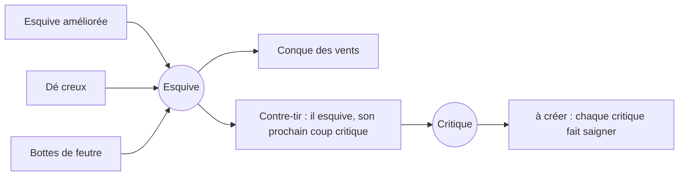
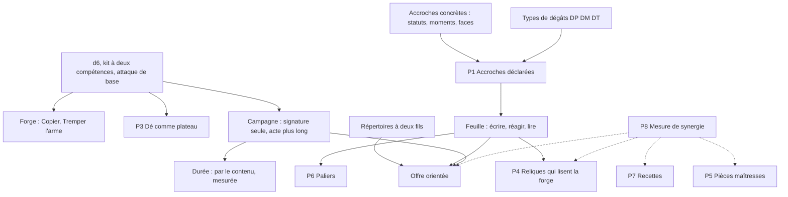
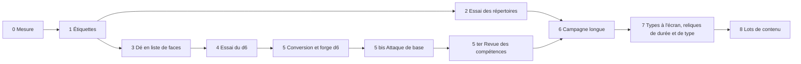

# Progression d'un personnage : profondeur et synergies

_Réflexion ouverte le 2026-10-23 (version 0.96), à la demande de l'utilisateur : comment approfondir la forge, les compétences et les reliques pour que les combinaisons ne relèvent pas du hasard. **Quatre passes de décisions le jour même** (§ 1), puis **un plan** (§ 18). **Rien n'est encore codé : ce document est un plan, pas une livraison.** Il garde toutes les pistes, retenues, revues ou gardées pour plus tard, avec une estimation rapide de chacune : ce qu'elle implique, ce qu'elle permet, la contrainte qu'elle ajoute, et la brique connue sur laquelle elle s'appuie. Les estimations sont des calculs à la main, sauf la mesure du § 3 ; aucune n'a été simulée, à la demande de l'utilisateur._

Documents liés : [CAMPAGNE.md](CAMPAGNE.md) (forge, campagne, décisions), [RELIQUES.md](RELIQUES.md), [FAMILLES.md](FAMILLES.md) (familles d'effet), [SORTS.md](SORTS.md) (laboratoire), [MISE_EN_SCENE.md](MISE_EN_SCENE.md) (couleurs des dégâts, Q5), [RESOLUTION.md](RESOLUTION.md).

---

## 0. En bref

- **Constat mesuré** : les reliques s'additionnent sans interagir (§ 3). Chaque ajout vit dans son coin ; les rares interactions sont des accidents.
- **La direction** (§ 2) : le plaisir se déplace du combat serré, à l'issue de pile ou face, vers **la conséquence visible d'un build**. Le duel équilibré reste le point de départ ; la progression en est le cœur.
- **Le socle** (§ 6, décidé, **livré en 0.105.0**) : un **d6 pour tous, aux faces imprimées**. Kit de référence de **deux compétences** ; en campagne, **la signature seule** au départ. « Sur un 4 » veut dire la face 4. Copier une face et Refondre remplacent Agrandir et Retailler. Dés livrés et mesures au § 6.8.
- **L'attaque de base** (§ 6 bis, demande de l'utilisateur du 2026-10-23, **livrée en 0.106.0**) : chaque personnage a une **attaque**, une petite fourchette de type DP ou DM, infligée en coup de base à **chaque jet** ; le dé ne fait plus de dégâts, il ne sert qu'à déclencher des compétences qui se **greffent** sur le coup de base, le **modifient** ou le **remplacent**. Une valeur commune que les reliques et les compétences peuvent lire : le socle des synergies. Livraison et mesures au § 6 bis.7.
- **Ce que chaque personnage peut apprendre** (§ 7) : un **répertoire** écrit pour lui, en deux fils de synergie, plus un petit fonds commun. Proposition complète pour les dix personnages, et un essai possible avec les seules compétences existantes.
- **Pas de familles comme règle** (§ 8) : les synergies s'accrochent à des **choses concrètes du combat** (un statut, un moment, un type de dégâts, un compteur du dé), pas à une catégorie.
- **Trois types de dégâts** (§ 9) : DP, DM, DT, **déclarés** sur chaque source (pas déduits de l'armure), avec des valeurs par défaut qui limitent la saisie à une dizaine de cas. Les récompenses qui font boule de neige sur un type (« +2 à tous les DM ») sont indispensables.
- **La feuille de personnage** (§ 10) : toutes les briques ne la lisent pas. Une brique **écrit** la feuille, **réagit** à un moment, ou **lit** un compteur ; seules les dernières la consultent, et elles doivent rester minoritaires.
- **Campagne** (§ 11) : la signature seule au départ, **un acte de 10 combats**, 4 forges et 6 reliques, **quatre faces de compétence au plus**, le système de difficulté actuel adapté, des **adversaires construits comme un champion** (0.105.0, § 11.5) ; une seule vie pour le moment.
- **Durée des combats** (§ 12) : un build agressif ramène un combat de 8 à 4 tours ; la durée doit **venir du contenu** (reliques, compétences, stats qui font durer), pas d'un calcul qui force une cible.
- **Gardés pour plus tard** (§ 15) : les super coups, le sertissage d'une relique dans une face, les défenses par type de dégâts, les vies.
- **Ce qui manque** (§ 17) : l'inventaire de ce que le cadre suppose et qui n'existe pas encore (moteur, données, contenu, icônes, écrans, mesures).
- **Le plan** (§ 18) : neuf phases, plus l'étape 6a et la phase 5 bis (l'attaque de base, ajoutée le 2026-10-23), des étiquettes et de la mesure (sans changer un combat) jusqu'aux lots de contenu, chacune avec sa preuve et ce qu'on décide à sa fin.
- **État des lieux au 2026-10-25** (§ 0 bis) : où en est le jeu après les versions 0.105.0 à 0.115.0, ce qui a été vu, mesuré, et ce qui reste ouvert.

## 0 bis. État des lieux (2026-10-25, version 0.115.0)

_Demandé par l'utilisateur avant la seconde partie de la phase 7 (écrit en 0.108.0, tenu à jour jusqu'à la 0.115.0). Depuis la 0.104.x, l'utilisateur a joué trois campagnes le 2026-10-24 (retours livrés en 0.111.0, § 1.11) ; il n'a pas encore joué la 0.111.0, la 0.112.0, la 0.113.0, la 0.114.0 ni la 0.115.0 (passe de nuit, § 1.14)._

### Ce qui a changé depuis la 0.104.x

| Version | Ce qui change pour le joueur |
| --- | --- |
| 0.105.0 | Un d6 pour tous ; deux compétences par personnage, sur les faces 1 et 2 ; les autres « hors kit », toujours gravables ; forge Copier et Refondre ; adversaires de campagne construits comme un champion ; signature affichée |
| 0.106.0 | **L'attaque** : chaque jet porte un coup tiré dans une petite fourchette ; le dé ne fait plus de dégâts, il déclenche ; une compétence se greffe, modifie ou remplace le coup ; Tremper l'arme (+1 à l'attaque) ; courbe de campagne abaissée (90 → 88 %) |
| 0.106.1 | Vocabulaire : Attaque, un coup, physique (DP) ou magique (DM) ; Cotte du mercenaire baissée |
| 0.107.0 | Revue des compétences (toutes les gravures de 8 à 20 points) ; la barde sur ses faces (deux jets, plus de doubles) ; Naraxes signée par l'Aura de décoction ; Aura sauvage à l'attaque ; Dent de loup baissée |
| 0.108.0 | Chaque chiffre de dégâts à la couleur de sa source (Lumière, Foudre, Poison…) ; évaluation des signatures (§ 13.3) |
| 0.109.0 | Cinq reliques consommatrices (Fiole de venin, Croc de boucher, Encens de l'abbaye, Écu cabossé, Plume d'aigle), le statut Élan ; Thaldrin signé par les Feux follets en campagne (§ 13.3) |
| 0.110.0, 0.110.1 | Corrections de la revue (moteur, écran, son, textes) ; chaque compétence s'aiguise sur un axe à elle ; l'Élan s'appelle Ferveur ; cinq emblèmes d'état peints |
| 0.111.0 | Plus de demi-rang ; la signature seule sur la face 1 ; dorure et gravure sur une face libre ; copie vers une face choisie ; six faces en combat ; reliques en texte court, offre pertinente ; **une attaque d'un type unique** (plus de DP ni de DM pour le joueur) (§ 1.11) |
| 0.112.0 | **Deux compétences au départ** de la campagne (la signature sur le 1, la seconde du kit sur le 2), cinq faces de compétence au plus ; adversaires à 75 % de leurs PV de base au moins, construits trois récompenses en retard ; Thaldrin à l'attaque 5 à 6 en campagne ; **trois reliques de durée** (Gambison matelassé, Onguent du rebouteux, Chandelle de veille) (§ 1.12, § 11.8) |
| 0.113.0 | **Un seul modèle de personnage** : le personnage du tournoi est celui du départ de campagne (signature sur le 1, seconde compétence sur le 2) ; Thaldrin, Feux follets sur le 1, Foudre sur le 2, attaque 5 à 6 partout ; Purification sans effet sur soi ; courbe de campagne option B (78, 86 %) (§ 1.13, § 11.9) |
| 0.114.0 | **Cinq compétences consommatrices** (phase 8, premier lot, [SORTS.md](SORTS.md) § 22) : Curée (deux coups bruts de plus si l'adversaire saigne), Récolte (+7 PV s'il est empoisonné), Virulence (triple son Poison), Sentence (il perd 1 PV à chaque soin), Rancune (son prochain coup est critique quand il encaisse un coup) ; dans les répertoires et hors kit ; Graver ne propose que des compétences à la portée du champion ; une compétence à condition fausse laisse sa face nue |
| 0.115.0 | **Passe de nuit** (§ 1.14) : le second lot de la phase 8 (Embrasement, Dé pipé, Rempart hérissé, Vindicte ; Soufflet de forge, Clous de pavois, Gantelet du talion, Pièce trouée ; [SORTS.md](SORTS.md) § 23, [RELIQUES.md](RELIQUES.md) § 15) ; une offre ne propose une consommatrice qu'une fois son producteur dans le build (« le producteur d'abord »), en campagne comme au tournoi ; la saison compose un build d'acte (4 forges, 6 reliques) sur les dix premiers matchs, gagnés ou perdus ; les options du tournoi dans une boîte ; textes du compendium réécrits courts ; mise en scène contrôlée par un test des timings |

### Le combat, en une page

- **Le dé** : un d6 (deux pour la barde) ; le jet désigne une face ; une face porte une compétence ou rien. Le dé ne fait aucun dégât.
- **Le coup** : chaque jet porte un coup, tiré dans l'**Attaque** du personnage (de 1 à 3 pour la barde à 7 à 9 pour l'ogre), physique ou magique ; esquive, critique, armure, boucliers et réactions comme avant.
- **La compétence de la face** se greffe sur le coup (le cas général), le modifie (Pourfendre, Pile ou face, Soliste, Crescendo) ou le remplace (Furie des vents, Coup de chance).
- **Les statuts** : bonus, malus, auras et mécanismes, inchangés dans leur principe ([STATUTS.md](STATUTS.md)).
- **À l'écran** : la fiche dit « Attaque 5 à 6 DP » ; une face nue montre son numéro ; chaque chiffre de dégâts a la couleur de sa source.

### Les mesures

| Mesure | Valeur | Repère |
| --- | --- | --- |
| Équilibre du roster (800 combats par duel, 0.113.0) | de 45,8 % (Ervald) à 55,6 % (Thaldrin) ; 46,8 à 54,3 % en 0.112.0 | 42 à 58 % |
| Pire duel | Naraxes contre Ysolde, 62,3 % (Elaria contre Morgrut, 61,9 %, en 0.112.0) | 65/35 au plus |
| Durée d'un combat | 15,2 tours (environ 7,6 par combattant) | 17,2 en 0.105.0 |
| Gravures (29 compétences) | de +10,4 (Foudre) à +19,7 (Esquive améliorée) | 8 à 20 points |
| Reliques (24) | toutes sous 20 depuis la Cotte (0.106.1) et la Dent de loup (0.107.0) ; les trois de durée (0.112.0) : +8,7, +12,0, +11,5 | 5 à 15, 20 au plus |
| Campagne (pilote automatique, 30 parties par champion, 0.113.0) | boss atteint 24 %, acte gagné 14 % ; PV des adversaires normaux au plus bas 75 %, en moyenne 85 % de leur base | courbe 78, 86, puis 90 → 88 %, boss 45 % ; attendu 26 % et 12 % |
| Départ de campagne contre le roster (deux compétences, 0.112.0) | de 45,9 % (Ervald) à 55,8 % (Thaldrin, attaque 5 à 6) ; Morgrut 49,5 % (sans compétence) ; Fanchon 49,5 % avec l'Ouverture ; depuis la 0.113.0, ce départ est le personnage du tournoi (ligne du roster ci-dessus) | 18,1 à 38,9 % à la signature seule (0.108.0) |

### Ce qui n'a été ni vu ni joué

Les règles se vérifient sans écran (tests, audit, simulations) ; à l'écran, seules des captures ont été prises : l'affrontement (attaque, faces nues, deux dés de la barde) et deux chiffres colorés (Lumière, Foudre). **Jamais vus en mouvement** : un combat entier sur les nouvelles règles, la rafale des deux dés de la barde, Crescendo qui monte, Soliste épuisé, Pile ×3, l'Aura sauvage sur la ligne d'attaque, les écrans de forge (Copier, Tremper l'arme), la carte de campagne. Le son ne se vérifie jamais.

### Ce qui reste ouvert

- **Synergies** : quatre ressources sans consommateur (Poison, Saignement, soins, coups encaissés) ; un premier lot de cinq reliques consommatrices validé (§ 13.3), livré en 0.109.0, icônes peintes en 0.109.1 ; l'Onguent du rebouteux (0.112.0) consomme aussi les coups encaissés, et ses soins nourrissent l'Encens. **0.114.0** : cinq compétences consommatrices (Curée, Récolte, Virulence, Sentence, Rancune ; [SORTS.md](SORTS.md) § 22), chacune de +8,1 à +10,4 gravée chez son producteur (Rancune +14,2 en moyenne) ; en campagne, paires liées par build 3,27 → 3,70. **0.115.0** : les quatre restes ont leur consommateur : la Brûlure (Embrasement, Soufflet de forge), la pile (Dé pipé, Pièce trouée), les dégâts renvoyés (Vindicte, Gantelet du talion), le bouclier vidé (Rempart hérissé, Clous de pavois) ; gravées de +8,0 à +9,7 chez leur producteur, reliques de +7,2 à +7,8, partenaires de +0,29 à +0,40 en log-cote. Restent : les rangs II de l'Embrasement et du Dé pipé sous la bande, et la présence des lots chez Elaria et Fanchon depuis « le producteur d'abord ».
- **La revue du contenu** ([REVUE_CONTENU.md](REVUE_CONTENU.md), écrite en 0.109.1) : **corrigée en 0.110.0** (moteur M1 à M4, écran et son A1 à A7, textes T1 à T15 sauf T12, documents en retard ; « un rang ajoute moins » : chaque compétence s'aiguise sur un axe à elle). **Restes fermés en 0.110.1** : T12 (l'Élan s'appelle Ferveur), E4 (une Peur bloquée par une immunité use sa fois), les cinq emblèmes d'état (A8, planche v15), le son de la Foudre (l'ancien gardé, l'Éclair retiré). Reste le résumé de l'état Puissance (second volet de T12). Les demi-rangs sont retirés en 0.111.0 (§ 1.11) ; les nouveaux textes et les emblèmes sont à juger en jeu.
- **Retours de partie du 2026-10-24 (0.111.0, § 1.11)** : axes de rang entiers, signature sur la face 1, dorure sur une face libre, copie vers une face choisie, six faces en combat, reliques en texte court et offre pertinente, attaque d'un type unique, mise en scène dé rendu → intervalle → impact. **Réponses de l'utilisateur** (§ 1.12) : rangs II au-dessus de +8 gardés ; le levier des PV moins fort et deux compétences au départ, livrés en 0.112.0. **Décisions du 2026-10-25** (§ 1.13, livrées en 0.113.0) : Purification sans effet sur soi, courbe option B, un seul modèle de personnage, Gambison et noms des reliques de durée gardés.
- **Décisions ouvertes après la 0.113.0** : Purification 5 → 6 dégâts pour compenser (Ysolde 45,9 → 48,3 % au laboratoire) ; Thaldrin à 55,6 % (garder, ou 53 PV : 47,6 %) ; Ervald à 45,8 % (critique 26 % : 47,8 %) ; un Onguent plus fort ([RELIQUES.md](RELIQUES.md) § 14) ; Brokk et Ysolde, dont la seconde compétence vaut autant ou plus que la signature.
- **Choix de l'agent en 0.114.0, à confirmer** (l'utilisateur a dit « enchaîne ») : cinq compétences sans le Rempart hérissé (rang II hors bande) ; la Virulence « Triple » (`fromStatus`) ; la Rancune critique ; Naraxes inchangée (Virulence +0,7 chez elle, son Poison s'estompe avant son jet) ; la Rancune sous l'état Renvoi. Anti-synergie Virulence × Fiole de venin −0,17, non traitée.
- **Les auras** : elles tiennent en valeur ; reste à voir si elles s'insèrent **naturellement** dans le nouveau jeu, et à les retoucher pour qu'elles soient plus utiles et plus synergiques (§ 1.10).
- **Les compétences** : à valider, tester et auditer encore, à compléter par d'autres, en pensant **familles** ([FAMILLES.md](FAMILLES.md)) ; leurs descriptions doivent rester courtes, simples, et porter le fonctionnement (§ 1.10).
- **Les répertoires** : une relecture légère sur le d6 et l'attaque (reste de la phase 6) ; premiers consommateurs ajoutés en 0.114.0 (de quatre à six compétences par répertoire).
- **Les types** : l'attaque est d'un type unique depuis la 0.111.0 ; les textes ne nomment pas de type, et les bonus de relique par type sont abandonnés (0.112.0).
- **Campagne** : la difficulté est plus dure qu'avant, voulue (courbe abaissée), à juger en jeu ; en 0.113.0 (modèle unique, courbe option B), boss atteint 24 % (26 % attendus), acte gagné 14 % (12 %), sur 30 parties par champion.
- **Points à surveiller** : une gravure sur la barde vaut près du double (deux dés) ; Crescendo et Soliste restent proches ; Peur et Soliste ne partent qu'une fois par combat ; la matrice des duels de [PERSONNAGES.md](PERSONNAGES.md) date de la 0.106.0.
- **La branche** `regles-v2` n'est pas fusionnée ; la fusion se décide après la campagne longue jouée par l'utilisateur (§ 18).

### Où en est le plan (§ 18)

Faites : 0 (mesure), 1 (étiquettes), 3 et 4 (le d6), 5 (conversion), 5 bis (l'attaque), 5 ter (revue des compétences), 6 (campagne longue, sauf une relecture légère des répertoires ; 0.112.0), 7 (types à l'écran en 0.108.0, retirés en 0.111.0 ; reliques de durée en 0.112.0 ; bonus par type abandonnés) ; le modèle unique de personnage (0.113.0, § 1.13). Livrées, à jouer : 2 (répertoires), 6a et 6 (campagne longue), un premier lot de consommateurs (0.109.0, § 13.3), les deux premiers lots de la phase 8 (0.114.0 : cinq compétences consommatrices ; 0.115.0 : le second lot, la saison qui compose un build d'acte, « le producteur d'abord » ; choix de l'agent à confirmer, § 1.14). À faire : le jugement en jeu des deux lots, les décisions ouvertes de la nuit, puis la revue des auras et des compétences du § 1.10 et le lot suivant (P4 à P7).

---

## 1. Décisions de l'utilisateur

### 1.1 Première passe (2026-10-23)

| Question                              | Décision                                                                                                                                                                                                                                                                                                                                           |
| ------------------------------------- | -------------------------------------------------------------------------------------------------------------------------------------------------------------------------------------------------------------------------------------------------------------------------------------------------------------------------------------------------- |
| Le d6 aux faces imprimées             | **Oui.** La mécanique de base, sur laquelle tout vient s'ajouter, doit être revue ; le d6 est aujourd'hui le meilleur levier pour cadrer (§ 6).                                                                                                                                                                                                    |
| Des écoles de compétences             | **Non, trop rigide.** Plutôt des possibilités **au cas par cas, par personnage**, selon le thème de ses attaques (§ 7). En revanche : **classer les attaques par type de dégâts** : DP (dégâts physiques, en rouge), DM (dégâts magiques, couleur selon la source), DT (dégâts temporaires, couleur selon la source : magie, poison, autre) (§ 9). |
| Compétences d'origine en campagne     | **La règle « les trois compétences d'origine restent les siennes » est obsolète** : les modes de jeu ont des règles différentes, la campagne peut avoir les siennes. **La campagne doit proposer plus de combats** : avec le nombre actuel, un build reste très incomplet (§ 11).                                                                  |
| Sertir une relique dans une face      | **Pas pour le moment**, gardé pour plus tard (§ 15.2).                                                                                                                                                                                                                                                                                             |
| Les super coups                       | **Gardés pour plus tard** : on revoit d'abord la progression par les compétences, les reliques et le dé. **Ne pas perdre de vue la réflexion sur les synergies** (§ 13).                                                                                                                                                                           |
| « Sur un 4 »                          | **La face 4**, quoi qu'elle porte.                                                                                                                                                                                                                                                                                                                 |
| La nature des compétences comme règle | **Non** : la nature (martiale, adresse, arcane) reste de la présentation.                                                                                                                                                                                                                                                                          |

### 1.2 Deuxième passe (2026-10-23)

| Question                               | Décision                                                                                                                                                                                                                                                              |
| -------------------------------------- | --------------------------------------------------------------------------------------------------------------------------------------------------------------------------------------------------------------------------------------------------------------------- |
| Kit de référence en d6 (duel, tournoi) | **Deux compétences** pour le moment : on commence petit, l'équilibrage est plus simple (§ 6.2).                                                                                                                                                                       |
| Forge sur le d6                        | **Copier et Refondre remplacent Agrandir et Retailler** (§ 6.5).                                                                                                                                                                                                      |
| Pile ou face, Riposte                  | **Des coups physiques : DP.** Le Saignement peut rester rouge (§ 9).                                                                                                                                                                                                  |
| Campagne : longueur                    | **Un acte plus long** (§ 11).                                                                                                                                                                                                                                         |
| Campagne : vies                        | La règle « une partie, une vie » peut être revue si elle sert le jeu, **mais pas plusieurs vies pour le moment** (§ 11).                                                                                                                                              |
| Kit de départ en campagne              | **La signature seule** (§ 11).                                                                                                                                                                                                                                        |
| Récompenses qui montent une stat       | **Oui**, à plat, comme les Bottes et leur esquive. **Des récompenses qui font boule de neige sur les DM** (« +2 à tous les DM ») sont logiques et **indispensables**, même s'il y a peu de sorts magiques aujourd'hui (§ 9.4).                                        |
| Défenses par type de dégâts            | **Trop compliqué pour le moment** (§ 15.3).                                                                                                                                                                                                                           |
| Répertoires                            | L'utilisateur ne se rend pas bien compte : **une proposition est demandée**, pour vérifier qu'on est sur la même longueur d'onde (§ 7).                                                                                                                               |
| Le spectacle                           | **Le combat serré perd de sa force face à l'évolution au cours d'une partie** (campagne ou tournoi) et à l'émergence des builds : la tendance aux combats « pile ou face » doit s'effacer au profit des conséquences d'une relique ou d'une compétence obtenue (§ 2). |
| PV et durée                            | **À réfléchir** : une évolution des PV (événement, valeur à plat, relique) ; un combat équilibré entre personnages nus peut durer 4 tours face à un build agressif ; pour profiter d'un build, il faut une montée des PV ou de la durée (§ 12).                       |

### 1.3 Troisième passe (2026-10-23)

| Question | Décision |
| --- | --- |
| Répertoires | La structure parle à l'utilisateur, **à condition qu'elle ne bloque pas trop de raisonnements plus tard** ; il faudra **déclarer ce qui manque** (§ 7.1, § 17). |
| Rétribution | **DP** (§ 9.2). |
| Bonus par type sur un sort à plusieurs impacts | **Par impact** : « plus drôle » (§ 9.4). |
| Difficulté de la campagne | Elle plaît telle qu'elle est : **on garde son système** (adversaires réglés sur le champion de référence), adapté à l'acte plus long (§ 11.3). |
| PV et durée | En tournoi, des PV qui montent **en lien avec le nombre de récompenses** : une relique qui donne 15 PV est aussi un gain de puissance. **La montée des PV et la durée des combats doivent venir du contenu** (reliques, compétences, effets, stats qu'ils modifient), **pas d'un calcul qui force une cible** (§ 12). |
| Longueur de l'acte | **10 combats au moins**, si cette longueur donne assez de faces forgées sans dépasser la limite, et assez de reliques pour faire sortir un build. **Avec six faces seulement, les forges peuvent être plus rares** (§ 11.2). |
| Copier | **Oui** : l'opération s'appelle « **Copier une face** » ; une même compétence sur deux faces au plus (§ 6.5). |

### 1.4 Quatrième passe (2026-10-23)

| Question | Décision |
| --- | --- |
| Limite de faces de compétence en campagne | **Quatre au plus**, signature comprise : au moins deux faces de coup (§ 11.2). |
| Récompenses d'un acte de 10 | **On commence avec la proposition** : 4 forges et 6 reliques, dans l'ordre du § 11.2. |
| Dés de référence | **D'accord** comme point de départ de l'essai (§ 6.7), kits compris (Ervald : Aura glaciale et Vol de vie). |
| Une récompense sur trois qui fait durer | **Oui**, comme repère d'écriture ; l'endurcissement en repli seulement (§ 12.3). |
| Signatures | **Gorak : la Furie des vents. Naraxes : Pile ou face. Brokk : Épines acérées** (§ 7.2). |
| Nature du document | **Un plan seulement** : rien n'est codé (§ 18). |

### 1.5 Cinquième passe (2026-10-23, après avoir joué la 0.104.x)

| Question | Décision |
| --- | --- |
| Adversaires de campagne | **Ils doivent être plus sérieux et grandir avec l'acte**, « si on arrive à équilibrer » (§ 11.5). |
| Le d6 | **« Avance tant que tu peux, intègre le d6 »** : phases 3 à 5, puis la campagne sur d6 (§ 6.8, § 11.5). Les auras de signature viennent ensuite, si le moment s'y prête. |
| Osselet fendu, Fer à quatre clous | Aucune mise en évidence spéciale sur les dés : ce sont des **événements** (« en cas de 4 »). |
| Clepsydre du siège | **Trop abstraite**, et son aura se montrait comme une compétence dans la barre de compétences : à refaire. |
| Signature | **La montrer à l'écran.** |

Retours de jeu qui les accompagnent : un dé trop grand ; peu de reliques et de choix ; des premiers combats sans intérêt (Brokk battu au premier combat par une Fanchon à 13 PV, à 0,3 % de probabilité : « mauvaise expérience ») ; le Critique assuré d'Elaria plus agréable qu'une aura qui demande une face précise parmi dix ; un acte gagné par Ervald avec un build direct (Cloche, Retailler, Feux follets).

### 1.6 Sixième passe (2026-10-23, après la 0.105.0)

| Question | Décision |
| --- | --- |
| Le dé en combat montre-t-il la valeur imprimée ? | **Non** : il montre le numéro de la face. Avec l'attaque de base (§ 6 bis), la question disparaît : les faces n'auront plus de valeur. |
| Osselet fendu, Fer à quatre clous « sur les dés » | La mise en évidence sur certaines faces venait d'une proposition de maquette (Claude Design), pas du jeu : **rien n'est dessiné sur les faces**, ces reliques restent des événements (« sur un 4 »). |
| Courbe de la campagne | **Plus basse au début** (environ 90 % au premier combat au lieu de 98 %) : des premiers combats disputés, au prix de moins de parties qui atteignent le boss. Appliquée au recalage de la campagne qui suit l'attaque de base (§ 18, phase 5 bis), puisque ce recalage refait toutes les rencontres. |
| Suite | **Avant toute chose, un changement de mécanique** : l'attaque de base (§ 6 bis). Il touche tout, mais assouplit tout ce qui viendra ensuite. Les auras de signature et la durée (phase 7) attendent. |

### 1.7 Septième passe (2026-10-23, l'attaque de base)

| Question (§ 19) | Décision |
| --- | --- |
| 6. Le type | **DD**, d'abord : « DP était une erreur, à changer partout ». **Revu à la huitième passe** (§ 1.8) : physique ou magique, DP et DM. |
| 7. Fixe ou fourchette | **Une petite fourchette.** |
| 8. L'échelle | **L'échelle actuelle.** |
| 9. Le coup sacrifié | **D'accord** : il disparaît ; Furie, Crescendo, Soliste et Coup de chance remplacent le coup ; Pile ou face : pile, ce coup ×2. |
| 10. Refondre | **« Carrément »** : remplacé par Tremper l'arme, +1 à l'attaque. |
| 11. Quatre faces de compétence | **Gardée.** Piste notée en passant (« ne nous éparpillons pas ») : une relique qui ajoute une attaque physique ou magique de plus. |
| 12. Morgrut, le druide, la barde | **D'accord** avec la proposition. |

### 1.8 Huitième passe (2026-10-24, après la 0.106.0)

| Question | Décision |
| --- | --- |
| Le vocabulaire | La stat s'appelle **Attaque** (« Attaque 5 à 6 », la valeur d'attaque) ; chaque jet inflige **un coup** de cette valeur (le « coup blanc » de l'utilisateur ; « coup de base » dans les règles). Son type : **physique ou magique**, DP ou DM (DT pour les statuts). « Dégâts directs » garde son sens : les dégâts qui ignorent l'esquive, l'armure et le critique. Le DD de la 0.106.0 redevient DP, partout. |
| Cotte du mercenaire | **Baissée** : +1 armure, −5 % d'esquive (le repli prévu en 0.77.0). |
| Effet boule de neige en saison | **Accepté** tel quel. |
| La suite | **Repasser sur les compétences** : elles ont été écrites pour un grand dé à faces sacrifiées ; le d6 imprimé (0.105.0), puis l'attaque de base (0.106.0), ont changé leur valeur et leur rôle. Phase 5 ter (§ 18). |

### 1.9 Neuvième passe (2026-10-24, la revue des compétences)

Réponses de l'utilisateur aux questions de l'audit ([SORTS.md](SORTS.md) § 19), avec la consigne : « l'utilisateur dort : fais un max d'avance ». Livré en 0.107.0 (§ 18, phase 5 ter).

| Question (SORTS.md § 19) | Décision |
| --- | --- |
| Le repère d'une gravure | **8 à 20 points** : toute compétence gravable doit y entrer, comme les reliques. |
| La signature de Naraxes | L'**Aura de décoction** ; Pile ou face reste dans son kit, renforcée (pile ×3). |
| L'Aura sauvage | **+1 à l'attaque par charge** : elle écrit la feuille, avant le critique (elle n'est plus un doublon de l'Aura de puissance). |
| La barde | Ses compétences passent **sur les faces**, comme pour tous ; ses deux dés frappent deux fois (deux jets complets). Plus de doubles. |

### 1.10 Dixième passe (2026-10-24, après l'évaluation des signatures)

| Question (§ 13.3) | Décision |
| --- | --- |
| Les auras | **À évaluer dans le nouveau jeu** : s'insèrent-elles naturellement ? Les retoucher si besoin pour les rendre plus naturelles, utiles et synergiques. |
| Les reliques consommatrices | **Validées** (le lot de cinq) : « un bon exemple de ce qu'on peut ajouter pour profiter du nouveau système émergent ». |
| Les compétences | **Valider, tester, auditer** les compétences existantes, **en ajouter** d'autres en considérant la mécanique de **famille** ([FAMILLES.md](FAMILLES.md)). Règle d'écriture : **une description courte, simple, qui porte le fonctionnement**, au niveau du code comme de la mécanique. |
| Les répertoires | L'utilisateur s'en réjouit : à poursuivre. |
| Thaldrin | **Signature : les Feux follets** (« super idée »). |
| La suite | **Un état des lieux** avant la seconde partie de la phase 7 (§ 0 bis). |

### 1.11 Retours de partie du 2026-10-24 (trois campagnes : Elaria, Gorak, Ysolde ; livrés en 0.111.0)

| Retour | Décision |
| --- | --- |
| « L'Aura de sainteté rend un chiffre à virgule » | **Pas de décimale** : chaque axe de rang est un entier ≥ 1 (`validateRoster`) ; les demi-rangs de la 0.110.0 sont retirés. |
| Les Feux follets de Thaldrin sur 4, 5 et 6 « ont l'air buggés » | **La signature sur la face 1**, une fois ; les cinq autres faces sont nues (reliquat de l'ancien système). |
| Face dorée | **Dorer seulement une face libre**, et une compétence ne se grave pas sur une face dorée ; plus de « 2 » sur une face dorée (le fond doré suffit). |
| « Copier une face devrait donner la possibilité de choisir la face de destination » | **Copier vers une face choisie** : l'origine, puis une face libre. |
| La zone de compétences en combat | **Les six faces** y apparaissent, nues et dorées comprises ; une face nue s'allume quand le dé tombe dessus. Plus d'icône de dé au choix du champion. |
| « Les descriptions de reliques sont trop compliquées » | **L'effet d'abord, la condition en clair, la limite en « 2x »** ; ni type ni élément montrés ; une limite ou une recharge, pas les deux. |
| « La Fiole de venin m'est proposée à chaque fois » | **Une offre de reliques pertinente** : pas de relique dont la condition ne peut pas arriver avec le champion. |
| « La distinction DM/DP ajoute une couche de confusion » | **Une attaque d'un type unique**, le coup de base en blanc (le « coup blanc »). |
| La Conque des vents, l'Aura de précision : « timing parfait » | **Principe de mise en scène : dé rendu → intervalle → impact** : ce qui dépend du dé part avec le dé posé, une relique qui donne un statut envoie sa particule, la charge d'un statut baisse à l'impact. |

### 1.12 Réponses du 2026-10-24 après la 0.111.0 (livrées en 0.112.0)

| Question | Réponse de l'utilisateur | Suite |
| --- | --- | --- |
| Onze rangs II au-dessus de +8 points | **Gardés tels quels pour le moment** | aucune |
| Les PV des adversaires réglés à la baisse (jusqu'à 20 PV sur 50) | « Mesure oui, ou réduis l'intensité du levier des PV ; croiser des persos à 13 PV, c'est bizarre » | plancher de 75 % des PV de base et adversaires trois récompenses en retard (§ 11.8) |
| Commencer avec deux compétences | « ok » | la signature sur le 1, la seconde compétence du kit sur le 2 ; aucune signature sous la bande de 8 à 20 points (§ 11.8) |
| La Purification : dissiper le dernier bonus de la cible, sinon lui infliger les dégâts, et dissiper aussi sur soi | proposition de l'utilisateur | c'est déjà la règle (0.42.0, 0.69.0) ; ses dégâts ne se typent pas (attaque d'un type unique) : ce sont des dégâts directs |
| Elaria « critique beaucoup » | rien à faire | aucune |

### 1.13 Décisions du 2026-10-25 (livrées en 0.113.0)

| Question | Réponse de l'utilisateur | Suite |
| --- | --- | --- |
| La Purification | « Soit retirer un bonus en face, soit lui infliger 5 dégâts s'il n'a pas de bonus. L'effet sur soi doit être retiré. » | l'effet sur soi (Purification double, 0.69.0) est retiré ; valeur nette +21,7 → +19,3, Ysolde 48,4 → 45,9 % ; compensation proposée, non appliquée : 6 dégâts (48,3 % au laboratoire) |
| La courbe de campagne (les combats 1 et 2 ne tenaient plus 90 % avec le plancher) | option B | les deux premières cibles écrites à ce qu'elles valent avec le plancher : 78 et 86 %, le reste inchangé (§ 11.9) |
| Des personnages différents selon le mode (`CAMPAIGN_CHAMPIONS`, attaque de Thaldrin en campagne) | « Les personnages de tournoi et de campagne doivent partir du même modèle. Un perso, en campagne ou en tournoi, commence exactement au même point ; ce sont les règles de chaque mode qui définissent ses possibilités d'évolution. Ne commence pas à avoir des versions de perso différentes à la base. Le tournoi est un laboratoire, pour nous, pour voir ce que les règles actuelles peuvent produire comme builds et combats. Le perso qui commence en tournoi doit être le même que celui de campagne : la version vanilla du perso, avant son évolution, dictée par la campagne ou le tournoi, qui utilisent les axes d'obtention de relique et de forge de dé. » | le registre du roster devient le personnage vanilla (le départ de campagne de la 0.112.0 : signature sur le 1, seconde compétence sur le 2 ; Thaldrin attaque 5 à 6) pour tous les modes ; `CAMPAIGN_CHAMPIONS` et `CAMPAIGN_STATS` retirés ; chaque mode garde ses règles (répertoire, offres, nombre de récompenses, plafond de faces) ; le Colosse reste à part. Roster 45,8 à 55,6 %, pire duel 62,3 %, aucun levier appliqué ([PERSONNAGES.md](PERSONNAGES.md)) |
| Le troc du Gambison matelassé (−1 à l'attaque) | gardé | aucune |
| Les noms des trois reliques de durée | gardés pour l'instant | aucune |

### 1.14 Passe de nuit du 2026-10-25 (livrée en 0.115.0)

La demande de l'utilisateur, avant d'aller dormir :

> « Franchement, tes exemples de relique sont super, je pense que nous sommes sur la bonne piste et je veux que tu enchaînes de manière autonome pour une grosse passe car je vais aller dormir :
> - que tu intègres le lot suivant, que tu cales le mode campagne pour que je puisse tester demain avec ces deux lots équilibrés intégrés dans la progression.
> - Je veux également que tu mettes à jour le tournoi : les nouvelles règles, reliques, personnages doivent être intégrés au mode tournoi saison, dont le fonctionnement de fond ne diffère pas. Seule modif dans l'UI : un menu exprès pour les options plutôt que glissées un peu partout sur l'écran de tournoi, une petite box qui s'ouvre avec l'activation des options dedans (noms uniques, activation des reliques, nombre de persos, forge du dé). Le système de forge et de relique doit composer le build d'un perso sur ses premiers matchs de saison. Maintenant que nous avons un d6 fixe de base pour tous, je te laisse ajuster le rythme et le nombre de chaque pour composer un d6 qui sera le build du perso pour la fin de la saison. Évidemment toutes les synergies et mécaniques que nous avons mises en place jusqu'à l'intégration du lot 2 doivent être présentes en mode tournoi. Le mode tournoi est le bac à sable que j'utilise en tant qu'humain pour tester la campagne, les persos, les reliques, les mécaniques synergisantes. Donc demain je veux campagne et tournoi prêts à être testés.
> - Évidemment les animations, la doc, le compendium, le style de rédaction du compendium, le contrôle des timings d'animation, tout doit être super nickel premium. Délègue des sous-agents pour me livrer une version pico bello. »

L'utilisateur dormait : chaque choix ouvert a été tranché par l'agent, au plus conservateur, mesuré, et noté ici pour qu'il le confirme ou le défasse.

| Sujet | Décision de l'agent | Mesure, raison |
| --- | --- | --- |
| Le second lot | Embrasement, Dé pipé, Rempart hérissé, Vindicte ; Soufflet de forge, Clous de pavois, Gantelet du talion, Pièce trouée ([SORTS.md](SORTS.md) § 23, [RELIQUES.md](RELIQUES.md) § 15) | gravées +8,0 à +9,7 chez leur producteur, reliques +7,2 à +7,8, partenaires +0,29 à +0,40 en log-cote ; aucun vanilla touché, empreinte inchangée |
| L'Embrasement | une charge qui attend le coup qui touche un adversaire qui brûle (plutôt qu'au jet) | au jet : 0,15 fois par combat, +2,2 à ×2 |
| Rangs II du lot | Rempart hérissé +6 Épines par rang ; Embrasement (+0,6) et Dé pipé (+1,1) gardés sous la bande | Rempart +1,7 → +3,2, seul pas entier dans la bande ; une ressource posée par le rang vaut +16,4 (Embrasement) et +19,5 (Dé pipé), hors bande par le haut |
| Naraxes | rien changé | une Décoction plus forte (2 Poison) la porte de 53,7 à 66,8 % |
| Rythme de la saison | une récompense à chacun des dix premiers matchs, gagné ou perdu, dans l'ordre d'un acte (4 forges, 6 reliques), builds figés au soir de la journée 10 | builds complets 185 → 192 sur 192 ; seul rythme essayé où chacun finit son build (une par victoire : 165 à 186 sur 192) ; la saison reproduit un acte de campagne |
| L'offre au tournoi | celle de la campagne, partout (`offers.ts`), arbre sans saison compris | aucun chemin du tournoi ne garde l'offre libre |
| Les paris | dans la boîte Options, avec les noms des parieurs | « et toute autre option glissée sur l'écran » |
| Défauts du tournoi, glyphe | saison, forge du dé et reliques activées ; glyphe `reglages` ajouté au kit ; la tuile de la forge montre une face gravée du dé | décision du parent ; aucune image peinte de forge n'existe (le d20 peint aurait menti sur un jeu au d6) |
| « Le producteur d'abord » | la portée d'une offre lit le build du jour, plus le répertoire : une consommatrice n'est offerte qu'une fois son producteur dans le build | décision du parent, gardée malgré Ervald à 10 % au boss sur 90 parties (10 / 3 / 17 % selon les graines, 17 % avant) et Elaria et Fanchon qui voient moins de briques des lots (39 et 45 % des actes, 85 et 89 % avant) |
| Campagne | courbe, pilote automatique (au hasard), répertoires et valeurs des briques inchangés ; aucun levier par champion | l'écart par champion à 30 parties est du bruit de graines (l'ordre se renverse d'un jeu à l'autre) ; l'écho au pilote creuse l'écart (8,6 → 9,7) sans gagner ; renforcer les consommatrices des builds faibles : 8,6 → 8,2 seulement |
| Rédaction | la condition dans la ligne, « 1x » au bout, ligne « Détail : » ; multiplicateurs de critique ×2,2 à ×2,5 gardés sur la fiche (des stats) ; « dégâts directs » gardé ; noms de statuts en majuscule dans les compétences | [SORTS.md](SORTS.md) § 24 ; `wording.test.ts` |
| Mise en scène | label de la Rancune en « + » ; l'Embrasement sonne Coup même gros, chiffre doré à 10 et plus ; l'Encens après un soin hors coup au milieu de sa lecture | [MISE_EN_SCENE.md](MISE_EN_SCENE.md) M41 à M45, [SONS.md](SONS.md) |
| Écrans | portrait du champion plus petit sur la carte de l'acte (il montait sur la piste) ; les builds restent hors des cartes de l'arbre (ce serait une fonctionnalité) | captures de la passe de finition |
| Icônes | planches v18 (compétences) et v19 (reliques), générées avec Artlist, version A gardée pour les huit | [STYLE_BIBLE.md](STYLE_BIBLE.md) § 7 |

**À trancher par l'utilisateur** : la Purification 5 → 6 (toujours en attente), Ervald au boss (à remesurer), la présence des lots chez Elaria et Fanchon, l'écart des builds de saison (37 à 68 %, écart-type 10,7 : la forge, dont les deux dés de Fanchon), les rangs II de l'Embrasement et du Dé pipé, les défauts du tournoi, les builds dans l'arbre, les multiplicateurs de critique, les choix de mise en scène ([ETAT.md](ETAT.md), limites connues ; [TODO.md](TODO.md) § 20).

---

## 2. La direction

**Ce qui change.** Le projet est parti de l'équilibre : des combats serrés, des retournements, une mesure du spectacle par la tension ([CAMPAGNE.md](CAMPAGNE.md) § 7). Avec la forge et les reliques, le plaisir se déplace : **on regarde ce que son build fait**. Un combat gagné parce que la Dent de loup est partie au bon moment, ou parce que trois faces copiées alimentent la même relique, raconte quelque chose ; un combat gagné à pile ou face, non.

**Ce qui reste.** Le **roster nu** du duel garde sa tolérance de 42 à 58 % ([EQUILIBRAGE.md](EQUILIBRAGE.md)) : c'est la base de départ, celle qui garantit qu'aucun personnage n'est condamné avant d'avoir rien reçu. Les **paris** restent au tournoi, aux cotes cachées ; quand l'issue dépend du build, **lire un build devient le talent du parieur**.

**Ce que la direction induit**, dans l'ordre :
1. **Un socle simple et égal pour tous** : le d6, deux compétences (§ 6).
2. **Une croissance dirigée** : un répertoire par personnage, une offre qui oriente (§ 7, § 13.2).
3. **Des accroches concrètes** pour que chaque ajout touche les autres (§ 8, § 9, § 10).
4. **Assez de récompenses** pour qu'un build se termine (§ 11).
5. **Assez de durée** pour qu'un build se voie (§ 12).
6. **Une mesure de la profondeur**, et plus seulement de la force ou de la tension (P8, § 14).

**Conséquence pour la mesure du spectacle.** En mode de progression, la bonne question n'est plus « ce combat était-il serré ? », mais « **le build se voit-il dans le résultat ?** » : l'écart de victoire entre le champion construit et le même champion nu, la part des combats où une brique précise a décidé de l'issue (le contrefactuel de [TODO.md](TODO.md) § 16), le nombre de tours où le build agit.

---

## 3. Le constat (mesuré le 2026-10-23)

Mesure jetable (script supprimé depuis ; P8 propose d'en faire un outil) : les 16 reliques deux à deux, sur les 10 personnages, 200 combats par duel contre le roster nu, mêmes graines (environ 2,5 millions de combats, 5 minutes). **Synergie = écart à l'additivité, en log-cote** : L(AB) − L(A) − L(B) + L(∅), où L(p) = ln(p / (1 − p)). En points de taux de victoire, la saturation près de 100 % fait paraître toute paire négative (Cotte + Chapelet : −2,0 points, mais +0,13 en log-cote) : la log-cote est la bonne échelle.

| Mesure | Valeur |
| --- | --- |
| Triplets (paire × personnage) | 1 200 |
| Synergie moyenne | −0,01 |
| Écart absolu moyen | 0,05 (de l'ordre du bruit de mesure) |
| Triplets au-delà de ±0,3 | 3 |
| Triplets au-delà de ±0,5 | 0 |

**Lecture** :
- **Une seule vraie synergie** : Dé creux + Conque des vents (+0,24 en moyenne, +0,49 sur Fanchon, +0,44 sur Thaldrin). Le Dé creux **produit** une esquive, la Conque la **consomme**. C'est le mécanisme à généraliser.
- **Les anti-synergies sont des conflits cachés sur le dé** : Contrepoids + Dé creux (−0,16 ; Fanchon −11,7 points : un dé plus grand rend le jet maximal plus rare), Contrepoids + Fer à quatre clous (−0,11 : le 4 plus rare), Cotte + Conque (−0,17 : −8 % d'esquive contre une relique d'esquive). Rien ne les annonce au joueur. **Le d6 supprime les deux premières.**
- **Rien n'oriente les offres** : Graver tire au hasard uniforme dans les 24 compétences de `ENGRAVABLE_SKILLS` (`drawForgeOffer`, `forge.ts`) ; l'offre de reliques aussi. (La première version de ce document disait 27 : il y en a 24, corrigé le 2026-10-23.)
- **Le choix de la face visée est presque décoratif** : hors le 4 (Fer) et le jet maximal (Dé creux), graver sur le 5 ou sur le 8 donne la même fréquence.
- **La taille du dé fausse la valeur des objets** : le Fer vaut de +3,6 (Thaldrin) à +19,2 points (Fanchon) ; une gravure occupe 1/7 du dé d'Ysolde et 1/14 de celui de Morgrut.

**Estimation : pourquoi les builds ne se forment pas.** Une forge propose 3 des 5 opérations (Graver dans 60 % des offres), et Graver ne montre qu'une compétence sur 24. Si 5 de ces 24 compétences vont bien à un personnage, la chance d'en voir une à une forge est de 0,6 × 5/24 ≈ **12,5 %** ; sur les deux forges d'un acte, ≈ **23 %**.

### 3.1 L'état de référence (phase 0, version 0.101.0)

_Mesuré le 2026-10-23 sur la branche `regles-v2`, avant tout changement de règle. C'est le « avant » de chaque phase suivante. Outils : `npm run synergy`, `npm run campaign`, `npm run season` ([EQUILIBRAGE.md](EQUILIBRAGE.md), tableau des outils). Rapports complets dans `logs/synergy/`, `logs/campaign/`, `logs/season/`._

**Synergies des reliques** (`npm run synergy`, 200 combats par duel) : les chiffres du § 3 se retrouvent à l'identique, mêmes graines. En plus :

| Mesure | Valeur |
| --- | --- |
| Triplets au-delà de +0,25 | 7 sur 1 200 (dont 5 de Dé creux + Conque des vents) |
| Triplets sous −0,15 | 34 |
| Reliques avec un partenaire au-delà de +0,25, sur au moins un personnage | 6 sur 16 (Contrepoids, Dé creux, Cloche, Clepsydre, Dent de loup, Conque) |

**Bruit** (estimation, non mesurée) : à 200 combats par duel, un taux de victoire varie de ±1,2 point ; un triplet, qui combine quatre taux, de l'ordre de ±0,1 en log-cote. Un partenaire à +0,25 sur un seul personnage est donc un indice, pas une preuve (le meilleur des 15 partenaires d'une relique profite du bruit) ; la moyenne sur le roster est fiable. À confirmer avec `SYNERGY_N=400`.

**Campagne** (`npm run campaign`, 30 parties par champion, 300 en tout ; boss atteint 51 % et acte gagné 28 %, comme en 0.89.0, [CAMPAGNE.md](CAMPAGNE.md) § 18.3 ; par champion, quelques écarts de 3 points depuis, les règles ayant bougé entre-temps) :

| Nœud | Récompenses reçues | Combats | Construit | Nu (même graine) | Apport du build | Tours par combattant (construit / nu) |
| --- | --- | --- | --- | --- | --- | --- |
| 1 | 0 | 300 | 92 % | 92 % | 0 | 5,5 / 5,5 |
| 2 | 1 | 276 | 90 % | 83 % | +7 points | 6,7 / 7,0 |
| 3 | 2 | 248 | 88 % | 80 % | +8 points | 7,4 / 7,2 |
| 4 | 3 | 219 | 84 % | 61 % | +23 points | 7,8 / 8,2 |
| 5 | 4 | 185 | 83 % | 57 % | +25 points | 9,3 / 9,6 |
| Boss | 5 | 153 | | | | 12,7 |

Tours par combattant, par champion, sur tout l'acte : de 6,0 (Fanchon) et 6,5 (Gorak, Morgrut) à 8,9 (Brokk) et **13,8 (Ysolde)**.

**Saison construite** (`npm run season`, 4 saisons de 24, reliques et forge, choix par défaut ; 60 combats par duel pour la valeur des constructions) :

| Tiers de saison | Journées | Tours par combattant |
| --- | --- | --- |
| 1 | 1 à 16 | 9,3 |
| 2 | 17 à 31 | 8,8 |
| 3 | 32 à 46 | 9,1 |

En fin de saison, les 96 constructions sont complètes (trois reliques, trois forges). Contre le roster nu, une construction vaut **+35 points** en moyenne (de +31 pour Brokk à +39 pour Fanchon et +40 pour Ysolde) : un participant nu à 50 % passe à environ 85 %.

**Lecture** :
- **Le build se voit déjà, mais tard** : en campagne, son apport reste faible après une ou deux récompenses (+7, +8 points), puis monte à +23 et +25 après trois et quatre. Avec cinq récompenses par acte, le champion ne joue que deux combats normaux avec un build qui compte : c'est le constat de l'utilisateur (« un build est très incomplet »), chiffré.
- **Les combats ne raccourcissent pas avec la puissance, aujourd'hui** : en saison, les deux camps se construisent, et la durée reste à 9 tours par combattant d'un bout à l'autre ; en campagne, les PV réglés des adversaires montent avec le champion de référence, et la durée monte avec eux (de 5,5 à 9,3). Le construit et le nu durent autant. Le risque « un build agressif finit en 4 tours » est réel sur le papier (§ 12.1), mais il n'apparaît pas dans les modes actuels ; il apparaîtra quand un champion dépassera nettement la référence.
- **Le combat le plus court est le premier de la campagne** : 5,5 tours par combattant, parce que l'adversaire y est réglé à 95 % (PV très bas). C'est la démonstration voulue, mais c'est aussi le combat où le champion n'a encore rien à montrer.
- **Ysolde dure deux fois plus que les autres** en campagne (13,8 tours) : l'Aura de sainteté. À garder en tête pour son kit de deux compétences (§ 6.7).
- **Les synergies restent à construire** : 6 reliques sur 16 ont un partenaire, toutes par un cas isolé ; aucune paire ne dépasse +0,25 en moyenne.

### 3.2 Ce que disent les accroches (phase 1, version 0.102.0)

_Les accroches (`hooks.ts`, § 8) sont déduites des données, sans regarder la mesure. Elles sont confrontées ici à la mesure du § 3.1 (`npm run synergy`, mêmes graines, 200 combats par duel)._

**Le vocabulaire prévoit la mesure** : chaque paire de reliques est classée selon le lien que prévoient ses accroches.

| Lien prévu | Paires | Synergie moyenne mesurée (log-cote) |
| --- | --- | --- |
| L'une nourrit l'autre (Dé creux + Conque, Bottes + Conque : l'esquive) | 2 | +0,18 |
| L'une gêne l'autre (Cotte + Conque : l'esquive ; Contrepoids + Dé creux, Fer, Osselet : les faces) | 4 | −0,13 |
| Aucun lien | 114 | −0,01 |

Six paires seulement : un indice, pas une preuve ; mais le sens est le bon, et aucune paire sans lien ne sort du bruit en moyenne.

**Le vocabulaire est tout en production** (reliques et compétences gravables) :

| Accroche | Briques qui la produisent | Briques qui la consomment |
| --- | --- | --- |
| DP infligés | 9 | 0 |
| DT infligés | 7 | 0 |
| DM infligés | 4 | 0 |
| Soin | 5 | 0 |
| Un statut posé (Poison, Saignement, Critique assuré…) | 1 à 3 chacun | 0 |
| Il touche | 3 | 4 |
| Il esquive, il critique | 3 chacun | 1 chacun |
| Il encaisse | 0 | 4 |
| Faces 1, 2, 3 | 1 (Coup de chance) | 8 à 9 (les compétences du dé) |

**Le kit ouvert** (§ 6.2, un relevé, pas encore une règle) : sur les dix kits d'aujourd'hui, une compétence est une « graine » si deux briques au moins (compétences d'autres personnages, reliques) consomment ce qu'elle produit. Seuls trois personnages en ont : Naraxes (Coup de chance, Pile ou face), Fanchon (ses doubles qui frappent), Gorak (la Furie des vents). **Les sept autres n'en ont aucune.**

**Lecture** :
- **Ce qui manque, ce sont les consommateurs.** Les briques d'aujourd'hui produisent des dégâts, des soins et des statuts, mais presque rien ne les lit : c'est pourquoi les reliques s'additionnent sans interagir (§ 3). La synergie viendra de **payoffs** : « +1 aux DT », « quand il se soigne, +1 Puissance », « par charge de Poison sur l'adversaire… », des briques qui **lisent** (§ 10.2). Ce sera la priorité des lots de contenu (phase 8), et la contrainte d'écriture des répertoires (phase 2) : dans chaque fil, au moins un consommateur (§ 7.1).
- **Les moments du coup sont la seule vraie monnaie d'échange** (il touche, il encaisse, il esquive, il critique) : c'est là que se trouve la seule synergie mesurée. Ils resteront le cœur du vocabulaire.
- **Le relevé du kit ouvert devient un contrôle** quand les répertoires existent (phase 2 et 5) : un kit dont aucune compétence n'est une graine ne passera plus `validateHooks`.

---

## 4. Le principe : producteur, ressource, consommateur

Trois leviers, dans cet ordre :
1. **Des accroches concrètes** : chaque brique produit ou consomme quelque chose qui existe dans le combat (§ 8) ; une brique qui fait les deux est un **pont**.
2. **Une offre qui oriente** : le hasard choisit dans ce qu'on construit, pas dans tout (§ 13.2).
3. **Un dé qui est un plateau** : où l'on forge doit compter (§ 6, P3).

---

## 5. Gabarit d'estimation

Chaque piste est estimée sur six lignes :
- **Implique** : ce qu'il faut changer ou produire ;
- **Permet** : ce que le joueur et le spectateur y gagnent ;
- **Contrainte nouvelle** : la règle qu'elle impose à tout le reste ;
- **Brique connue** : ce qui existe déjà dans le moteur ou les documents ;
- **Coût** : faible (données, une règle), moyen (un module, un lot de contenu), lourd (refonte, rééquilibrage du roster) ;
- **Estimation** : un ordre de grandeur calculé à la main.

---

## 6. Le socle : un d6 aux faces imprimées (décidé)

### 6.1 La règle

Tous les combattants lancent **un dé à six faces**. Chaque face **imprime ce qu'elle fait** :
- **Coup N** : un coup de N (esquive, critique, armure, comme aujourd'hui) ;
- **une compétence** : qui sacrifie le coup (comme aujourd'hui sur les faces 1 à 3), ou qui accompagne un coup imprimé (comme Pourfendre) ;
- **Attente** : rien (l'ogre).

L'identité d'un personnage passe par **ses six faces et ses stats**, plus par la taille de son dé. « Sur un 4 » veut dire **la face 4**, quoi qu'elle porte ; « jet maximal » devient **la face 6**.

### 6.2 Le kit de référence : deux compétences (décidé)

Deux faces de compétence, quatre faces de coup : un jet sur trois déclenche une compétence (33 %, contre 21 % pour Morgrut à 43 % pour Ysolde aujourd'hui). Coup moyen par jet, hors critiques et compétences :

| Personnage | Aujourd'hui | Valeur imprimée moyenne des 4 coups (kit de référence) | Des 5 coups (campagne, signature seule) |
| --- | --- | --- | --- |
| Gorak (d9) | 6/9 × 6,5 = 4,3 | 6,5 | 5,2 |
| Ysolde (d7) | 4/7 × 5,5 = 3,1 | 4,7 | 3,8 |
| Brokk (d10) | 7/10 × 7 = 4,9 | 7,4 | 5,9 |
| Morgrut (d14, 3 Attentes) | 11/14 × 9 = 7,1 | 10,7 (2 Attentes) | 8,5 (1 Attente) |

**Lecture** : passer de trois compétences à deux retire de la puissance ; à coup égal, il faut le rendre ailleurs, dans l'ordre d'[EQUILIBRAGE.md](EQUILIBRAGE.md) : la valeur des compétences restantes, les valeurs imprimées, les stats secondaires, les PV en dernier. **Quelle compétence part du kit** est une décision personnage par personnage (proposition au § 7.3).

**Le kit doit être ouvert** (demande de l'utilisateur : « un personnage, au départ, doit être équilibré et susceptible de comboter avec les autres briques ») : chaque compétence du kit **produit** au moins une chose que **deux briques au moins** consomment (dans son répertoire ou parmi les reliques). C'est la « graine » de ses builds. P1 peut le contrôler (`validateRoster`).

### 6.3 Ce que le socle change, et ce qu'il garde

| Sujet | Aujourd'hui | En d6 imprimé |
| --- | --- | --- |
| Taille du dé | levier d'identité et d'équilibre | fixe ; le levier devient les valeurs imprimées |
| Valeur d'une gravure | de 1/14 (Morgrut) à 1/7 (Ysolde) | 1/6 pour tous |
| Reliques de face | de +3,6 à +19,2 points selon le dé (Fer) | même fréquence pour tous ; la valeur dépend de ce que porte la face |
| Contrepoids de plomb (+2 faces) | relique du tournoi sans forge | relique de critique depuis la 0.105.0 : +1 au multiplicateur, −4 % de critique |
| La barde (deux d5) | double 1 fois sur 5 | deux d6 : double 1 fois sur 6 ; un double 6 à écrire (historique : les doubles sont retirés en 0.107.0, ses compétences sont sur ses faces) |
| Le druide, forme humaine (d3) | trois sorts | un d6 où chaque sort occupe deux faces : mêmes probabilités |
| Critique, esquive, armure | stats | inchangées |

### 6.4 Des dés différents, dans le d6

Puisque chaque face est imprimée, « un dé différent » n'est plus un autre nombre de faces, mais **une autre répartition des six faces**. Le dé reste l'arme ([CAMPAGNE.md](CAMPAGNE.md) § 4.1) :

| Dé (exemples) | Faces | Ce qu'il change |
| --- | --- | --- |
| Dé régulier | 2 compétences, Coup 5, 5, 5, 5 | même moyenne qu'une suite de valeurs (5), sans variance : un échange (régularité contre pics), pas un gain |
| Dé à compétences | 4 compétences, 2 coups | 67 % de jets de compétence au lieu de 33 % ; demande des coups imprimés plus forts |
| Dé lourd | 1 compétence, 5 gros coups | l'ogre |

**Estimation** : répartir les valeurs change la **variance**, pas la moyenne ; un dé n'est un gain que si ses valeurs montent (la dorure le fait : +2 par face).

### 6.5 La forge sur un d6 (décidé : Copier une face et Refondre)

| Opération | Sur le d6 | Estimation |
| --- | --- | --- |
| **Graver** | une compétence remplace une face | 1/6 des jets pour tous |
| **Dorer** | +2 à la valeur imprimée d'une face qui frappe | sur Coup 7, +29 % sur cette face |
| **Aiguiser** | un rang de plus (inchangé, rang III au plus) | — |
| **Copier une face** (remplace Agrandir) | une face prend la copie d'une autre, telle qu'elle est (compétence et rang, ou coup et dorure) | une compétence passe de 1/6 à 2/6 des jets : l'opération la plus forte de la grammaire, et un vrai moteur de synergie (doubler ce qui alimente une relique) |
| **Refondre** (remplace Retailler) | changer les valeurs des faces de coup (lisser, ou monter une face et en baisser une autre) | les dés du § 6.4 |

- **Décidé** : une même compétence sur deux faces au plus ; la signature peut être copiée, comme le reste.
- **Brique connue** : `forgeState` (faces gravées, dorées, rangs), les déclencheurs `face:N`.

### 6.6 La migration, en étapes

1. **Refactor à résultats identiques** : le moteur lit une **liste de faces** au lieu de `damageDie`. Un dN d'aujourd'hui s'écrit `[compétence 1, compétence 2, compétence 3, Coup 4, …, Coup N]`. L'empreinte de non-régression et l'audit doivent rester **identiques** : c'est la preuve.
2. **Essai au laboratoire** sur Gorak (témoin), Ysolde (celle qui perd le plus), Aldric (celui qui gagne le plus) et Morgrut (l'exception), en d6 à deux compétences, par `adjusted()`, à partir des dés du § 6.7.
3. **Conversion du roster entier**, puis équilibrage (`npm run balance`). Empreinte mise à jour volontairement, notée au CHANGELOG.
4. **Forge** : Copier une face et Refondre ; retrait d'Agrandir, de Retailler et du Contrepoids.

- **Implique** : [RESOLUTION.md](RESOLUTION.md) d'abord (la face, sa valeur imprimée), les dix personnages, [PERSONNAGES.md](PERSONNAGES.md), le compendium, l'écran du dé (`Die.tsx`, `DieBuild.tsx`) ; le format de l'historique (`battler:history:v1`) ne change pas ; **de nouvelles compétences et leurs icônes** (§ 7.5).
- **Contrainte nouvelle** : les traces d'avant la conversion (`logs/combats/`) ne se rejoueront plus à l'identique par `npm run logs`.
- **Coût** : lourd ; l'étape 1 est un refactor sans risque d'équilibre.

### 6.7 Premiers dés de référence (point de départ de l'essai)

Faces 1 et 2 : les deux compétences du kit (§ 7.3) ; faces 3 à 6 : les coups, imprimés pour garder le coup moyen par jet d'aujourd'hui (§ 6.2). La face 4 et la face 6 frappent ainsi pour tous, comme l'attendent le Fer à quatre clous et le Dé creux ; la face 1 porte une compétence pour tous, comme l'attend l'Osselet fendu.

| Personnage | Face 1 | Face 2 | Faces 3 à 6 | Moyenne (cible) | Écart estimé |
| --- | --- | --- | --- | --- | --- |
| Gorak | Pourfendre | Furie des vents | 5, 6, 7, 8 | 6,5 (6,5) | +5 |
| Elaria | Œil de faucon | Esquive améliorée | 4, 5, 6, 7 | 5,5 (5,6) | +2 |
| Brokk | Peau de pierre | Épines acérées | 6, 7, 8, 9 | 7,5 (7,4) | 0 |
| Ervald | Vol de vie | Aura glaciale | 6, 7, 8, 9 | 7,5 (7,4) | 0 |
| Ysolde | Purification | Aura de sainteté | 4, 4, 5, 6 | 4,75 (4,7) | −7 |
| Naraxes | Pile ou face | Aura de décoction | 6, 7, 8, 9 | 7,5 (7,4) | +5 |
| Aldric | Rétribution | Riposte | 4, 5, 6, 7 | 5,5 (5,6) | +10 |
| Morgrut | Attente | Attente | 9, 10, 11, 13 | 10,75 (10,6) | non estimé |
| Thaldrin | homme : Foudre sur trois faces, Feux follets sur trois ; ours : Coup 3 à 8, +3 (Force de l'ours) | | | | −5 |
| Fanchon | deux d6 et leurs doubles : à poser pendant l'essai (historique : doubles retirés en 0.107.0) | | | | non estimé |

**L'écart estimé**, en points de victoire, est un ordre de grandeur. Méthode : les valeurs nettes de la 0.84.0 (`npm run balance` du 2026-10-21) ; une compétence gardée tombe 1 fois sur 6 au lieu de 1 sur N, sa valeur nette est multipliée par N/6 ; la compétence retirée perd la sienne. Écart ≈ (valeurs des deux gardées) × N/6 − (valeurs des trois d'aujourd'hui). La méthode est grossière : les valeurs nettes ne s'additionnent pas, et une part du coût du coup sacrifié est déjà rendue par les valeurs imprimées.

**Lecture** : Ysolde perd le plus (43,9 % aujourd'hui, la plus basse : elle sortirait de la tolérance par le bas), Aldric gagne le plus (53,9 % : il en sortirait par le haut). D'où les quatre personnages de l'essai. Pourfendre frappe aujourd'hui pour la valeur de sa face (1) : sa valeur imprimée est à fixer.

### 6.8 Livré en 0.105.0 (phases 3 à 5)

- **Phase 3, le dé en faces imprimées** : `CharacterDef.strikes` (une valeur par face), `Character.strikeValue`, `faceValue` (forge comprise). Le jet désigne la face, la face frappe pour sa valeur imprimée ; un dé étranger (Coup de chance) frappe pour son jet ; le gros coup d'un double vaut le nombre de coups × la valeur imprimée du double (historique : doubles retirés en 0.107.0). `Attack.printed` dans la trace (« face imprimée : coup de N ») et l'audit. Empreinte identique tant qu'aucun dé n'avait de valeurs imprimées (commit intermédiaire).
- **Phases 4 et 5, le roster** : les dés du § 6.7 retouchés à la mesure (800 combats par duel, avant → après) :

| Personnage | Face 1 | Face 2 | Faces 3 à 6 | Hors kit | Taux 0.104.1 → 0.105.0 |
| --- | --- | --- | --- | --- | --- |
| Gorak | Pourfendre (frappe pour 4) | Furie des vents | 5, 5, 6, 7 | Aura de puissance | 51,0 → 48,7 % |
| Elaria (53 PV) | Œil de faucon | Esquive améliorée | 5, 6, 6, 7 | Aura de précision | 47,3 → 49,2 % |
| Brokk | Peau de pierre | Épines acérées | 7, 7, 8, 10 | Aura d'intimidation | 47,4 → 49,9 % |
| Ervald | Vol de vie | Aura glaciale | 6, 6, 7, 9 | Souffle de la tombe | 53,9 → 49,3 % |
| Ysolde | Purification | Aura de sainteté | 6, 7, 7, 8 | Peur | 43,9 → 50,9 % |
| Naraxes | Pile ou face | Aura de décoction | 6, 7, 7, 8 | Coup de chance | 53,7 → 50,7 % |
| Aldric | Rétribution | Riposte | 4, 5, 6, 7 | Aura d'immunité | 53,9 → 50,2 % |
| Morgrut | Attente | coup de 7 | 8, 9, 10, 11 | — | 47,4 → 51,4 % |
| Thaldrin | homme : Foudre sur 1 à 3, Feux follets sur 4 à 6 ; ours : 3 à 8, +3 | | | Aura sauvage | 49,4 → 51,6 % |
| Fanchon | deux d6 : 1, 2, 3, 4, 5, 4 ; doubles 1 à 5 inchangés, double 6 sans compétence (historique : doubles retirés en 0.107.0) | | | — | 52,1 → 48,2 % |

- **Écarts au § 6.7** : Morgrut n'a qu'une Attente (deux le laissaient trop prévisible contre l'esquive d'Elaria) ; Elaria +3 PV, dernier levier, pour son duel contre Aldric (la Rétribution relâche ses critiques) ; les faces de compétence qui sacrifient le coup ont une petite valeur imprimée (3, ou 2 pour Ysolde), qui ne sert qu'aux coups bruts et à la signature seule en campagne. Écartés à l'essai : la Rétribution à deux jauges (Aldric contre Fanchon 31,6 %), le critique d'Elaria à 12 % (sans effet).
- **Pires duels** : Aldric contre Thaldrin 35,9 % (la Foudre et les brûlures ne remplissent pas les jauges de Rétribution), Aldric contre Elaria 63,4 %. Le garde-fou passe à 800 combats par duel : à 300, le bruit (±5 points) faisait sortir au hasard ces duels typés.
- **Forge** (§ 6.5) : Copier une face (sur la face de coup la plus faible ; deux faces au plus par compétence ; un coup ne se copie que sur plus faible que lui) et Refondre (les faces de coup frappent pour leur moyenne, arrondie au-dessus). Agrandir et Retailler retirés.
- **Contrepoids** (§ 19, point 3) : il devient une relique de critique (+1 au multiplicateur, −4 % de critique), mesurée +3,5 (Elaria +17,2, Fanchon −3,2). Une relique ne change plus la taille du dé (`validateRelics`).
- **Hors kit** : les compétences quittées restent au personnage (`reserve`), gravables, citées « hors kit » au compendium, en tête de son répertoire de campagne.
- **Restent à faire** : le druide et la barde à la signature seule (le druide ne peut qu'Aiguiser en forge). Le dé qui roule montre le numéro de la face (décidé, § 1.6). Les valeurs imprimées ne vivront qu'une version : l'attaque de base les remplace (§ 6 bis).

---

## 6 bis. L'attaque de base : un coup à chaque jet (demande de l'utilisateur, 2026-10-23 ; livrée en 0.106.0, § 6 bis.7)

### 6 bis.1 La demande

L'utilisateur, après la 0.105.0 : « dans la perspective de produire des reliques et autres qui lisent des valeurs et de favoriser les synergies, les personnages auront désormais une **valeur d'attaque**, exprimée en DD (dégâts directs) ou DM (magiques), une valeur fixe ou une petite fourchette, servant de **coup de base infligé à chaque jet** de dé ou coup pendant un affrontement. Les valeurs de dé obtenues ne servent qu'à **déclencher des compétences** qui viennent se **greffer** sur le coup de base, le **remplacer** dans certains cas (la Furie des vents) ou le **modifier** (ajout de poison, par exemple). La sortie en dégâts est liée à une valeur qui appartient à l'identité du personnage, et les possibilités du dé s'assouplissent : il y a toujours une sortie de dégâts. Au niveau des reliques et des compétences, les possibilités augmentent. » Priorité : **avant toute chose**. (Le type s'appelle finalement physique, DP : § 1.8.)

### 6 bis.2 La règle proposée

- **L'attaque** est une stat de la feuille (§ 10) : une valeur (fixe ou petite fourchette, § 19, question 7) et un type, DP ou DM (question 6). Elle remplace le dé de dégâts et les valeurs imprimées de la 0.105.0.
- **Chaque action porte un coup de base** de la valeur d'attaque, avec toutes les règles d'un coup : esquive, critique, modificateurs (Aura de puissance), armure, boucliers, réactions (Riposte, Épines, Vol de vie). Deux dés (la barde) : deux coups de base.
- **Le dé ne fait plus de dégâts.** Il désigne une face ; la face déclenche sa compétence, ou rien (une **face nue** : le coup de base seul). « Sur un 4 » reste la face 4 : l'Osselet, le Fer et le Dé creux ne changent pas ; la dorure ajoute +2 au coup de base de sa face.
- **Trois relations** entre une compétence et le coup de base, déclarées sur la compétence (elles remplacent `forfeitsHit`, `needsTouch` et `reshapesHit`) :

| Relation | Ce qui se passe | Exemples |
| --- | --- | --- |
| **Greffe** (par défaut) | le coup de base part, la compétence s'ajoute | Peau de pierre (le coup et le bouclier), une aura, Purification, Peur |
| **Modifie** | la compétence change ce coup-là | Pourfendre (s'il touche, Saignement), Vol de vie (ce coup soigne), un poison posé par ce coup, Pile ou face (pile : ce coup ×2) |
| **Remplace** | le coup de base ne part pas ; la compétence le remplace | Furie des vents (deux coups de base), Crescendo et Soliste (un coup de base ×N), Coup de chance (un coup de base de plus) |

- **Le coup sacrifié n'est plus la règle** : 23 des 30 compétences du roster le portent aujourd'hui (`forfeitsHit`), plus l'Attente de l'ogre. Une compétence qui ne frappe pas devient une compétence qui **remplace** le coup par rien : un choix déclaré et rare, pas un défaut.

### 6 bis.3 Ce que ça change

| Sujet | 0.105.0 | Avec l'attaque de base |
| --- | --- | --- |
| Dégâts d'un jet | la valeur imprimée de la face ; rien sur une face qui sacrifie le coup | l'attaque, sur toutes les faces |
| Une face de compétence | un échange : la compétence contre un coup | un **gain pur** : les valeurs des compétences sont à revoir, ou les PV |
| Valeurs imprimées, Refondre | l'identité du dé, une opération de forge | retirées ; Refondre à remplacer (question 10) |
| Dorer | +2 à la valeur d'une face | +2 au coup de base sur cette face (même effet) |
| Copier une face | double une compétence ou un coup | double une compétence ; copier une face nue n'a plus d'objet |
| Quatre faces de compétence au plus | garder deux faces de coup | plus de raison mécanique (question 11) |
| Graver | une compétence contre un coup | une compétence de plus, sans rien perdre : la forge devient une **construction de déclencheurs** |
| Furie des vents | deux coups bruts aux valeurs des faces | deux coups de base |
| Coup de chance | un d6 de plus, qui frappe pour son jet | un coup de base de plus |
| La barde | deux coups aux valeurs imprimées ; Crescendo 12, Soliste 15 | deux coups de base, plus petits ; Crescendo et Soliste en multiples de l'attaque |
| Le druide | homme : un sort, jamais de coup ; ours : coups de 3 à 8, +3 | homme : un petit coup DM et son sort ; ours : un gros coup DP (question 12) |
| Morgrut | une Attente, des coups de 7 à 11 | la plus forte attaque, l'Attente n'a plus de sens (question 12) |
| La feuille (§ 10) | « Coups 5 à 7 » | « Attaque 6 · DP » : un seul nombre, lisible sur une télévision |
| Le spectacle | les dégâts varient avec le dé | ils ne varient plus que par le critique, l'esquive et les compétences (avec une attaque fixe) |

### 6 bis.4 Repère mesuré : ce que frappe un jet aujourd'hui

Calcul sur les dés de la 0.105.0 (`roster.ts`), hors critique, esquive et effets des compétences : la somme des valeurs des faces qui frappent, divisée par six. Les deux coups bruts de la Furie (une fois sur six) sont comptés pour Gorak ; la pièce de Naraxes ne l'est pas.

| Personnage | Faces qui frappent | Coup moyen quand il frappe | Dégâts de coup par jet |
| --- | --- | --- | --- |
| Gorak | 1, 3 à 6 (et la Furie sur le 2) | 5,4 | 6,2 (4,5 sans la Furie) |
| Elaria | 3 à 6 | 6,0 | 4,0 |
| Brokk | 3 à 6 | 8,0 | 5,3 |
| Ervald | 3 à 6 | 7,0 | 4,7 |
| Ysolde | 3 à 6 | 7,0 | 4,7 |
| Naraxes | 3 à 6 | 7,0 | 4,7 |
| Aldric | 3 à 6 | 5,5 | 3,7 |
| Morgrut | 2 à 6 | 9,0 | 7,5 |
| Thaldrin, ours | 1 à 6 | 8,5 (Force de l'ours comprise) | 8,5 ; homme : 0 (des sorts seulement) |
| Fanchon, par dé | 1 à 6 | 3,2 | 3,2, deux dés |

**Lecture** :
- **Deux ancrages possibles pour l'attaque.** Au **jet** (dernière colonne, 4 à 8) : les dégâts de coup par tour restent ceux d'aujourd'hui, et les compétences, désormais gratuites, s'ajoutent par-dessus ; un coup paraît plus petit qu'aujourd'hui (Elaria 4 au lieu de 5 à 7). Au **coup** (avant-dernière colonne, 5,5 à 9) : de l'ordre de +30 à +50 % de dégâts de coup par tour [estimation : rapport des deux colonnes], à compenser par les compétences, puis les PV en dernier. Le laboratoire tranchera sur quatre personnages (phase 5 bis), comme pour le d6.
- **La granularité** : avec une attaque de 4 à 8, « +1 Attaque » vaut +12 à +25 % des coups ; « +2 », jusqu'à +50 %. Les reliques qui écrivent l'attaque seront grossières à cette échelle (question 8).
- **Les compétences gagnent toutes** : celles qui sacrifiaient le coup lui ajoutent maintenant leur effet. À coup égal, Peau de pierre ou Œil de faucon valent un coup de plus par déclenchement : leurs valeurs baissent, ou les PV montent.

### 6 bis.5 Ce que ça ouvre

- **Une valeur que tout peut lire** : une compétence ou une relique s'écrit en multiple de l'attaque, et grandit avec elle. « Crescendo : un coup ×3 » ; « Pile : ce coup ×2 » ; « Vol de vie : soigne la moitié du coup » ; « Lame enduite : chaque coup de base pose 1 Poison » ; « Riposte : la moitié du coup reçu » (déjà relative). C'est la **feuille lue par compteur** du § 10.3, avec le compteur le plus central du jeu.
- **Des reliques qui écrivent la feuille** (§ 10.2) : « +1 Attaque » ; « Attaque DM : +1 par impact » (§ 9.4) ; et des **paliers** (P6) : « Attaque 8 ou plus : … ».
- **Le dé s'assouplit** : chaque face peut porter une compétence sans perdre de dégâts. Le choix de la face compte encore (Fer sur le 4, Dé creux sur le 6), Copier double un déclencheur, Dorer pèse sur le coup de base.
- **Les types prennent corps** (§ 9) : le coup de base porte le type du personnage. Un build DM existe dès la feuille, au lieu de dépendre de trois sorts ; les bonus par type (phase 7) touchent chaque jet.
- **Les compétences se lisent mieux** : « ce coup pose 2 Poison », au lieu de « ce jet ne frappe pas, mais pose 2 Poison ».

### 6 bis.6 Risques

- **Tout l'équilibre est à refaire** : dix personnages, 30 compétences (dont 23 qui sacrifiaient le coup), 16 reliques, le boss, la courbe de la campagne. Une phase aussi lourde que la conversion au d6.
- **La variance baisse** avec une attaque fixe : des combats plus prévisibles, des paris moins ouverts. À mesurer (spectacle, `scripts/lab/spectacle.ts`) avant de trancher la question 7.
- **Les valeurs imprimées de la 0.105.0 ne vivent qu'une version** : `strikes`, `strikeValue`, `Attack.printed` et Refondre se retirent.
- **Les traces d'avant** ne se rejouent plus à l'identique (`npm run logs`).

- **Implique** : [RESOLUTION.md](RESOLUTION.md) d'abord (coup de base, relations) ; `character.ts`, `combat.ts`, `events.ts`, `forge.ts`, `roster.ts` ; l'audit (`audit.ts`) et la trace ; la fiche (`StatSheet`), le compendium (règles, pastille « coup sacrifié » remplacée), la mise en scène (une compétence qui se greffe tombe avec le coup : [MISE_EN_SCENE.md](MISE_EN_SCENE.md)) ; PERSONNAGES, STATUTS, FEATURES. Le format de l'historique (`battler:history:v1`) ne change pas.
- **Brique connue** : `damage.ts` (types DP, DM, DT, déjà sur chaque dégât), `hooks.ts` (accroches), la chaîne d'attaque du moteur v2.

### 6 bis.7 Livré en 0.106.0

**Ce qui est construit** ([RESOLUTION.md](RESOLUTION.md) § 3 et § 3 bis) :
- **L'attaque** : `CharacterStats.attackMin` et `attackMax` (un écart de 2 au plus pour tous ; `validateRoster` en tolère 3), `CharacterDef.attackKind` (DP ou DM ; par forme pour le druide, `CharacterForm.attackKind`). Chaque action porte un **coup de base** tiré dans la fourchette, avec toute la chaîne d'un coup. Deux dés : deux coups de base.
- **Le dé ne fait plus de dégâts** : il désigne la face qui déclenche sa compétence, ou rien (face nue) ; `damageDie` quitte les stats (`DIE_FACES`). Le Fer à quatre clous et la dorure s'ajoutent au coup de base de leur face.
- **Trois relations** (`CharacterEvent.relation`) : **greffe** par défaut (la compétence au jet, nouvelle étape `roll`, puis le coup), **modifie** (Pourfendre ; Pile ou face : pile, ce coup compte double), **remplace** (Furie des vents, Crescendo, Soliste, Coup de chance). En 0.107.0 : Coup de chance se greffe, Crescendo et Soliste modifient (« ce coup ×N »), pile ×3.
- **Forge** : **Tremper l'arme** (+1 à l'attaque, sans face visée, cumulable, héritable) remplace Refondre ; **Copier une face** ne copie plus qu'une face de compétence, sur la face nue de plus petit numéro (non dorée d'abord).
- **Retirés** : le coup sacrifié (`forfeitsHit`), `needsTouch`, `reshapesHit` et la règle cachée « Coup transformé » ; les valeurs imprimées (`strikes`, `strikeValue`, `Attack.printed`, `ForgeState.printed`) ; Refondre ; l'Attente de l'ogre (statut `waiting`).
- **Campagne** : courbe abaissée au début, le Colosse réécrit, sauvegarde v5 (§ 11.6).

**Choix faits par les agents, à valider** :
- **Ordre de résolution** : une compétence greffée part au jet, avant le coup (étape `roll`). Les reliques de face restent dans les fenêtres d'après le coup. Une compétence qui modifie part dans la fenêtre de sa face si le coup touche.
- **Pile ou face** (modifie) : la pièce part si le coup touche ; pile inflige à nouveau les PV retirés par ce coup, en DP qui comptent comme un coup qui touche. Coup esquivé : pas de pièce.
- **Coup de chance** (remplace) : le jet ne frappe pas ; l'action suivante a un jet complet de plus par charge.
- **Druide** : une seule fourchette d'attaque (3 à 4), le type change selon la forme, la Force de l'ours (+3) est gardée.
- **Sur un double** (historique, doubles retirés en 0.107.0) : graver une compétence qui modifie en fait une greffe ; les coups instantanés de la Furie partent aussi après une paire (une Furie gravée sur un double).
- **Dorure** : une copie qui tombe sur une face dorée garde sa dorure.
- **Fourchette d'attaque** : `validateRoster` accepte un écart de 3 au plus ; une relique « +N à l'attaque » change autant le minimum que le maximum.
- **Fiches** : Morgrut (« Taper. Taper encore. Taper plus fort. », nouveau fond, forces et faiblesses) ; libellés « Sur un N au dé » ; règles du compendium « Le dé », « Coup de base » et « Greffe, modifie, remplace » à la place du coup sacrifié, de « s'il touche », du coup transformé et de la rafale.
- **Équilibre** : Foudre réduite à 3 × 1 ; Morgrut descend à 59 PV, son seul levier après l'attaque ; stats secondaires d'Elaria (esquive, critique), de Brokk (multiplicateur) et de Fanchon (critique) ajustées.

**Par personnage** (`BALANCE_N=800 npm run balance`, 800 combats par duel, 0.105.0 → 0.106.0 ; détail dans [PERSONNAGES.md](PERSONNAGES.md), « L'attaque de base (0.106.0) ») :

| Personnage | Attaque | Type | PV | Changements | Taux | Tours par combat |
| --- | --- | --- | --- | --- | --- | --- |
| Gorak | 5 à 6 | DP | 57 | Pourfendre modifie, Furie remplace | 48,7 → 50,5 % | 15,8 → 14,9 |
| Elaria | 4 à 5 | DP | 53 | esquive 26 → 22 %, critique 17 → 15 % | 49,2 → 48,9 % | 20,4 → 18,0 |
| Brokk | 5 à 6 | DP | 57 | critique ×2,5 → ×2,2 | 49,9 → 51,5 % | 18,1 → 17,0 |
| Ervald | 4 à 6 | DP | 56 | aucun | 49,3 → 49,8 % | 18,7 → 17,9 |
| Ysolde | 4 à 6 | DM | 52 | aucun | 50,9 → 49,1 % | 20,7 → 18,5 |
| Naraxes | 4 à 5 | DP | 50 | Pile ou face modifie (pile : ce coup ×2), Coup de chance remplace | 50,7 → 52,2 % | 16,1 → 15,1 |
| Aldric | 3 à 5 | DP | 54 | aucun | 50,2 → 50,3 % | 15,4 → 14,6 |
| Morgrut | 7 à 9 | DP | 63 → 59 | plus d'Attente, six faces nues | 51,4 → 48,8 % | 16,4 → 15,1 |
| Thaldrin | 3 à 4 (homme DM, ours DP +3) | DM / DP | 56 | Foudre 3×2 → 3×1 | 51,6 → 49,4 % | 16,1 → 15,4 |
| Fanchon | 2 à 4, deux coups | DP | 46 | critique 5 → 10 %, Crescendo ×4, Soliste ×5 (doubles, retirés en 0.107.0) | 48,2 → 49,5 % | 14,0 → 13,1 |

**Mesures** :
- **Tests** : `npm run check` vert (10 fichiers, 312 tests), `npx vite build` passe ; audit sans anomalie, toutes les mécaniques nouvelles rencontrées ; empreinte `balance.test.ts` mise à jour volontairement.
- **Duels** : de 48,8 à 52,2 % ; les cinq plus déséquilibrés : Elaria contre Morgrut 61,9 %, Ervald contre Naraxes 40,8 %, Morgrut contre Thaldrin 58,8 %, Elaria contre Ysolde 42,0 %, Aldric contre Elaria 57,8 % ; aucun au-delà de 65/35.
- **Durée** : 17,2 → 16,0 tours par combat (−7 %), environ 8,6 → 8,0 par combattant : une baisse légère.
- **Valeurs nettes** : toutes positives (l'Attente valait −3,7 et les Feux follets −3,1) ; les plus fortes : Aura de décoction +41,8, Rétribution +38,7, Feux follets +36,1, Aura de sainteté +32,6.
- **Reliques** (`npm run relics`, 400 combats par duel) : Cotte du mercenaire +22,1 → **+28,2**, hors de la cible de 20 ; Collier de ronces +10,8 → +16,9 ; les autres à moins de 4 points ([RELIQUES.md](RELIQUES.md) § 7).
- **Saisons de 20** (12 saisons) : victoires par participant de 2 à 32 (8 à 30 en 0.105.0), 11 participants sans construction complète (6 avant) : la construction fait plus boule de neige.

**Limites** : la Cotte au-delà de 20 ; la collision de vocabulaire « dégâts directs » (§ 19, point 6) ; les anciennes traces ne se rejouent plus (`npm run logs`, la forge `reforge` y est illisible) ; le druide ne peut rien graver en campagne (Aiguiser et Tremper l'arme seulement) ; Coup de chance gravé sur la barde reste sans effet ; aucun rendu de l'étape `roll` vu ; son non vérifiable.

---

## 7. Les répertoires : ce que chaque personnage peut apprendre (proposition)

### 7.1 La structure

| Partie               | Nombre    | Rôle                                                                                                                                                                                                                                                  |
| -------------------- | --------- | ----------------------------------------------------------------------------------------------------------------------------------------------------------------------------------------------------------------------------------------------------- |
| **Signature**        | 1         | sa compétence emblème ; la seule au départ d'une campagne                                                                                                                                                                                             |
| **Kit de référence** | 2         | la signature et un complément ; duel et tournoi                                                                                                                                                                                                       |
| **Répertoire**       | 6 à 8     | ce qu'il peut graver ; deux **fils** de synergie (deux thèmes, comme Aldric lumière et ombre), chacun avec ses producteurs et ses consommateurs ; environ la moitié **propre**, l'autre **partagée** avec un ou deux personnages voisins par le thème |
| **Fonds commun**     | environ 8 | ouvert à tous, par la carte libre de l'offre (§ 13.2) : de petites compétences simples, une par ressource, pour lancer un fil inattendu                                                                                                               |

**Pourquoi deux fils** : un fil seul donne toujours le même build ; trois dispersent les récompenses d'un acte. Avec deux fils et 6 à 8 compétences, le joueur en grave 3 ou 4 par partie : de l'ordre de 20 à 70 combinaisons, et deux directions nettes.

**Règle d'écriture** : dans chaque fil, au moins un producteur et un consommateur ; la signature appartient à un fil ; au moins une compétence du répertoire fait **pont** entre ses deux fils.

**Un cadre, pas un verrou** (condition de l'utilisateur : « si elle ne bloque pas trop de raisonnements plus tard ») : les nombres sont des repères ; une compétence peut entrer dans un répertoire à tout moment ; un personnage peut avoir un seul fil ou trois si son thème le demande ; Morgrut et Fanchon sont des exceptions de structure ; le fonds commun et la carte libre de l'offre laissent toujours une porte ouverte au reste. Ce qui manque pour la mettre en place est déclaré au § 17.

### 7.2 Les dix répertoires proposés

Les compétences existantes sont dans le jeu ; les compétences du laboratoire ont été mesurées sur un roster plus ancien ([SORTS.md](SORTS.md) § 5, valeurs indicatives, à remesurer en d6) ; les autres sont des thèmes à écrire.

| Personnage | Signature | Kit de référence (2) | Fil 1 | Fil 2 | Répertoire : existantes | Laboratoire | À écrire |
| --- | --- | --- | --- | --- | --- | --- | --- |
| **Gorak** | Furie des vents | Pourfendre, Furie des vents | **Sang** : le Saignement | **Furie** : actions et Puissance | Pourfendre, Aura de puissance, Épines acérées (avec Brokk), Vol de vie (avec Ervald) | Colère (chaque coup encaissé, +1 dégât ; +29,8 : trop forte en l'état), Ivresse du sang (critique → Furie : le pont entre ses fils ; +10,4) | Curée : +DP contre un adversaire qui saigne |
| **Elaria** | Œil de faucon | Œil de faucon, Esquive améliorée | **Chasse** : le critique | **Fuite** : l'esquive | Esquive améliorée, Aura de précision | Contre-tir (il esquive, son prochain coup critique : le pont ; +19,8), Second tir (esquivée, le prochain coup critique ; +7,4) | Flèche barbelée : un critique fait saigner (mesuré +2,8 en 0.68.0) |
| **Brokk** | Épines acérées | Épines acérées, Peau de pierre | **Rempart** : le bouclier | **Représailles** : faire payer | Peau de pierre, Aura d'intimidation, Riposte (avec Aldric) | Tenir la porte (sous la moitié, +1 intimidation ; +10,0) | Rempart hérissé : un bouclier consommé donne des Épines (le pont, [FAMILLES.md](FAMILLES.md) § 7) |
| **Ervald** | Aura glaciale | Aura glaciale, Vol de vie | **Poison** | **Drain** : le Vol de vie | Souffle de la tombe, Vol de vie, Aura de décoction (avec Naraxes) | Moisson (chaque critique empoisonne ; +9,5) | Givre : DM de givre ; Récolte : consommer le Poison pour se soigner (le pont) |
| **Ysolde** | Aura de sainteté | Aura de sainteté, Purification | **Lumière** : le soin | **Contrôle** : le tempo | Peur, Purification (avec Aldric), Aura d'immunité (avec Aldric) | Jugement (encaissé, 1 chance sur 7 de Peur ; +8,0) | Soin débordant : le soin au-delà des PV max devient bouclier ; Sentence : DM sacrés selon les PV soignés |
| **Naraxes** | Pile ou face | Pile ou face, Aura de décoction | **Fortune** : le jet | **Poison** | Coup de chance, Aura de décoction, Souffle de la tombe (avec Ervald) | — | Dé pipé : un jet modifié donne +DP ; Lame enduite : une pile empoisonne (le pont) |
| **Aldric** | Rétribution | Rétribution, Riposte | **Lumière** : sceaux et purge | **Ombre** : le serment brisé | Riposte, Aura d'immunité, Purification (avec Ysolde), Vol de vie (avec Ervald) | — | Garde sacrée (statut existant, sans porteur) ; Serment brisé : chaque coup encaissé inflige un DT d'ombre |
| **Morgrut** | (aucune : le dé lourd) | Attente sur deux faces, quatre gros coups : **l'exception, le combattant nu** | **Colère** : l'Attente qui se paie | **Masse** : encaisser | Aura de puissance (avec Gorak), Peau de pierre (avec Brokk) | — | Colère sourde : chaque Attente, +2 au prochain coup (le pont) ; Coup de massue : la face 6 étourdit |
| **Thaldrin** | Foudre (et ses deux formes) | Foudre, Feux follets (homme) ; l'ours frappe | **Orage** : les DM | **Feu** : la Brûlure (DT) | Foudre, Feux follets, Aura sauvage | Bûcher (chaque critique, Brûlure ; +6,5) | Chaîne d'éclairs : un impact de plus à la Foudre ; Embrasement : la Brûlure relâchée en DM (le pont) |
| **Fanchon** | Ouverture (et ses doubles) | deux compétences de double | **Chant** : les doubles | **Fortune** (avec Naraxes) | Siffloter, Fausse note, Aura mélodieuse, Crescendo, Soliste, Coup de chance (avec Naraxes) | — | Refrain : un double rejoue le dé ; un double 6 |

**Fonds commun** (à écrire, une compétence par ressource) : Garde (bouclier), Concentration (critique assuré), Pas de côté (esquive assurée), Second souffle (soin), Entaille (Saignement, DP), Fiole (Poison, DT), Étincelle (DM), Élan (+2 au prochain coup).

**Signatures décidées** (quatrième passe) : Gorak, la Furie des vents (sa compétence la plus forte, +17,8 en 0.84.0 : en campagne, il part de sa rafale) ; Naraxes, Pile ou face (l'identité plutôt que la valeur : +4,5, contre +12,3 pour la décoction) ; Brokk, Épines acérées. Les autres restent celles du tableau, à corriger à l'usage. Morgrut et Fanchon sont des exceptions de structure (le combattant nu, les deux dés). **Neuvième passe (§ 1.9, 0.107.0)** : la signature de Naraxes devient l'Aura de décoction ; Fanchon n'est plus une exception (signature : l'Aura mélodieuse, sur ses faces).

### 7.3 Ce qui quitte le kit de référence (proposition)

La compétence retirée du kit n'est pas perdue : elle entre dans le répertoire.

| Personnage | Kit d'aujourd'hui | Kit de référence proposé | Rejoint le répertoire | Sa valeur nette (0.84.0) |
| --- | --- | --- | --- | --- |
| Gorak | Pourfendre, Furie, Aura de puissance | Pourfendre, Furie | Aura de puissance | +6,3 |
| Elaria | Œil de faucon, Esquive améliorée, Aura de précision | Œil de faucon, Esquive améliorée | Aura de précision | +6,8 |
| Brokk | Peau de pierre, Épines acérées, Aura d'intimidation | Épines acérées, Peau de pierre | Aura d'intimidation | +8,0 |
| Ervald | Souffle de la tombe, Vol de vie, Aura glaciale | Aura glaciale, Vol de vie | Souffle de la tombe | +11,2 (sa plus forte ; variante : garder le Souffle et retirer l'Aura glaciale, +7,3) |
| Ysolde | Peur, Purification, Aura de sainteté | Aura de sainteté, Purification | Peur | +16,4 (la Purification vaut +18,9 : la garder coûte moins) |
| Naraxes | Coup de chance, Pile ou face, Aura de décoction | Pile ou face, Aura de décoction | Coup de chance | +6,3 |
| Aldric | Rétribution, Riposte, Aura d'immunité | Rétribution, Riposte | Aura d'immunité | +2,0 |
| Thaldrin | Foudre, Feux follets, Aura sauvage | Foudre, Feux follets | Aura sauvage | +5,0 |

**Lecture** : les auras (aujourd'hui toutes sur le 3) quittent le plus souvent le kit. Elles sont permanentes, donc lourdes à équilibrer dans un kit à deux compétences, et elles font de bonnes récompenses de campagne. Exceptions : l'Aura de sainteté d'Ysolde et l'Aura glaciale d'Ervald, qui sont leur identité ; à surveiller (l'Aura de sainteté vaut +36,0 points en 0.84.0). Brokk garde sa signature, Épines acérées, qui est pourtant sa compétence la moins forte (+4,6).

### 7.4 L'essai sans contenu nouveau (phase 2, livré en 0.103.0)

L'utilisateur « ne se rend pas bien compte » : on essaie les répertoires **avant d'écrire une seule compétence**, sur les dés d'aujourd'hui, en campagne seulement.

**Les répertoires de l'essai** (`repertoire` de chaque personnage, `roster.ts`) : quatre compétences gravables d'autres personnages, deux par fil. Avec 24 compétences gravables et aucune nouvelle, les fils sont approximatifs : c'est le contenu qui manque, pas la structure.

| Personnage | Fil 1 | Fil 2 |
| --- | --- | --- |
| Gorak | Sang : Épines acérées, Vol de vie | Furie : Œil de faucon, Aura de précision |
| Elaria | Chasse : Furie des vents, Pourfendre | Fuite : Coup de chance, Riposte |
| Brokk | Rempart : Aura d'immunité, Rétribution | Représailles : Riposte, Pourfendre |
| Ervald | Poison : Aura de décoction, Feux follets | Drain : Pourfendre, Peur |
| Ysolde | Lumière : Aura d'immunité, Rétribution | Contrôle : Peau de pierre, Vol de vie |
| Naraxes | Fortune : Œil de faucon, Esquive améliorée | Poison : Souffle de la tombe, Aura glaciale |
| Aldric | Lumière : Purification, Vol de vie | Ombre : Peur, Souffle de la tombe |
| Morgrut | Colère : Aura de puissance, Pourfendre | Masse : Peau de pierre, Aura d'intimidation |
| Thaldrin | Orage et Feu : Souffle de la tombe, Aura de décoction | Bête : Aura de puissance, Épines acérées |
| Fanchon (sur ses doubles) | Fortune : Coup de chance, Pile ou face | Chant : Esquive améliorée, Aura de précision |

**L'offre orientée** (`drawReward`, `campaign.ts`, § 13.2) : une forge propose **toujours Graver** quand une face peut la recevoir, sa compétence tirée dans le répertoire au poids de son écho avec le build (1, plus 2 par accroche partagée, `ECHO_WEIGHT`), puis dans tout le roster une fois le répertoire épuisé ; une relique, la première carte à l'écho, les deux autres libres. Le champion de référence reçoit les mêmes offres. La saison du tournoi n'est pas touchée.

**Mesure** (`npm run campaign`, 30 parties par champion ; builds d'un acte complet, 120 par champion, tirés comme le champion de référence) :

| Mesure | Avant (0.102.0) | Après (0.103.0) |
| --- | --- | --- |
| Gravures par build d'un acte (deux forges) | 0,36 | **0,65** |
| Gravures prises dans le répertoire | 20 % environ | **100 %** |
| Compétences gravées distinctes, par champion | 10 à 23 | 4 (le répertoire) |
| Paires de briques liées par build (accroches) | 0,86 | **1,08** |
| Boss atteint, acte gagné (300 parties) | 51 %, 28 % | 49 %, 22 % |
| Apport du build aux nœuds 4 et 5 | +23, +25 points | +18, +22 points |

**Lecture** :
- **L'offre fait ce qu'on lui demande** : presque deux fois plus de gravures, toutes dans le répertoire. Le choix par défaut reste au hasard parmi trois opérations : une forge sur trois grave (0,65 sur deux forges). Fanchon grave peu (0,13) : ses cinq doubles sont pris, il lui faut d'abord Agrandir.
- **La cohérence monte peu** (0,86 → 1,08 paire liée par build), et presque seulement chez Elaria (1,6 → 3,3 : Furie des vents, Coup de chance et Pourfendre multiplient les coups qui touchent, que son kit et les reliques consomment) et Gorak. Chez Brokk, Ervald, Ysolde, Aldric, Morgrut et Thaldrin, elle reste près de 0 : leurs compétences de répertoire **produisent** sans que rien ne les **consomme**. C'est le constat du § 3.2, confirmé : sans consommateurs (phase 8), un répertoire ne fait qu'une direction de thème, pas une synergie mesurable.
- **La difficulté ne bouge pas de façon sûre** : 22 % d'actes gagnés, plus près des 23 % attendus que les 28 % d'avant (écart de l'ordre de deux fois le bruit de 300 parties). L'apport du build baisse un peu aux nœuds 4 et 5 : une gravure qui sacrifie un coup vaut moins qu'une dorure ou une relique, et Graver est maintenant toujours dans l'offre.
- **Ce que la mesure ne dit pas** : si un build se lit mieux, et si le joueur sent une direction. C'est à l'utilisateur de jouer (§ 18, phase 2).

### 7.5 Le contenu à produire

| Contenu | Nombre estimé |
| --- | --- |
| Compétences existantes réutilisées | 24 |
| Idées du laboratoire, à remesurer | 8 |
| Compétences « à écrire » du § 7.2 | environ 17 |
| Fonds commun | 8 |
| **Compétences nouvelles, avec leur icône peinte** | **environ 35**, soit 3 planches de 12 |

Créer en lots dans ce cadre, puis couper au laboratoire : une idée sur cinq ou six survit à la mesure ([CAMPAGNE.md](CAMPAGNE.md) § 14).

---

## 8. Les familles d'effet : un vocabulaire, pas une règle

### 8.1 La question de l'utilisateur

La première version de ce document parlait encore de familles (« compétences de chaque famille d'effet »). N'est-ce pas trop rigidifiant ?

| Pour des familles | Contre des familles |
| --- | --- |
| un vocabulaire commun pour écrire les compétences, les sons, le compendium ([FAMILLES.md](FAMILLES.md)) | une catégorie de plus à apprendre pour le joueur, qui ne la voit jamais dans le combat |
| une accroche pour une relique (« tes compétences de Garde… ») | une accroche abstraite : « +1 par compétence de Garde » ne dit pas ce qui se passe à l'écran |
| un contrôle à la validation (chaque brique a une famille) | le rangement se discute (la Luciole est à cheval sur deux familles) ; chaque compétence nouvelle doit entrer dans une case |
| | concevoir « pour la case » appauvrit les idées ; les mêmes relèvent des écoles, refusées |

### 8.2 La décision proposée

**Les familles ne sont pas une règle de progression.** Les synergies s'accrochent à des **choses concrètes du combat**, qui existent déjà et se voient :

| Accroche | Exemples | Existe déjà |
| --- | --- | --- |
| **un statut** et ses charges | Saignement, Poison, bouclier, Puissance, Critique assuré | oui (`statuses.ts`, condition `hasStatus` avec un nombre de charges) |
| **un moment** | il critique, il esquive, il encaisse, il se soigne, un bouclier se vide | en partie (`crit`, `dodge`, `hurt`, `hit` ; « bouclier vidé », « soin reçu » à ajouter) |
| **un type de dégâts** | DP, DM, DT (§ 9) | à étiqueter |
| **le dé** | une face précise, une face dorée, une face copiée, un double | oui (`face:N`, `double:N`, `forgeState`) |

FAMILLES.md reste un document de vocabulaire (pour écrire, ranger les sons, présenter le compendium), sans rôle dans les règles de progression. P1 (§ 14) déclare des accroches concrètes, pas des familles.

---

## 9. Les types de dégâts : DP, DM, DT

### 9.1 Le type est déclaré, pas déduit

La première version disait que « les dégâts directs, sans armure, correspondent aux DM » : c'était confondre deux choses.
- **La mécanique** d'un dégât (est-ce un coup, avec esquive, critique et armure ? des dégâts directs ? un statut qui agit ?) est une règle du moteur, qui existe déjà.
- **Le type** (direct, magique, temporaire) est **ce que le dégât est dans l'histoire** : Pile ou face est un coup de dague, donc direct, même si sa mécanique est celle des dégâts directs (décision de l'utilisateur).

Le type se **déclare** donc sur chaque source, et il ne change, pour commencer, **aucune règle** : l'armure s'applique comme aujourd'hui. Il sert d'étiquette, de couleur et d'accroche pour les bonus (« +2 à tous les DM »).

### 9.2 Des valeurs par défaut, pour ne presque rien saisir

| Source | Type par défaut | À déclarer |
| --- | --- | --- |
| Un coup du dé (coup imprimé, Furie, Crescendo, Soliste) | **DP** | rien |
| Un statut qui ronge (Poison, Brûlure, Saignement) | **DT** | rien : la source se déclare une fois dans le statut, et donne aussi la couleur de son « −N » (fait en 0.102.0) |
| Un effet de dégâts d'une compétence ou d'une relique | **à déclarer** | une dizaine de sources aujourd'hui |

Les cas à déclarer, avec une proposition (à valider) :

| Source | Mécanique | Type proposé |
| --- | --- | --- |
| Pile ou face | dégâts directs qui comptent comme un coup | **DP** (décidé) |
| Riposte | renvoi d'une part du coup | **DP** (décidé) |
| Épines acérées | pose un Saignement | **DT**, rouge (décidé : le Saignement reste rouge) |
| Osselet fendu | 3 dégâts directs | DP (un os) |
| Foudre | 3 × 2 dégâts directs | **DM**, foudre |
| Braise captive | 3 × 2 dégâts directs | **DM**, feu |
| Conque des vents | 3 × 2 dégâts directs | **DM**, vent |
| Rétribution (relâche) | dégâts directs | **DP** (décidé : des coups rendus) |

### 9.3 L'interface : rien de nouveau à manipuler

- **Le chiffre flottant** prend la couleur de son type et de sa source : DP rouge (l'or reste au critique), DT selon la source (déjà fait pour le poison et l'arcane, règle M37 de [MISE_EN_SCENE.md](MISE_EN_SCENE.md)), DM selon la source. Cela répond aussi à la question Q5 de MISE_EN_SCENE (« classer tous les dégâts en familles ? »). **Livré en 0.108.0** : la palette est lue dans `DAMAGE_SOURCES` (`damage.ts`), six teintes : Coup et Saignement en rouge (l'ambre du critique et l'or d'un coup lourd restent), Lumière en ivoire cerclé d'or, Foudre en cyan, Vent en acier, Feu, Brûlure et Pourriture en mauve, Poison en vert acide ; les sources des DM du coup de base sont déclarées (`attackSource`, contrôlée par `validateRoster`) : Ysolde frappe de la Lumière, la forme humaine du druide de la Foudre, l'ours reste DP. Vu en capture (Ysolde contre Thaldrin, graine 22) : la Lumière et la Foudre ; pas vus : le Vent et le Feu.
- **Le texte** de la compétence ou de la relique nomme le type (« 3 × 2 dégâts magiques ») ; le compendium a une règle « Types de dégâts ». **En 0.108.0, seule la règle est faite** (DP, DM, DT, leurs sources et leurs couleurs, liée depuis « Coup de base ») ; **les textes des compétences et des reliques ne nomment pas encore leur type** : à faire.
- **Aucun nouvel écran, aucune nouvelle pastille.** La palette reste courte : la couleur par famille a été refusée pour les médaillons (0.51.0, « carnaval ») ; ici, une teinte par source, six au plus, sur le chiffre seulement.
- **Brique connue** : `TONE_CLASS` (`narration.ts`), `DAMAGE_SOURCES` (`damage.ts`, 0.102.0, qui remplace `harm`), l'effet `damage` et ses `hits`.
- **Coût** : faible ; l'étiquette ne change pas l'empreinte de non-régression.

### 9.4 Des récompenses qui font boule de neige sur un type (décidé)

« +2 à tous les DM » est logique et indispensable : c'est ce qui fait d'un type un **build**. Deux conditions :
- **des sources de chaque type dans les répertoires** : aujourd'hui, les DM ne viennent que de la Foudre et de deux reliques (Braise, Conque) ; Thaldrin (Orage), Ervald (Givre), Ysolde (Sentence) et le fonds commun (Étincelle) en apportent (§ 7.2) ;
- **par impact** (décidé : « plus drôle ») : « +2 à tous les DM » sur la Foudre (3 × 2) donne 3 × 4 = 12, le double. C'est le combo qui donne envie (Foudre, Chaîne d'éclairs, bonus de DM). Le montant reste à mesurer : sur un sort à trois impacts, +1 par impact vaut déjà +50 %.

---

## 10. La feuille de personnage

### 10.1 Aujourd'hui : six stats, une base fixe

La fiche d'un personnage, ce sont aujourd'hui **six stats** (`CharacterStats`, `character.ts`), écrites une fois dans `roster.ts`, plus son kit (compétences, `twinDice`, `forms`) :

| Stat             | Rôle                                    | Valeurs du roster             | Ce qui la modifie aujourd'hui                                             |
| ---------------- | --------------------------------------- | ----------------------------- | ------------------------------------------------------------------------- |
| PV (`maxHp`)     | durée de vie                            | 46 (Fanchon) à 63 (Morgrut)   | rien ; les PV des adversaires de campagne servent de réglage de rencontre |
| Dé (`damageDie`) | dégâts **et** fréquence des compétences | d6 imprimé depuis la 0.105.0 | la forge ; **remplacé par l'attaque** (§ 6 bis) : le dé ne fera plus que déclencher |
| Armure           | retirée de chaque coup reçu             | **0 pour les dix**            | la Cotte (+2), l'Armure temporaire                                        |
| Esquive          | chance d'éviter un coup                 | 0 % (Morgrut) à 26 % (Elaria) | les Bottes (+6 %), la Cotte (−8 %)                                        |
| Critique         | chance de critique                      | 0 % (Morgrut) à 19 % (Gorak)  | rien                                                                      |
| Multiplicateur   | force du critique                       | × 2 à × 2,5                   | rien                                                                      |

**Constat** : la feuille définit la base, puis ne bouge presque plus. Trois reliques de caractéristique et la taille du dé sont les seules progressions de stats ; l'armure est une stat inutilisée à la base.

### 10.2 Trois façons de toucher la feuille : toutes les briques ne la lisent pas

| Façon | Ce que fait la brique | Exemple | Lit la feuille ? |
| --- | --- | --- | --- |
| **Écrire** | change une stat ou une face, en permanence | Bottes de feutre (+6 % d'esquive) ; « +4 PV » ; Dorer | non, elle la **modifie** |
| **Réagir** | agit à un moment du combat | « +2 PV par tour » (début de tour : soin) ; Dent de loup (sous 40 %) | non : elle produit quelque chose (ici, du soin) que d'autres briques peuvent consommer |
| **Lire** | sa valeur dépend d'un compteur | « +1 aux DP par face dorée » ; « +3 % d'esquive par esquive assurée en attente » | **oui** |

« +2 PV par tour » ne lit donc pas la feuille : elle **réagit** au début du tour et **produit** du soin. Elle entre en synergie avec ce qui consomme le soin (« quand il se soigne, +1 Puissance »), pas par la feuille.

**Règle proposée** : les briques qui **lisent** restent **minoritaires**, de l'ordre d'une sur quatre ou cinq. Si tout lit la feuille, tout grandit avec tout : une boule de neige générale, et des builds qui se ressemblent. Les briques qui lisent sont les **payoffs** d'un build ; les autres le construisent.

### 10.3 Ce que porte la feuille demain

- **Les stats**, qui peuvent progresser à plat (décidé : comme les Bottes) ;
- **les six faces** du d6 ;
- **l'attaque** (§ 6 bis) : une valeur et un type, DP ou DM, le compteur le plus lu ;
- **des compteurs**, que les briques qui lisent consultent : faces dorées, faces copiées, rangs, compétences gravées, charges d'un statut, dégâts infligés par type ;
- **les reliques**.

**L'idée qui passe à l'échelle** : une brique qui lit un **compteur de la feuille** interagit d'office avec toutes les briques qui le font monter. Avec N briques, il y a N liens à écrire au lieu de N² paires. C'est la réponse à « on ne peut pas créer une synergie de tout avec tout ».

- **Implique** : la feuille en données (un objet calculé depuis le personnage, la forge et les reliques, comme `forgeState`) ; une tuile de feuille lisible sur une télévision (principe 10 d'[INTENTION.md](INTENTION.md) : pas de tableau de réglages).
- **Permet** : la lisibilité (principe 5 : « tout se voit ») ; la carte de récompense peut montrer, sans explication, ce qu'elle fait monter.
- **Contrainte nouvelle** : une brique qui lit doit lire **par palier** (à 2, à 4) plutôt que par point, pour borner la boule de neige.
- **Brique connue** : `CharacterStats`, `adjusted()`, `forgeState`, les reliques de type Caractéristique, l'écran du champion, la vue de construction (`DieBuild.tsx`), la fiche du compendium.
- **Coût** : faible pour les données ; moyen pour l'écran.

---

## 11. La campagne : ses propres règles, un acte plus long

### 11.1 Chaque mode a ses règles (décidé)

Duel et tournoi gardent le **kit de référence** (deux compétences, roster nu, 42 à 58 %). La campagne part de **la signature seule** et de cinq faces de coup ; la forge remplit le reste.

- **Estimation** : la signature tombe 1 jet sur 6 (17 %) ; pour garder 4,3 de coup par jet, Gorak imprime en moyenne 5,2 sur ses cinq faces de coup (§ 6.2).
- **Risque** : des premiers combats en temps mort ; la courbe nominale à recalibrer.
- **Brique connue** : Morgrut, sans compétence, est déjà ce cas ; ses Attentes sont des faces libres (`idle`).

### 11.2 Combien de récompenses, et combien de forges

Le dé n'a que six faces, et la campagne part de la signature seule : **cinq faces libres**. Pour qu'un build sorte sans « déborder » le dé :
- **une limite de faces de compétence** (décidé) : quatre au plus, signature comprise, pour garder **au moins deux faces de coup**. Graver et Copier une face ne sont plus proposées quand la limite est atteinte ; Dorer, Aiguiser et Refondre le restent ;
- **des forges plus rares que les reliques** (décision) : chaque forge pèse 1/6 du dé.

| Acte | Récompenses | Forges | Reliques | Dé à la fin (exemple) |
| --- | --- | --- | --- | --- |
| 5 combats (actuel) | 5 | 2 | 3 | — |
| 10 combats | 10 | 4 | 6 | signature, deux gravures, une copie : quatre faces de compétence, deux coups ; ou trois compétences et une dorure |
| 12 combats | 12 | 5 | 7 | la limite de quatre est atteinte ; la 5e forge dore, aiguise ou refond |

**Lecture** : quatre forges suffisent pour trois faces de compétence de plus et une retouche, sans dépasser la limite ; six reliques donnent de quoi faire sortir un build (par exemple une relique de type, une qui lit la forge, une qui fait durer). **Ordre retenu pour commencer** (quatrième passe) : forge, relique, relique, forge, relique, forge, relique, relique, forge, relique (une forge tôt, quand la signature est seule). Variante pour plus tard : l'itinéraire choisit le genre de la récompense (§ 13.2).

### 11.3 La difficulté : le système actuel, adapté (décidé)

La difficulté actuelle plaît : on garde le réglage des adversaires par leurs PV sur le champion de référence, qui reçoit les mêmes récompenses aux mêmes moments (`campaign.ts`). Seule la courbe s'adapte. Avec une seule vie, la chance d'atteindre le boss est le produit des chances de chaque combat :

| Combats normaux | Courbe | Atteint le boss |
| --- | --- | --- |
| 5 (actuel) | de 95 à 81 % | 51 % (mesuré) |
| 10 | de 98 à 89 %, un point de moins par combat | 51 % |
| 12 | de 99 à 88 %, un point de moins par combat | 44 % |

**Lecture** : avec une seule vie, un acte long demande des combats normaux gagnés à plus de 90 % en moyenne. C'est cohérent avec la direction du § 2 : les combats normaux montrent le build (la démonstration), le boss garde le drame (45 %). La tension d'un acte vient alors du **choix** (quel adversaire, quelle récompense), et de la peur de **mal construire**, plus que du dé.

**Proposition** : **10 combats normaux**, une récompense par victoire (4 forges, 6 reliques), courbe de 98 à 89 %, puis le boss à 45 %. Les élites, le repos et le marchand restent gardés pour plus tard ([CAMPAGNE.md](CAMPAGNE.md) § 1).

- **Brique connue** : la courbe nominale (`campaign.ts`) suit n'importe quel nombre de combats.
- **Gardé pour plus tard** : les vies (§ 15.4).

### 11.4 L'acte long, avancé sur les dés actuels (étape 6a, livré en 0.104.0)

Demande de l'utilisateur après la phase 2 (« aucun changement en campagne ») : jouer l'acte long **avant** le d6. Ce qui est livré, sur les dés d'aujourd'hui :
- **la signature seule** (§ 7.2) : Gorak, la Furie des vents ; Elaria, Œil de faucon ; Brokk, Épines acérées ; Ervald, Aura glaciale ; Ysolde, Aura de sainteté ; Naraxes, Pile ou face ; Aldric, Rétribution (`signature` dans `roster.ts`, `CAMPAIGN_CHAMPIONS` dans `campaign.ts`). Les faces quittées (deux sur trois) frappent à leur valeur et se gravent ; les compétences quittées entrent en tête du répertoire de campagne (§ 7.3), devant les quatre de la phase 2 ;
- **exceptions jusqu'au d6** : Morgrut (ses Attentes sont déjà des faces libres), Thaldrin (sa forme humaine ne fait que lancer des sorts : une face sans sort n'y a pas de sens) et Fanchon (ses compétences sont ses doubles) gardent leur kit entier ;
- **10 combats**, forge, relique, relique, forge, relique, forge, relique, relique, forge, relique (§ 11.2) ; courbe de 98 à 89 %, boss à 45 % (§ 11.3) ;
- **quatre faces de compétence au plus** (§ 11.2), signature comprise ; Fanchon n'y est pas soumise ;
- sauvegarde `battler:campaign:v3` : une partie en cours de l'acte de cinq est oubliée ; un héritage qui ne vaut plus sur le dé de campagne est écarté.

**Mesure** (`npm run campaign`, 12 parties par champion, 120 en tout ; 0.103.0 → 0.104.0) :

| Mesure | Acte de 5, kit entier (0.103.0) | Acte de 10, signature seule (0.104.0) |
| --- | --- | --- |
| Boss atteint | 49 % | 47 % (attendu 51 %) |
| Acte gagné | 22 % | 24 % (attendu 23 %) |
| Gravures par build, à la fin de l'acte | 0,65 | 1,2 (Fanchon 0,57, Thaldrin 0,77, Naraxes 1,43) |
| Paires liées par build | 1,08 | 1,12 (Fanchon 2,73, Naraxes 2,34, Elaria 1,96, Gorak 1,88 ; les six autres autour de 0,4) |
| Apport du build (construit contre nu, même graine) | +18 et +22 points aux nœuds 4 et 5 | environ 0 aux nœuds 1 à 3, +8 au 4, +18 au 6, +35 au 8, **+50 au 10** |
| Tours par combattant | — | 3,9 au premier combat, 8,1 au dixième, **20,2 contre le boss** |

**Lecture** :
- **La difficulté tient** : la courbe allongée donne le même produit que l'acte de cinq (47 % au boss sur 120 parties, l'écart à 51 % est dans le bruit d'un si petit échantillon).
- **Le build se voit enfin**, et de plus en plus : nul les trois premiers combats (la signature seule, une forge et deux reliques ne changent rien à 97 % de victoire), il vaut 50 points au dixième. C'est la direction du § 2.
- **Les premiers combats sont des temps morts** (risque annoncé au § 11.1) : 3,9 tours par combattant, des adversaires aux PV réduits pour tenir 98 %. À juger en jeu.
- **Le boss dure** : 20 tours par combattant, plus du double d'un combat normal. Le Colosse est réglé par ses PV sur un champion de référence déjà construit ; un levier possible : le régler par autre chose que les PV (phase 7, durée).
- **La cohérence ne monte pas** avec les gravures (1,08 → 1,12) : le manque de consommateurs du § 3.2 reste la limite, que seuls les lots de contenu (phase 8) lèvent.
- **À refaire au d6** (phase 6) : les faces quittées deviennent des coups imprimés, Thaldrin et Fanchon passent à la signature seule, la courbe se recale.

**Correction (0.105.0)** : en 0.104.0, `npm run campaign` mesurait l'apport du build contre le personnage à son **kit entier**, et non à sa signature seule. La ligne « Apport du build » ci-dessus compare donc le champion construit au personnage de duel : « nul aux nœuds 1 à 3 » veut dire que la signature, une forge et deux reliques rendaient à peu près ce que la signature seule avait perdu. Le rapport compare désormais à la signature seule (`CAMPAIGN_CHAMPIONS`).

### 11.5 La campagne sur le d6, adversaires construits (phase 6 en partie, livré en 0.105.0)

Demande de l'utilisateur après la 0.104.x (§ 1.5) : des adversaires **plus sérieux, qui grandissent avec l'acte**. Ce qui est livré :
- **la signature seule sur le d6** : la face de l'autre compétence du kit frappe pour sa valeur imprimée (3 le plus souvent) et se grave ; cette compétence et celles hors kit entrent en tête du répertoire de campagne. Morgrut, Thaldrin et Fanchon gardent leur kit entier ;
- **des adversaires construits** : au nœud k, un adversaire part de sa signature (son kit pour les trois exceptions) et reçoit les k récompenses que l'acte lui aurait données (`drawBuild`, le même tirage que pour le champion de référence) ; ses PV le règlent ensuite sur la courbe, inchangée (98 → 89 %, boss 45 %). `Encounter` porte sa forge et ses reliques ; l'écran d'affrontement les montre ;
- **la signature affichée** au choix du champion et sur la carte (« Signature : Pile ou face, sur le 1 ») ;
- **le boss en d6** : Peau de pierre, Pourfendre (frappe pour 6), Aura d'intimidation, un couperet qui frappe pour 10, 11 et 12, doré sur le 5 et le 6 ;
- sauvegarde `battler:campaign:v4`.

**Mesure** (`npm run campaign`, 12 parties par champion, 120 en tout ; 0.104.0 → 0.105.0) :

| Mesure | 0.104.0 (anciens dés, adversaires nus) | 0.105.0 (d6, adversaires construits) |
| --- | --- | --- |
| Boss atteint | 47 % | 48 % |
| Acte gagné | 24 % | 24 % |
| PV de l'adversaire réglé, en part de sa base | non mesuré | 46 % au premier combat, 50 % au dixième |
| Apport du build (contre la signature seule, même graine) | non mesuré (voir la correction du § 11.4) | 0 au premier combat, **+54 points au dixième** |
| Tours par combattant | 3,9 au premier combat, 8,1 au dixième, 20,2 contre le boss | 4,2 à 4,9 en combat normal, **13,3 contre le boss** |

**Lecture** :
- **La difficulté tient** sur le d6 : 48 % au boss, 24 % d'actes gagnés, comme avant.
- **Les adversaires grandissent** : ils portent les reliques et la forge de leur nœud, au lieu d'être des personnages de duel aux PV réduits. Mais **la courbe de 98 % leur retire encore la moitié de leurs PV** : tant que le premier combat doit être gagné 98 fois sur 100, un adversaire construit ne peut pas être entier. Une courbe plus basse au début (par exemple 90 %) donnerait des combats plus disputés, et moins de parties qui atteignent le boss : à trancher avec l'utilisateur (§ 19, point 5).
- **Les combats sont courts** : environ 5 tours par combattant, du premier au dixième ; le d6 imprimé frappe plus souvent qu'un grand dé à trois faces de compétence. Le boss dure moins (13,3 au lieu de 20,2). La durée reste l'affaire de la phase 7.
- **Le build se voit** : +54 points au dixième combat contre le même personnage à sa signature seule.
- **Reste de la phase 6** : Thaldrin et Fanchon à la signature seule (le druide ne peut qu'Aiguiser en forge), les répertoires relus pour le d6, les auras de signature si l'utilisateur les veut.

### 11.6 La courbe abaissée (0.106.0)

Décision de l'utilisateur (§ 1.6), appliquée avec l'attaque de base, qui refait toutes les rencontres :
- **Courbe** : 90, 90, 90, 89, 89, 89, 89, 88, 88, 88 % (98 → 89 % avant), boss 45 % (`NORMAL_TARGETS`, `BOSS_TARGET`). Attendu pour le champion de référence : boss atteint 31 %, acte gagné 14 %.
- **Le Colosse réécrit** : attaque 6 à 8 DP ; Peau de pierre (1) et Aura d'intimidation (3) greffées, Pourfendre (2) qui modifie ; dorures sur le 5 et le 6 ; Cotte du mercenaire et Dent de loup.
- **Sauvegarde** `battler:campaign:v5` (une partie v4 est oubliée).

Mesuré (`npm run campaign`, 12 parties par champion ; rapport `logs/campaign/2026-10-23-22-48_campagne.md`) :

| Mesure | 0.105.0 (courbe 98 → 89 %) | 0.106.0 (courbe 90 → 88 %) |
| --- | --- | --- |
| Boss atteint | 48 % | 27 % (31 % attendus) |
| Acte gagné | 24 % | 13 % (14 % attendus) |
| PV de l'adversaire réglé, en part de sa base | 46 % au premier combat, 50 % au dixième | 67 % au premier combat, 53 % au dixième |
| Tours par combattant | 4,2 à 4,9 en combat normal, 13,3 contre le boss | 4,5 à 8,2 (Ysolde 8,2), 14,0 contre le boss |

**Lecture** : la courbe plus basse rend aux adversaires du début une plus grande part de leurs PV (67 % au lieu de 46 %) : des premiers combats plus disputés, au prix de moins de parties qui atteignent le boss (27 % au lieu de 48 %), comme l'utilisateur l'avait accepté. Le mesuré reste proche de l'attendu. À juger en jeu.

### 11.7 La revue des compétences en campagne (0.107.0)

- **Fanchon n'est plus une exception** : ses compétences sont sur ses faces (§ 1.9) ; elle part de sa signature seule, l'**Aura mélodieuse** sur le 1, sans Ouverture (16,9 % brute contre le roster ; Soliste seul : 6,0 %). Elle forge ses faces nues comme tous ; ses deux dés lisent le même dé forgé. Seuls **Morgrut** (le combattant nu) et **Thaldrin** (un sort sur chaque face) gardent leur kit entier.
- **La signature de Naraxes devient l'Aura de décoction** (sur le 2) ; Pile ou face et Coup de chance entrent en tête de son répertoire de campagne.
- **Copier une face** n'est plus proposée quand la copie ne gagne rien (une aura plafonnée à une charge, posée sur son porteur sans toucher au coup : aujourd'hui l'Aura de puissance).

Mesuré (`npm run campaign`, 12 parties par champion) : boss atteint **28 %** (31 % attendus), acte gagné **13 %** (14 %) ; par champion, boss de 8 % (Thaldrin) à 42 % (Brokk), acte de 8 % à 33 % (Elaria). Naraxes tire 35 % de ses gravures d'autres personnages. Thaldrin ne peut toujours rien graver.

### 11.8 Deux compétences au départ et un levier des PV moins fort (0.112.0)

Réponses de l'utilisateur (§ 1.12). Ce qui est livré ([CAMPAGNE.md](CAMPAGNE.md) § 18) :
- **le départ** : la signature sur le 1 et la seconde compétence du kit de tournoi sur le 2 (§ 6.2), quatre faces nues ; Thaldrin, la Foudre sur le 2 ; Fanchon, Soliste et l'Ouverture ; Morgrut inchangé ;
- **cinq faces de compétence au plus** (quatre avant) : mesuré à 4 et à 5 avec le départ à deux compétences (12 parties par champion) : gravures par build 1,07 → 1,27, paires liées 3,07 → 3,31, boss atteint 28 → 28 %, acte gagné 13 → 13 % ;
- **le levier des PV moins fort** : un adversaire normal garde au moins **75 %** de ses PV de base (`HP_FLOOR`) et il est construit avec les récompenses de trois nœuds plus tôt (`OPPONENT_LAG`), pour que ses PV restent proches de sa base ; le boss garde le plancher du quart. Treize options mesurées (plancher, retard, les deux) : [CAMPAGNE.md](CAMPAGNE.md) § 18.3 ;
- **Thaldrin à l'attaque 5 à 6 en campagne** (3 à 4 en tournoi ; choix de l'agent) : son départ gagne 15,1 % contre le roster à 3-4, 34,3 % à 4-5, 55,8 % à 5-6.

Mesuré (`npm run campaign`, 30 parties par champion, sur les reliques de la 0.111.0) :

| Mesure | 0.111.0 | 0.112.0 |
| --- | --- | --- |
| Boss atteint | 30 % | 26 % (31 % attendus) |
| Acte gagné | 13 % | 12 % (14 % attendus) |
| PV des adversaires normaux, en part de leur base | au plus bas 25 %, en moyenne 62 % | au plus bas 75 %, en moyenne 83 %, aucun sous 75 % |
| Victoire du joueur, nœuds 1 à 10 | 88, 88, 91, 86, 91, 89, 88, 88, 88, 89 % | 78, 86, 87, 84, 89, 90, 89, 90, 91, 91 % |
| Apport du build au nœud 10 | +69 points | +81 points |
| Paires liées par build | 2,46 | 3,54 |

Avec les trois reliques de durée (dépôt réel, 12 parties par champion) : boss atteint 24 %, acte gagné 15 %, PV au plus bas 75 %, en moyenne 84 %.

**Lecture** :
- **Le levier des PV s'affaiblit comme demandé** : plus aucun adversaire sous 75 % de sa base (25 % au plus bas avant).
- **La courbe ne tient plus aux deux premiers combats** : un adversaire à 75 % de ses PV, construit sans retard possible au début, bat plus souvent un champion qui n'a encore rien reçu (78 et 86 % au lieu de 90 %). Le reste de l'acte reste proche de la courbe.
- **Le build pèse plus** : +81 points au nœud 10 (+69 avant), des paires liées plus nombreuses (3,54 contre 2,46).
- **À l'utilisateur** : relever la courbe (proposition : 90, 90, 92 ×5, 91 ×3 % → boss 28 %, acte 15 % sur 12 parties par champion ; 93 et 92 → 29 % et 16 %). Non retenue : l'utilisateur a choisi l'option B le 2026-10-25 (§ 11.9).

### 11.9 La courbe, option B, et un seul modèle de personnage (0.113.0)

Décisions de l'utilisateur (§ 1.13). Les cibles des deux premiers combats sont écrites à ce qu'elles valent avec le plancher : **78, 86, 90, 89, 89, 89, 89, 88, 88, 88 %** (`NORMAL_TARGETS`), boss 45 %. Le champion et ses adversaires partent du personnage vanilla du roster, le même qu'en tournoi : c'est le départ de campagne de la 0.112.0 (même dé, Thaldrin à l'attaque 5 à 6), si bien qu'en campagne aucun départ ne change ; seul le tournoi change de personnages. Une partie de la 0.112.0 se charge telle quelle.

Mesuré (`npm run campaign`, 30 parties par champion, mêmes graines) :

| Mesure | 0.112.0 | 0.113.0 |
| --- | --- | --- |
| Boss atteint | 25 % (31 % attendus) | 24 % (26 % attendus) |
| Acte gagné | 15 % (14 % attendus) | 14 % (12 % attendus) |
| PV des adversaires normaux, en part de leur base | au plus bas 75 %, en moyenne 84 % | au plus bas 75 %, en moyenne 85 % |
| Victoire du joueur, nœuds 1 et 2 | 78, 86 % | 75, 84 % |
| PV des adversaires, nœuds 1 et 2 | 76, 77 % | 80, 80 % |
| Apport du build aux nœuds 2, 5, 10 | +6, +44, +73 points | +5, +46, +75 points |

**Lecture** : l'option B n'est pas tout à fait neutre (75 et 84 % aux deux premiers combats au lieu de 78 et 86) : la cible plus basse laisse plus de PV aux adversaires (80 % de leur base). Les builds sont identiques. Par champion, boss atteint (± 8 points) : Gorak 20 → 17, Brokk 43 → 40, Ysolde 13 → 17, Aldric 27 → 20, Morgrut 47 → 40, les autres inchangés.

---

## 12. La durée des combats et les PV

### 12.1 Le problème

Un build agressif raccourcit les combats, au point qu'on n'a plus le temps de le voir. **Estimation** : un combat dure environ 17 tours, soit 8 à 9 tours par combattant. Le nombre de tours pour abattre l'adversaire est à peu près PV ÷ dégâts par tour : avec **+50 %** de dégâts, il passe de 8,5 à 5,7 tours ; avec **le double**, à **4,2 tours**, le chiffre que l'utilisateur pressent.

### 12.2 Le vocabulaire : une durée qui vient du contenu (décidé)

L'utilisateur : « l'augmentation des PV et de la longueur d'un combat doit se faire au travers des reliques, compétences, effets, modifications de stat qu'elles produisent, et pas par un calcul des impacts de chacune des possibilités pour ensuite forcer une cible ». Le vocabulaire fait sens : il sépare deux façons de faire.

| | Durée pilotée (écartée) | Durée qui vient du contenu (retenue) |
| --- | --- | --- |
| Comment | une règle calcule les PV pour viser une durée | des récompenses font durer : PV à plat, soin, bouclier, armure |
| Ce qu'on voit | rien : les PV montent tout seuls | une relique « +15 PV », une compétence qui soigne : un choix du joueur |
| Ce que ça dit du build | rien | un build qui dure est un build ; un build tout en attaque finit vite, et c'est son prix |

La durée devient une **conséquence** des choix. On la **mesure** (un indicateur dans `npm run campaign` et le rapport de saison), on ne la force pas.

### 12.3 Ce que ça implique

- **Dans chaque tirage, des récompenses qui font durer** (décidé, repère d'écriture) : une règle d'écriture du contenu, pas un calcul. Environ une sur trois, parmi les reliques et les compétences du fonds commun (PV à plat, soin, bouclier, armure). Plus on reçoit de récompenses, plus les PV ont de chances de monter : la montée suit le nombre de récompenses, comme le propose l'utilisateur.
- **En campagne** : le réglage actuel compense déjà en partie (les PV des adversaires montent avec le champion de référence) ; seul un champion bien meilleur que la référence abrège ses combats (la démonstration, [CAMPAGNE.md](CAMPAGNE.md) § 6.1).
- **En tournoi et en saison** : les deux camps reçoivent leurs récompenses ; celles qui font durer y montent les PV, sans règle à part.
- **Repli, si le contenu ne suffit pas** : chaque récompense obtenue donne aussi quelques PV (un « endurcissement »). C'est lié au nombre de récompenses, sans cible ; à n'essayer que si la mesure montre des combats trop courts.
- **Estimation d'une relique « +15 PV »** (écrite avant la mesure) : sur environ 55 PV, +27 % de survie ; « +15 PV » vaudrait de l'ordre de +13 points. **Corrigée par la mesure (0.112.0, [RELIQUES.md](RELIQUES.md) § 14)** : chaque PV max vaut environ 2,3 points (200 combats par duel) ; « +15 PV » seuls valent +30,0, « +12 PV » +25,7, au-delà du plafond de 20 : l'estimation était fausse d'un facteur deux. Livré : le Gambison matelassé, « +15 PV max et −1 à l'attaque » (+8,7), le seul levier mesuré qui allonge vraiment le combat (durée 7,9 → 9,6 tours par combattant, contre +0,2 à +0,4 pour un soin, un bouclier ou des PV seuls à valeur égale).
- **Brique connue** : les reliques de type Caractéristique (`stats`), les soins et boucliers des compétences, `combatReport`.

**Effet de bord à connaître** : quand les PV montent, un bonus à plat (« +2 aux DM ») pèse relativement moins ; un bonus en pourcentage garderait sa force. C'est plutôt sain : les bonus à plat s'usent, ceux qui font boule de neige doivent être choisis.

**Avec l'attaque de base** (§ 6 bis) : chaque jet frappe, et les compétences s'ajoutent au coup au lieu de le remplacer. Les combats raccourcissent si rien ne compense ; la durée se mesure dès le laboratoire de la phase 5 bis, et se règle par le contenu (§ 12.2), les PV en dernier.

---

## 13. Les synergies dans le nouveau cadre

_À ne pas perdre de vue (décision de l'utilisateur)._

### 13.1 Ce que le cadre règle déjà

| Décision | Ce qu'elle fait pour la synergie |
| --- | --- |
| d6 pour tous (§ 6) | supprime les conflits cachés sur la taille du dé (§ 3) ; une relique de face vaut autant pour tous ; Copier double ce qui alimente une relique |
| Face 4 = la face 4 | les reliques de face deviennent **positionnelles** : où l'on grave compte (P3) |
| Kit ouvert (§ 6.2) | chaque personnage part avec une graine que deux briques au moins consomment |
| Répertoires à deux fils (§ 7) | des chaînes producteur → consommateur écrites, et un pont par répertoire |
| Accroches concrètes (§ 8) | des synergies qui se voient à l'écran, sans catégorie à apprendre |
| Types de dégâts (§ 9) | trois axes de build, et des bonus qui font boule de neige sur un type |
| Feuille (§ 10) | N liens au lieu de N² ; des payoffs qui lisent par palier |
| Acte plus long (§ 11) | assez de récompenses pour qu'une synergie se termine |
| Durée maintenue (§ 12) | assez de tours pour qu'elle se voie |

### 13.2 L'offre orientée

Garder le hasard, mais le pencher vers le build.

- **Implique** :
  - **une offre de trois cartes** : une du **répertoire** du champion (garantie), un « écho » (touche une accroche de ce qu'il porte déjà), une libre (fonds commun ou tout le reste) ;
  - **un tirage pondéré** pour l'écho et la libre : poids = 1 + α × (nombre d'accroches partagées avec la feuille), α réglable (de l'ordre de 2) ;
  - **l'itinéraire qui oriente** (portes de Hades) : chaque nœud montre le genre de sa récompense ; choisir un adversaire, c'est choisir son butin. Variante : la **dépouille** (retenue par l'utilisateur, réflexion auto-battler de [TODO.md](TODO.md)) : une compétence du répertoire du vaincu ;
  - **le pilote automatique** choisit par synergie mesurée (P8) au lieu de tirer à parts égales ([TODO.md](TODO.md) § 16 le demandait déjà).
- **Permet** : des parties différentes et des synergies qu'on construit ; l'itinéraire devient aussi un choix de build.
- **Contrainte nouvelle** : une offre trop pondérée rend les parties identiques : la carte libre reste tirée sans poids.
- **Brique connue** : `drawForgeOffer`, `drawOffer` et `pick`/`shuffle` du `Rng` (le tirage pondéré est un `pick` à poids) ; les deux adversaires par nœud de la campagne (`campaign.ts`).
- **Coût** : faible.
- **Estimation** : chance de voir une compétence de son répertoire à une forge : 11 % aujourd'hui, 100 % avec la carte garantie ; avec la seule pondération (α = 2, 5 compétences bienvenues sur 27), leur poids passe de 5/27 à 15/37, environ 41 % de la carte Graver.

### 13.3 Les signatures et les auras : évaluation (2026-10-24, règles 0.107.0)

Demande de l'utilisateur : « évalue les auras de signature : faut-il les garder en l'état, servent-elles les nouvelles règles ? L'idée est de garder les compétences aura comme elles sont, avec des retouches pour entrer dans nos règles : équilibrage, synergies. Deux personnages vanilla sont équilibrés ; ce sont l'évolution par le dé et les reliques qui créent les synergies. Idéalement, une compétence ou une aura signature pose les bases d'une mécanique du personnage. »

**Verdict 1 : sur les nouvelles règles, les auras tiennent, en l'état.** Depuis la revue des compétences (0.107.0), chacune entre dans la bande d'une gravure : en moyenne sur les hôtes, de +12,5 (mélodieuse) à +17,9 (puissance) ; glaciale +13,5, précision +13,5, sainteté +13,8, intimidation +14,7, sauvage +15,2, immunité +16,8, décoction +17,5 (`logs/skills/2026-10-24-01-15-40_v0.106.1.md`, [SORTS.md](SORTS.md) § 19). Chacune vit avec le coup de base : une aura de coup vaut autant de fois qu'il y a de coups. Aucune retouche de valeur n'est proposée. **Un point à surveiller** : sur la barde, qui lance deux dés, une gravure vaut près du double (Aura de décoction +30,9, Aura de puissance +28,9) ; la moyenne reste dans la bande. **Une retouche faite** : les accroches (`hooks.ts`) déclarent maintenant que les auras de coup (puissance, sauvage, mélodieuse, force de l'ours) **consomment les coups** ; la Furie, Coup de chance, Pile ou face, Soliste et Crescendo les nourrissent. C'est une correction de la mesure, pas du jeu.

**Verdict 2 : comme base d'une mécanique, la plupart des signatures sont des impasses.** Relevé des accroches (mesure jetable du 2026-10-24 : ce que la signature produit, qui dans son répertoire de campagne et parmi les reliques le consomme ; la signature seule contre le roster, 200 combats par duel) :

| Personnage | Signature | La ressource qu'elle pose | Qui la consomme | Qui la nourrit | Signature seule |
| --- | --- | --- | --- | --- | --- |
| Gorak | Furie des vents | des coups de plus | Pourfendre, Aura de puissance, Vol de vie ; Dent de loup | — | 35,0 % |
| Elaria | Œil de faucon | des critiques | Aura de précision | — | 32,6 % |
| Brokk | Épines acérées | du Saignement (sur qui le frappe) | **personne** | — | 32,2 % |
| Ervald | Aura glaciale | du Poison | **personne** | — | 33,1 % |
| Ysolde | Aura de sainteté | des soins | **personne** | — | 27,2 % |
| Naraxes | Aura de décoction | du Poison, à chaque coup | **personne** | Pile ou face, Coup de chance | 38,9 % |
| Aldric | Rétribution | les coups qu'il encaisse, rendus | **personne** | — | 31,7 % |
| Fanchon | Aura mélodieuse | un bonus sur chaque coup | — | Soliste, Crescendo, Coup de chance, Pile ou face | 18,1 % |
| Morgrut | aucune (le cogneur nu) | son attaque | — | — | 49,6 % |
| Thaldrin | kit entier (pas de signature) | des dégâts magiques | — | — | 45,8 % |

**Lecture** : deux signatures sur huit nourrissent quelque chose (Gorak, Elaria). Quatre ressources du jeu n'ont **aucun consommateur**, nulle part : le **Poison** (Aura glaciale, Aura de décoction, Souffle de la tombe), le **Saignement** (Épines, Pourfendre), les **soins** (Sainteté, Vol de vie, Siffloter, Chapelet) et les **coups encaissés** (Rétribution, Riposte, Épines). Ces signatures font de la valeur, mais ne posent pas de mécanique : rien ne grandit avec elles. C'est le constat du § 3.2 (« il manque des consommateurs »), vu cette fois depuis les signatures.

**Proposition (à valider)** :
1. **Garder les auras et les signatures telles quelles** : le duel vanilla reste équilibré (42 à 58 %, aucune signature hors bande).
2. **Nommer la mécanique de chaque personnage** par la ressource de sa signature (le tableau ci-dessus), et viser **deux consommateurs au moins** par ressource, comme le veut le kit ouvert (§ 6.2).
3. **Les consommateurs viennent des reliques d'abord** : elles n'existent pas en duel vanilla (l'équilibre de base ne bouge pas), elles arrivent par l'évolution, comme le veut l'utilisateur, et `npm run relics` et `npm run synergy` les mesurent. Un premier lot, une relique par ressource orpheline, qui **lit par palier** (§ 10.3) :

| Ressource | Relique proposée (nom provisoire) | Règle proposée |
| --- | --- | --- |
| Poison | Fiole de venin | ses coups font +2 contre un adversaire qui porte 3 Poison ou plus |
| Saignement | Croc de boucher | ses coups font +2 contre un adversaire qui saigne |
| Soins | Encens de l'abbaye | chaque fois qu'il regagne des PV, +1 à son prochain coup (cumulable) |
| Coups encaissés | Écu cabossé | quand il encaisse un coup de 6 ou plus, +2 Armure temporaire |
| Critiques (le second consommateur d'Elaria) | Plume d'aigle | après un critique, +1 Esquive améliorée (recharge 2 tours) |

4. **Puis les répertoires** (phase 8) : une compétence consommatrice par fil, écrite pour le personnage.

**Ce qu'il faut pour le lot de reliques** : cinq icônes peintes (règle du projet : jamais d'emoji, l'icône se demande à l'utilisateur ; une planche comme la v13, générée avec Artlist si l'utilisateur le veut), et une mesure par `npm run relics` (cible de 5 à 15 points, 20 au plus) et `npm run synergy` (un partenaire au-delà de +0,25).

**Thaldrin, toujours sans signature** : sa forme humaine porte un sort sur chaque face. Proposition : sa signature devient les **Feux follets** (faces 4 à 6, la Brûlure comme ressource) ; en campagne, les faces 1 à 3 de la Foudre deviennent nues et se gravent, et la Foudre entre en tête de son répertoire.

#### Livré en 0.109.0

Validé par l'utilisateur le 2026-10-24 (§ 1.10) : le lot de cinq et la signature de Thaldrin. Règles et mesures complètes : [RELIQUES.md](RELIQUES.md) § 13.

**Le lot**, cinq reliques Coup, avec ce que le moteur a reçu pour elles : le moment « Quand il regagne des PV » (`healed`), la condition « ce coup retire N PV ou plus » (`hitAtLeast`), le bonus de coup sous condition (`when` sur un `rollBonus`) et le statut **Élan** (+1 par charge au prochain coup qui touche, cumulable).

| Relique | Règle livrée | Apport moyen | Chez ses producteurs | Déclenchements par combat |
| --- | --- | --- | --- | --- |
| Fiole de venin | si l'adversaire porte Poison : +2 dégâts à la frappe | +1,6 | Ervald +13,7, Naraxes +2,0, les autres 0 | 0,3 |
| Croc de boucher | si l'adversaire porte Saignement : +2 dégâts à la frappe | +2,0 | Brokk +10,7, Gorak +9,7, les autres 0 | 0,4 |
| Encens de l'abbaye | quand il regagne des PV : +1 Élan | +1,1 | Ysolde +8,4, Ervald +2,5, les autres 0 | 0,5 |
| Écu cabossé | quand il encaisse un coup qui retire 6 PV ou plus : +2 Armure temporaire | +15,5 | d'Elaria +11,8 à Thaldrin +19,5 | 2,9 |
| Plume d'aigle | quand il porte un critique : +1 Esquive améliorée (recharge 2 tours) | +10,2 | Ervald +17,1, Elaria +16,9, Morgrut 0 | 0,7 |

`npm run relics`, 400 combats par duel ; les seize anciennes reliques identiques à la 0.107.0. **Écart à la proposition** : la Fiole lit 1 Poison, pas 3 (à 3 : +0,2, Ervald +1,5 ; le Poison s'estompe d'une charge par tour et personne n'en tient trois). Fiole, Croc et Encens valent 0 sans leur ressource : des consommateurs typés, voulus. L'Écu, au-dessus de 15 et sous 20, est gardé aux valeurs validées (replis : 7 PV ou plus, +2 : +9,4 ; 6 ou plus, +1 : +8,9).

**Synergie** (`npm run synergy`, 200 combats par duel) : le Croc (Collier de ronces sur Fanchon +0,58) et la Plume (Cloche d'ouverture sur Thaldrin +0,69 ; Clepsydre + Plume +0,43) ont un partenaire au-delà de +0,25 ; l'Encens de peu en dessous (+0,24) ; la Fiole et l'Écu aucun. Contre les compétences pour lesquelles elles sont faites : Fiole × Ervald +0,55, Croc × Brokk +0,44, Croc × Gorak +0,40, Encens × Ysolde +0,34. Anti-synergies : Cotte + Écu −0,19 (non prévue par les accroches), Contrepoids + Plume −0,18 (prévue). En tout, **11 reliques sur 21** ont un partenaire (6 sur 16 au § 3.1) ; les paires qui se nourrissent selon les accroches font +0,254.

**Thaldrin** : signature les Feux follets ; en campagne, sa forme humaine les porte sur le 4, le 5 et le 6, les faces 1 à 3 sont nues et se gravent, la Foudre ouvre son répertoire ; l'ours et le kit de duel ne changent pas (empreinte inchangée). La limite de quatre faces de compétence compte les faces : il reçoit une gravure et garde deux faces nues (§ 11.2). Mesuré : signature seule contre le roster 28,4 % (kit entier 45,8 %) ; en campagne (12 parties), 5,2 victoires en moyenne (4,2 avant), boss atteint 25 % (8 %), acte gagné 8 % (8 %), 0,83 gravure par build (0), à 73 % prises à d'autres personnages ; tous les champions : boss 26 %, acte 13 %. Échantillon trop petit pour conclure. Morgrut est désormais le seul sans signature.

**Reste** : cinq icônes de relique à peindre (idées au § 13 de RELIQUES.md) et une pour l'Élan (il montre l'emblème de la Puissance) ; rien n'a été vu dans un navigateur.

#### La signature sur la face 1 (0.111.0)

Décision du § 1.11 : un champion de campagne commence avec sa signature **sur le 1 seulement**, une fois ; ses cinq autres faces sont nues. Passent du 2 au 1 : Gorak (Furie des vents), Brokk (Épines acérées), Ervald (Aura glaciale), Ysolde (Aura de sainteté), Naraxes (Aura de décoction) ; Thaldrin : les Feux follets du 4, 5 et 6 au 1 seul ; déjà sur le 1 : Elaria, Aldric, Fanchon ; Morgrut inchangé (sans signature).

Mesuré (`npm run campaign`, toute la livraison 0.111.0, 12 parties par champion, 120 parties) : **boss atteint 23 → 27 %** (31 % attendus), **acte gagné 10 → 10 %** (14 %). Boss atteint par champion : Gorak 17 %, Elaria 50 %, Brokk 25 %, Ervald 33 %, Ysolde 25 %, Naraxes 25 %, Aldric 17 %, Morgrut 17 %, Thaldrin 17 %, Fanchon 42 % ; à 12 parties, l'écart par champion est dans le bruit. Gravures par build d'un acte : de 1,18 (Gorak) à 1,44 (Morgrut) ; Thaldrin 0,82 → 1,33. L'apport du build monte de 0 (nœud 1) à 72 à 74 points (nœuds 9 et 10). PV des adversaires, en part de leurs PV de base, par nœud : 70, 66, 65, 64, 62, 56, 57, 63, 56, 60 %.

---

## 14. Pistes de l'agent (P1 à P8)

| Piste | État au 2026-10-23 |
| --- | --- |
| P1 Accroches déclarées | **faite (0.102.0)** : `hooks.ts`, accroches concrètes déduites des données, déclarées par statut (§ 3.2) ; le contrôle du kit ouvert reste un relevé jusqu'aux répertoires |
| P2 Offre orientée | active (§ 13.2) |
| P3 Dé comme plateau | active, renforcée par le d6 et « face 4 = la face 4 » |
| P4 Reliques qui lisent la forge | active ; ce sont des briques qui **lisent** (§ 10.2) ; Sertir gardé pour plus tard |
| P5 Pièces maîtresses | active |
| P6 Paliers | revue : des paliers sur les compteurs de la feuille, pas sur des écoles |
| P7 Recettes | active |
| P8 Mesure de synergie | active |

### P1. Les accroches, déclarées dans les données
- **Implique** : chaque compétence, relique et opération de forge déclare ce qu'elle **produit** et ce qu'elle **consomme** parmi les accroches concrètes du § 8 (statuts, moments, types de dégâts, faces) ; `validateRelics` et `validateRoster` refusent une brique sans accroche, et un kit de référence qui n'est pas ouvert (§ 6.2).
- **Permet** : plus d'ajout isolé ; la matrice de synergie (P8) lisible par accroche.
- **Contrainte nouvelle** : une accroche nouvelle (« bouclier vidé », « soin reçu ») est un moment à ajouter au moteur une fois, pas une fois par brique.
- **Brique connue** : les déclencheurs `hit`, `crit`, `dodge`, `hurt`, `turnStart` ; la condition `hasStatus`.
- **Coût** : faible ; **empreinte de non-régression inchangée**.

### P3. Le dé comme plateau
- **Implique** : des règles de position : faces **voisines** (une dorure qui rayonne sur ses voisines), face **opposée** (n et 7 − n, propre au d6), **suite** (le jet vaut le précédent + 1), **répétition** (même face deux fois de suite : un écho), faces hautes et basses.
- **Permet** : le choix de la face visée devient une vraie décision ; le spectateur voit une suite se former.
- **Contrainte nouvelle** : mémoriser le jet précédent (un état de plus dans le combat).
- **Brique connue** : `face:N`, la dorure par face.
- **Coût** : moyen.
- **Estimation** : sur un d6, une suite tombe 5 fois sur 36 (14 % des jets) ; une répétition, 1 sur 6 (17 %) : une à deux fois par combat, la fréquence d'un moment rare.

### P4. Des reliques qui lisent la forge
- **Implique** : des reliques dont le chiffre est un compteur de la feuille, par palier : « +1 à la frappe par face dorée », « Aiguiser donne deux rangs », « à deux faces copiées… ».
- **Permet** : la forge et les reliques s'alimentent ; une relique prend de la valeur au fil de la partie.
- **Brique connue** : le type Caractéristique et le bonus `onFace` ; `forgeState` expose déjà faces gravées, dorées et rangs.
- **Coût** : faible à moyen.

### P5. Les pièces maîtresses
- **Implique** : des reliques rares qui changent une règle, avec un prix : « ta face 6 compte double, ta face 1 ne fait rien » ; « tes DT durent deux fois plus longtemps, tes DP perdent 2 ».
- **Permet** : une direction à la partie : on chasse ce qui va avec la pièce (Balatro, reliques de boss de Slay the Spire).
- **Contrainte nouvelle** : une rareté (au plus une par partie ?) ; des valeurs hors de la cible de 5 à 15 points, admises en campagne seulement.
- **Brique connue** : la Cotte du mercenaire, première relique à troc.
- **Coût** : moyen.

### P6. Des paliers sur la feuille
- **Implique** : à 2 puis 4 dans un compteur de la feuille (faces dorées, compétences qui posent du Poison, faces de DM), un bonus de palier, affiché sur la feuille.
- **Permet** : une synergie qu'on planifie et qu'on lit de loin (à la Teamfight Tactics).
- **Brique connue** : la condition `hasStatus` avec un nombre de charges ; un statut permanent (`innate`) comme les formes du druide.
- **Coût** : faible une fois la feuille en place.

### P7. Les recettes
- **Implique** : 6 à 10 paires précises qui s'éveillent (Dent de loup + Vol de vie gravé donne « Faim du loup »), découvertes en jouant, consignées au compendium.
- **Permet** : des combos écrits à la main, jamais un hasard ; le plaisir de comprendre seul (décision de l'utilisateur, 0.95.0).
- **Contrainte nouvelle** : chaque recette est un contenu à part, avec son nom, son icône, sa mesure.
- **Coût** : moyen, et en lot.

### P8. La mesure de synergie, permanente
- **Implique** : `npm run synergy` (le script du § 3, en log-cote) ; cible d'un lot : chaque brique a au moins un partenaire au-delà de +0,25, et aucune anti-synergie non voulue sous −0,15. Avec la direction du § 2 : ajouter « le build se voit-il ? » (écart construit contre nu, contrefactuel par brique, tours où le build agit).
- **Permet** : mesurer la **profondeur**, pas seulement la force ; voir les conflits cachés avant le joueur.
- **Contrainte nouvelle** : environ 5 minutes pour 16 reliques à 200 combats par duel ; à ne lancer que pour un lot (règle de vérification proportionnée).
- **Brique connue** : `winRate` (`analysis.ts`), `npm run relics`.
- **Coût** : faible.

**Garde-fou commun** : un combo doit **se voir**. La décomposition du coup maillon par maillon ([TODO.md](TODO.md) § 11) devient prioritaire dès que les synergies arrivent ; sinon, un « +2 aux DM » qui triple la Foudre passe pour un gros chiffre de plus.

---

## 15. Gardé pour plus tard

### 15.1 Les super coups

_Gardés pour plus tard (décision de l'utilisateur) : on revoit d'abord la progression par les compétences, les reliques et le dé._

Un coup spécial, rare, mis en scène à part. Niveaux proposés par l'utilisateur : **par personnage**, **par école** (sans objet depuis le refus des écoles : par répertoire, ou abandonné), **par type de dégâts** (§ 9).

| Niveau | Qui l'a | Déclenchement proposé |
| --- | --- | --- |
| Personnage (signature ultime) | un par personnage | une **jauge** remplie par sa ressource : Gorak par chaque Saignement posé, Elaria par chaque critique, Brokk par chaque coup encaissé, Ysolde par chaque soin |
| Type de dégâts | un par type (DP, DM, DT) | un enchaînement : trois dégâts du même type de suite |

- **Implique** : une jauge générique (aujourd'hui, seule la Rétribution remplit des jauges) ; une **scène** par super coup (`scenes.ts`, tout en SVG et CSS) ; un palier de mise en scène (ralenti, arène assombrie, nom en grand) dans [MISE_EN_SCENE.md](MISE_EN_SCENE.md), et son son dans [SONS.md](SONS.md).
- **Permet** : un but de build lisible, un **consommateur final** pour chaque ressource ; le « coup d'éclat » que la campagne veut mesurer.
- **Contrainte nouvelle** : **pas de posture de capacité** ([POSTURES.md](POSTURES.md)) ; **rare** (une à deux fois par combat au plus) ; **un seul super coup équipé à la fois** ; hors du roster nu, ou intégré au kit de référence et rééquilibré.
- **Brique connue** : la Rétribution (effet `release`), la condition `hasStatus` avec un nombre de charges, `limit`, les scènes à plusieurs impacts (`SceneTiming.impacts`), le coup unique de Crescendo et Soliste (`volley`, `merged`).
- **Estimation** : une ressource gagnée un tour sur deux remplit une jauge de 4 vers le 8e tour du combattant : le super coup tombe en fin de combat, l'heure du retournement ; entre +10 et +30 points selon la jauge (une relâche de Rétribution vaut +34).
- **Premier prototype conseillé, le moment venu** : Aldric.

### 15.2 Sertir une relique dans une face

Une opération de forge : la relique part aussi quand sa face tombe. Elle relie directement relique et dé, mais viole la règle « une relique n'est jamais une face du dé » ([RELIQUES.md](RELIQUES.md) § 2). Avec le d6, sa fréquence serait de 1/6 pour tous.

### 15.3 Des défenses par type de dégâts

Une défense par type sur la feuille : **armure** contre les DP (existe), **résistance** contre les DM, **ténacité** contre les DT. Trois axes de build et trois contres lisibles, mais trois stats de plus à équilibrer : **trop compliqué pour le moment** (décision de l'utilisateur).

### 15.4 Les vies en campagne

Avec trois vies (une défaite coûte une vie et ne rapporte rien), douze combats à 85 % mènent 74 % des parties au boss, à 80 %, 56 % : de la tension dans chaque combat. Le principe peut être revu s'il sert le jeu, **pas pour le moment** (décision de l'utilisateur). L'héritage devra alors dire quand une partie à vies se termine.

---

## 16. Comment tout s'emboîte

| Piste | État | Coût | Change l'empreinte du roster nu | Dépend de |
| --- | --- | --- | --- | --- |
| d6, refactor à résultats identiques | décidé | moyen | non (preuve) | — |
| d6 à deux compétences, conversion du roster | décidé | lourd | **oui** | refactor, essai |
| Attaque de base (§ 6 bis) : un coup à chaque jet, compétences greffées, modifiantes ou remplaçantes | **fait (0.106.0)** | lourd | **oui** | d6 |
| Forge : Copier une face, Tremper l'arme (Refondre retirée en 0.106.0) | fait (0.105.0, 0.106.0) | moyen | non | d6 |
| Répertoires, essai avec l'existant | proposé | faible | non | — |
| Répertoires, contenu (environ 35 compétences) | proposé | lourd | non (campagne) | essai |
| Accroches déclarées (P1) | proposé | faible | non | — |
| Types de dégâts (étiquette, couleur) | décidé en principe | faible | non | — |
| Bonus par type (« +2 à tous les DM ») | décidé | faible | non (campagne, saison) | types |
| Feuille (données, compteurs) | proposé | faible | non | P1 |
| Campagne : signature seule, 10 combats au moins, 4 forges et 6 reliques | décidé en principe | moyen | non | d6 |
| Durée : par le contenu (récompenses qui font durer), mesurée | décidé en principe | faible | non | — |
| Offre orientée | proposé | faible | non | répertoires |
| P3, P4, P5, P6, P7, P8 | proposé | faible à moyen | non | d6, feuille |
| Super coups, Sertir, défenses par type, vies | gardés pour plus tard | — | — | — |

---

## 17. Ce qui manque, à déclarer

_Demande de l'utilisateur : « il faudra déclarer ce qui manque ». Inventaire de ce que le cadre suppose et qui n'existe pas encore._

| Domaine | Ce qui manque | Où | Coût |
| --- | --- | --- | --- |
| Moteur : le dé | une liste de faces imprimées au lieu de `damageDie` ; les deux dés de la barde et les formes du druide dans ce format | `character.ts`, `combat.ts`, [RESOLUTION.md](RESOLUTION.md) | moyen (refactor à résultats identiques) |
| Moteur : la forge | Copier une face, Refondre ; la limite de faces de compétence ; le retrait d'Agrandir, de Retailler et du Contrepoids | `forge.ts`, `relics.ts` | moyen |
| Moteur : l'attaque | ~~la stat d'attaque (fourchette, type), le coup de base à chaque action, les relations greffe, modifie, remplace ; le retrait des valeurs imprimées et de Refondre~~ (fait, 0.106.0 : `attackMin`, `attackMax`, `attackKind`, `CharacterEvent.relation`, Tremper l'arme) | `character.ts`, `combat.ts`, `events.ts`, `forge.ts`, [RESOLUTION.md](RESOLUTION.md) | lourd |
| Moteur : les types de dégâts | ~~l'étiquette DP, DM, DT et sa source sur chaque dégât~~ (faite, 0.102.0 : `damage.ts`) ; ~~les bonus par type, par impact~~ (abandonnés en 0.112.0 : attaque d'un type unique depuis la 0.111.0) | `combat.ts`, `events.ts`, `damage.ts` | — |
| Moteur : des moments | soin reçu, bouclier vidé, jet modifié, Attente (action perdue) ; plus tard, suite et répétition (P3) | `events.ts` (`TRIGGERS`) | faible chacun |
| Données : les répertoires | une liste par personnage, le fonds commun ; l'offre qui tire dedans (carte garantie, écho, libre) | `roster.ts`, `forge.ts`, `campaign.ts`, `season.ts` | faible |
| Données : les accroches | ~~ce que chaque brique produit et consomme~~ (fait, 0.102.0 : `hooks.ts`) ; le contrôle du kit ouvert, relevé aujourd'hui, à rendre bloquant avec les répertoires | `hooks.ts`, `validateHooks` | faible |
| Données : la feuille | les compteurs (faces dorées, copiées, gravées, rangs, dégâts par type) | un module calculé, comme `forgeState` | faible |
| Campagne | la signature seule au départ, l'acte de 10 combats, l'ordre des récompenses | `campaign.ts`, [CAMPAGNE.md](CAMPAGNE.md) | moyen |
| Statuts | aucun statut nouveau prévu ; des statuts existants sans porteur à réemployer : Garde sacrée, Étourdi, Régénération, Affaibli, Vulnérable | `statuses.ts`, [STATUTS.md](STATUTS.md) | — |
| Contenu : compétences | environ 35 (§ 7.5) | `roster.ts`, [SORTS.md](SORTS.md) | lourd, en lots |
| Contenu : reliques | ~~qui font durer (« +15 PV »)~~ (trois livrées en 0.112.0, [RELIQUES.md](RELIQUES.md) § 14) ; ~~de type (« +N aux DM », aux DP, aux DT)~~ (abandonnées) ; qui lisent la forge (P4) ; un remplaçant du Contrepoids au tournoi | `relics.ts`, [RELIQUES.md](RELIQUES.md) | moyen |
| Icônes | environ 35 compétences, les reliques nouvelles (une planche par type, [STYLE_BIBLE.md](STYLE_BIBLE.md) § 7) | `src/assets/icons/` | lourd |
| Écrans | le dé imprimé (la valeur sur chaque face), la couleur des chiffres par type et par source, la tuile de feuille | `Die.tsx`, `DieBuild.tsx`, `narration.ts` | moyen |
| Documents | RESOLUTION (face et valeur, types), PERSONNAGES, FEATURES, SONS (le son des DM), MISE_EN_SCENE (Q5) | `docs/` | — |
| Mesures | `npm run synergy` (P8) ; la durée dans `npm run campaign` et le rapport de saison ; « le build se voit-il ? » | `scripts/` | faible |

---

## 18. Le plan

**La branche `regles-v2`** (ouverte le 2026-10-23, depuis `design-system-v1` en 0.100.0) porte tout ce chantier, comme `moteur-v2` a porté le moteur v2. Règles de la branche :
- **une phase, un ou plusieurs commits**, chacun avec la version montée et son entrée au CHANGELOG ; la case de la phase se coche dans [TODO.md](TODO.md) § 20 ;
- **`design-system-v1` continue de vivre** (interface, autres chantiers) : on la fusionne dans `regles-v2` régulièrement, pour que la fusion finale reste petite ;
- **les phases 0 à 3 ne changent aucun combat** : elles peuvent revenir sur `design-system-v1` sans attendre la fin, si l'utilisateur le souhaite ;
- **à partir de la phase 5, la branche change les règles** : une trace d'avant la conversion ne se rejoue plus à l'identique, et l'empreinte de non-régression est mise à jour volontairement ;
- **la fusion finale** se décide après la phase 6, une fois la campagne longue jugée en jeu par l'utilisateur.

_Le plan a été écrit sans code (décision de l'utilisateur) ; les phases s'y cochent à mesure qu'elles sont livrées. Chaque phase livrée suit la procédure de `CLAUDE.md` (version, CHANGELOG, FEATURES, ETAT) et la vérification proportionnée : `npm run check`, un seul `npm run balance` quand l'équilibre peut bouger, aucun combat joué dans le navigateur pour valider le gameplay. **Prochaine étape** (0.115.0 : phase 8, second lot livré pendant la passe de nuit, choix de l'agent à confirmer, § 1.14) : le jugement en jeu des deux lots en campagne et en saison, les décisions ouvertes de la nuit (Purification 5 → 6 dégâts, Ervald au boss, lots chez Elaria et Fanchon, écart des builds de saison, rangs II de l'Embrasement et du Dé pipé), puis la revue des auras et des compétences demandée au § 1.10 et le lot suivant de la phase 8 (reliques qui lisent la forge, pièces maîtresses, paliers)._

| Phase | Contenu | Combats changés ? | Preuve | Ce qu'on décide à la fin |
| --- | --- | --- | --- | --- |
| **0. Mesure** (faite, 0.101.0) | `npm run synergy` (P8, log-cote) ; la durée des combats dans `npm run campaign` et `npm run season` ; une première mesure « le build se voit-il ? » (champion construit contre le même nu) | non | l'état de référence, § 3.1 | les cibles de synergie et de durée sont-elles les bonnes ? |
| **1. Étiquettes** (faite, 0.102.0) | les accroches de chaque brique (P1) ; le type DP, DM ou DT et la source de chaque dégât (§ 9.2, valeurs par défaut et une dizaine de déclarations) ; le relevé du kit ouvert | **non** : l'empreinte de non-régression reste identique | `balance.test.ts` identique ; l'audit contrôle le type de chaque dégât ; résultats au § 3.2 | ce que doivent contenir les lots de contenu : des consommateurs |
| **2. Essai des répertoires** (livré, 0.103.0 ; à jouer) | les répertoires des compétences existantes (§ 7.4) ; l'offre orientée (Graver garantie dans le répertoire, première relique à l'écho, § 13.2) ; campagne seulement | en campagne seulement | `npm run campaign` avant et après (§ 7.4) : gravures 0,36 → 0,65 par acte, toutes du répertoire ; paires liées 0,86 → 1,08 | **l'utilisateur joue** : la structure tient-elle ? (jugé avec l'étape 6a : sur l'acte de cinq, l'offre orientée ne se voyait pas en jeu) |
| **6a. Campagne longue sur les dés actuels** (livré, 0.104.0 ; à jouer ; avancée à la demande de l'utilisateur) | la signature seule (sept personnages ; Morgrut, Thaldrin et Fanchon entiers jusqu'au d6 ; Fanchon à la signature seule depuis la 0.107.0, § 11.7) ; 10 combats dans l'ordre retenu ; courbe 98 → 89 %, boss 45 % ; quatre faces de compétence au plus | en campagne seulement | `npm run campaign` (§ 11.4) : boss atteint 47 %, acte gagné 24 % ; apport du build nul aux nœuds 1 à 3, +50 points au 10 ; boss à 20 tours par combattant | **l'utilisateur joue** : longueur, premiers combats, rythme des forges, durée du boss |
| **3. Dé en liste de faces** (faite, 0.105.0) | le moteur lit des faces imprimées au lieu de `damageDie` ; [RESOLUTION.md](RESOLUTION.md) d'abord | **non** | empreinte et audit identiques (commit intermédiaire) | — |
| **4. Essai du d6** (fait, 0.105.0, essais jetables pendant la conversion) | Gorak, Ysolde, Aldric et Morgrut en d6 à deux compétences, depuis les dés du § 6.7 ; valeur imprimée de Pourfendre (4) | non (essais) | taux avant → après (§ 6.8) | les dés retouchés (§ 6.8) |
| **5. Conversion et forge d6** (faite, 0.105.0 ; à jouer) | les dix personnages en d6 ; Fanchon (deux d6, un double 6) et le druide (Foudre sur 1 à 3, Feux follets sur 4 à 6) ; Copier une face, Refondre, la limite de quatre ; retrait d'Agrandir et de Retailler ; Contrepoids en relique de critique | **oui**, volontairement | `npm run balance` à 800 combats par duel : 48,2 à 51,6 %, aucun duel au-delà de 65/35 ; empreinte mise à jour et notée au CHANGELOG ; PERSONNAGES, FEATURES | — |
| **5 bis. L'attaque de base** (faite, 0.106.0 ; à jouer) | RESOLUTION.md d'abord ; l'attaque et le coup de base ; les relations greffe, modifie, remplace ; conversion des dix personnages et de leurs compétences ; forge sans valeurs imprimées (Tremper l'arme, Copier sur la face nue) ; reliques réécrites (le Fer sur le coup de base) ; recalage de la campagne avec la courbe abaissée (§ 1.6, § 11.6) | **oui**, volontairement | `npm run check` (312 tests) et `vite build` ; `BALANCE_N=800 npm run balance` : 48,8 à 52,2 %, pire duel Elaria contre Morgrut 61,9 %, aucun au-delà de 65/35 ; durée 17,2 → 16,0 tours ; `npm run relics` : Cotte +28,2, ramenée à +13,7 en 0.106.1 ; `npm run campaign` : boss atteint 27 %, acte gagné 13 % ; empreinte mise à jour et notée au CHANGELOG (§ 6 bis.7) | tranché à la huitième passe (§ 1.8) : le vocabulaire, la Cotte, la revue des compétences |
| **5 ter. Revue des compétences** (faite, 0.107.0 ; à jouer) | les compétences relues pour le d6 et l'attaque (bande de 8 à 20 points par gravure, § 1.9) ; la barde sur ses faces (deux jets complets, plus de doubles) ; « ce coup ×N », Crescendo qui monte, greffe épuisée qui laisse sa face nue ; signature de Naraxes, l'Aura de décoction ; table des gravures dans `scripts/skills.report.ts` ; Dent de loup +1 Vol de vie ; Copier sans gain retiré de l'offre | **oui**, volontairement | `npm run check` (317 tests) et `vite build` ; gravures avant → après : +3,2 à +28,5 → +10,4 à +19,7, les 29 dans la bande ([SORTS.md](SORTS.md) § 19) ; `BALANCE_N=800 npm run balance` : 46,8 à 54,3 %, pire duel Elaria contre Morgrut 61,9 %, aucun au-delà de 65/35 ; durée 15,8 → 15,2 tours ; `npm run relics` : tout +1 point environ, Dent de loup 22,0 → 12,4 ; `npm run campaign` : boss atteint 28 %, acte gagné 13 % ; empreinte mise à jour et notée au CHANGELOG | **l'utilisateur joue** ; ensuite : les auras de signature, la durée, la campagne |
| **6. Campagne longue en d6** (faite, 0.105.0 à 0.112.0 ; à jouer) | les faces quittées en coups imprimés, Copier une face sous la limite, adversaires construits comme un champion, signature affichée (§ 11.5) ; Fanchon à la signature seule (0.107.0, § 11.7). Thaldrin à sa signature, les Feux follets (0.109.0, § 13.3). 0.112.0 : deux compétences au départ, cinq faces de compétence au plus, plancher de 75 % des PV et adversaires trois récompenses en retard, Thaldrin à l'attaque 5 à 6 (§ 11.8). Reste : une relecture légère des répertoires pour le d6 | en campagne | `npm run campaign` (§ 11.5) : boss atteint 48 %, acte gagné 24 %, adversaires à 46-50 % de leurs PV, 13,3 tours par combattant contre le boss ; 0.112.0 (§ 11.8, 30 parties par champion) : boss atteint 26 %, acte gagné 12 %, adversaires à 75 % de leurs PV au moins, 83 % en moyenne | **l'utilisateur joue** : longueur, rythme des forges, difficulté, adversaires ; la courbe (§ 11.8) |
| **7. Types à l'écran, durée** (faite, 0.108.0 et 0.112.0) | 0.108.0 : la couleur des chiffres par source (§ 9.3, `DAMAGE_SOURCES`, six teintes), la source du coup de base magique (`attackSource`), la règle « Types de dégâts » au compendium ; retirés en 0.111.0 (attaque d'un type unique, choix de l'utilisateur). 0.112.0 : trois reliques de durée (Gambison matelassé, Onguent du rebouteux, Chandelle de veille ; [RELIQUES.md](RELIQUES.md) § 14). Les **bonus par type** (« +N aux DM, par impact ») sont **abandonnés** | en campagne et en saison (les types à l'écran : non, empreinte inchangée) | 0.108.0 : `npm run check` (319 tests) et `vite build` ; empreinte inchangée ; capture Firefox. 0.112.0 : `npm run check` (355 tests), `vite build`, empreinte inchangée ; `npm run relics` (400 combats par duel) : +8,7, +12,0, +11,5 points, durée 7,9 → 9,6, 8,2, 8,1 tours par combattant | le troc du Gambison, un Onguent plus fort, les noms |
| **8. Lots de contenu** (lots 1 et 2 livrés, 0.114.0 et 0.115.0 ; à jouer) | compétences des répertoires et du fonds commun (environ 35, en lots, au laboratoire), leurs icônes (une planche par lot, demandées à l'utilisateur) ; reliques qui lisent la forge (P4), pièces maîtresses (P5), paliers (P6), recettes (P7), plateau (P3). **Lot 1 livré** : cinq compétences consommatrices (Curée, Récolte, Virulence, Sentence, Rancune ; [SORTS.md](SORTS.md) § 22), `applyStatus.fromStatus`, offre de compétences pertinente, planche v17. **Lot 2 livré** (passe de nuit, § 1.14) : Embrasement, Dé pipé, Rempart hérissé, Vindicte ([SORTS.md](SORTS.md) § 23) et quatre reliques ([RELIQUES.md](RELIQUES.md) § 15) ; déclencheurs `shieldBroken`, `reflected`, `heads` ; « le producteur d'abord » dans tous les modes ; la saison compose un build d'acte ; planches v18 et v19 | en campagne et en saison | P8 : un partenaire au-delà de +0,25 par brique, aucune anti-synergie non voulue sous −0,15. Lot 1 : `npm run check` (364 tests), empreinte inchangée ; gravées chez leur producteur de +8,1 à +10,4 (Rancune +14,2 en moyenne) ; partenaires de +0,30 à +0,42 au laboratoire ; Virulence × Fiole −0,17 ; campagne : paires liées 3,27 → 3,70. Lot 2 : `npm run check` (387 tests), empreinte inchangée ; gravées de +8,0 à +9,7, reliques de +7,2 à +7,8 ; partenaires de +0,29 à +0,40 ; pire anti-synergie Soufflet × Embrasement −0,14 (prévue) ; campagne : boss atteint 19 / 20 / 23 %, acte gagné 7 / 10 / 9 % ; saison : builds complets 192 sur 192 | lot par lot, ce qu'on garde ; lot 1 : les choix de l'agent (Virulence « Triple », Rancune critique, Naraxes) ; lot 2 : les choix de la nuit (§ 1.14) ; ensuite le jugement en jeu, puis P4 à P7 |

**Plus tard** : super coups, Sertir, défenses par type, vies (§ 15).

**Pourquoi cet ordre** : les phases 0, 1 et 3 ne changent aucun combat, donc ne coûtent aucun équilibrage ; la phase 2 laisse l'utilisateur juger les répertoires avant d'écrire une seule compétence ; la conversion (phase 5), seule phase lourde pour le roster, ne vient qu'après un essai sur quatre personnages.

---

## 19. À trancher en cours de route

Toutes les questions posées ont une réponse (§ 1). Restent des choix que les phases éclaireront :
1. ~~**La valeur imprimée de Pourfendre**~~ : 4 (0.105.0).
2. ~~**Les dés de Fanchon et du druide** en d6~~ : § 6.8 (0.105.0).
3. ~~**Le remplaçant du Contrepoids de plomb**~~ : il devient une relique de critique (0.105.0).
4. ~~**Le montant des bonus par impact**~~ : abandonné avec les bonus par type (0.112.0 ; attaque d'un type unique depuis la 0.111.0).
5. **La courbe de l'acte long** : plus basse au début (décidé, § 1.6) ; appliquée en 0.106.0 (§ 11.6) : 90, 90, 90, 89, 89, 89, 89, 88, 88, 88 %, boss 45 % ; mesuré : boss atteint 27 %, acte gagné 13 %. La place des forges, après les parties de l'utilisateur.

**L'attaque de base (§ 6 bis), points de friction posés à l'utilisateur le 2026-10-23, tranchés** (§ 1.7) :

6. ~~**Le type**~~ : physique ou magique, DP ou DM, avec les règles d'un coup ; DM pour la forme humaine du druide et Ysolde (§ 1.8 : le DD de la 0.106.0 redevient DP ; « dégâts directs » garde son sens).
7. ~~**Fixe ou petite fourchette**~~ : une petite fourchette.
8. ~~**L'échelle des nombres**~~ : l'échelle actuelle.
9. ~~**Le coup sacrifié**~~ : il disparaît.
10. ~~**Refondre**~~ : remplacé par Tremper l'arme.
11. ~~**La limite de quatre faces de compétence**~~ : gardée.
12. ~~**Morgrut, le druide, la barde**~~ : comme proposé.
13. **Une relique qui ajoute une attaque** (DP ou DM) de plus : piste de l'utilisateur, pour la phase 8.
