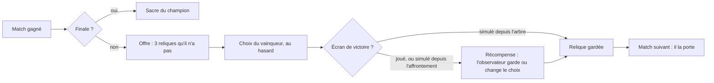

# Reliques

_Système livré en 0.75.0, première série de douze reliques en 0.77.0 (demandes de l'utilisateur du 2026-10-20), quatre reliques élémentaires en 0.85.0 (§ 12), le lot des consommateurs le 2026-10-24 (§ 13). Ce document est la maison des reliques : décisions, ce qui les sépare des compétences, règles, tournoi, interface, identité visuelle et grammaire d'illustration, catalogue mesuré, prompts d'images. Il réunit le travail d'exploration de l'autre agent (douze reliques, concepts d'illustration, revus par l'utilisateur) et le système livré : l'utilisateur a retenu ses reliques et son concept visuel._

**Une relique est un objet gagné en tournoi qui change le profil d'un combattant** : une stat, la valeur de ses coups, ou un effet à un moment précis. Après chaque victoire, le vainqueur en choisit une parmi trois ; après trois victoires, il en porte trois, et ce n'est plus tout à fait le même combattant. C'est la première « variable qui pèse sur l'issue » de la fiche produit ([INTENTION.md](INTENTION.md), principe 11).

## 1. Les demandes, et les décisions prises

| Demande ou décision de l'utilisateur | Mise en œuvre |
| --- | --- |
| Obtenues après chaque victoire de tournoi, 3 proposées parmi toutes | Une récompense par match gagné, **sauf la finale** (le tournoi est fini). Offre de 3 reliques **que le vainqueur n'a pas encore** : pas de doublon, donc au plus 3 reliques par combattant (huitièmes, quarts, demies) |
| Match simulé : le gagnant choisit au hasard, sauf si l'observateur décide autrement sur l'écran de victoire | Le choix du vainqueur est toujours tiré au hasard dans l'offre, à parts égales (`autoPick`). Sur l'écran de victoire (match joué, ou simulé depuis l'écran d'affrontement), l'observateur voit ce choix et peut en imposer un autre. Un match simulé depuis l'arbre n'a pas d'écran de victoire : le choix du vainqueur reste |
| Relique affichée à côté du nom pendant le combat, avec son infobulle | Rangée de sceaux entre le nom et les dés de compétence. Charges restantes en pastille, sceau éteint quand tout est dépensé, éclat quand elle agit ; depuis la 0.78.0, son label (type Relique) se pose aussi sous le dé, à l'instant où son bonus s'applique |
| Quatre types : stat de base à plat, bonus au jet ou effet sur un moment, au bout d'un certain tour, sous un seuil de PV | Quatre types : **Caractéristique**, **Coup**, **Tour**, **Seuil**, déduits de la définition (`relicKind`) |
| Recharge, charges, effet, description, image | `cooldown` (en tours du porteur), `charges` (déclenchements par combat), `effects` (les effets des compétences), description **rédigée depuis les données** (`describeRelic`), image peinte par id (`src/assets/icons/<id>.png`) |
| Le contenu : se fier au travail d'exploration de l'autre agent, pour le nombre et la description (2026-10-20) | **Douze reliques, trois par type** (§ 7), telles que proposées et revues. La série de test de la 0.75.0 (Brassard de fer, Pierre à aiguiser, Chandelle des heures, Fiole du dernier souffle) est retirée |
| Le concept visuel de l'autre agent est meilleur (2026-10-20) | Sa grammaire d'illustration est la règle (§ 6.2) : un objet immobile, patiné, avec son attache, la magie contenue, le chiffre de la règle lisible dans l'objet. Le sceau hexagonal natif reste le cadre (§ 6.1) |
| Identité visuelle : sceau, ou pastille octogonale à bord biseauté | **Hexagone biseauté** (jusqu'à la 0.91.1 ; depuis, l'objet peint seul, sans sertissage, § 6.1). L'octogone est déjà pris par les compétences (`SkillSeal`) et la pièce prestige, le rond par les statuts : une troisième forme dit « relique » sans lire |
| Montrer les reliques sur l'arbre du tournoi ? sur l'écran d'affrontement ? | **Les deux.** Affrontement : les parieurs doivent les voir, elles comptent dans les cotes. Arbre : petits sceaux à côté du nom, sur chaque match, avec les reliques qu'il avait pour ce match. Aussi : écran du champion, compendium, journal, trace |
| Aucune relique ne pose de malus sur l'adversaire, « visuellement en tout cas » | Une relique agit sur son porteur. Règle 7 du § 3, vérifiée par `validateRelics` |
| Deux dés (Fanchon) : « sur un 1 » validé si un des dés fait 1 ; le jet maximal est celui d'un seul dé | Chaque dé se lit seul. Règle 8 du § 3, vérifiée par un test |
| Une stat négative peut s'afficher sur la fiche, même traitée à 0 en combat (« c'est marrant ») | On ne borne pas : Cotte du mercenaire sur Morgrut = −8 % d'esquive affiché ; une esquive négative n'esquive jamais |
| Avec la phase de saison, les reliques apparaissent dès la saison : trois au plus, gagnées pendant les premiers matchs, plus pendant l'arbre ; puis le personnage se fige (2026-10-22). Correction : un personnage qui perd ses premiers matchs doit quand même avoir ses améliorations ; « alterner gain de relique et forge du dé à chaque victoire, jusqu'à trois de chacun » | **Construction** (0.92.0, corrigée en 0.92.1, § 4) : chaque victoire de saison rapporte au vainqueur sa récompense suivante, une relique choisie dans une offre de trois, en alternance avec une forge du dé si elle est activée, jusqu'à trois de chaque. Puis il se fige jusqu'à la fin du tournoi : l'arbre d'un tournoi à saison n'offre plus rien |
| Les descriptions sont trop compliquées : une information simple, qui dit quand elle agit et comment elle s'insère dans la résolution ; « +4 dégâts aux frappes de 4. Point. » ; pas de lore dans les infobulles ; si on ne sait pas dire quand elle se déclenche, c'est que la règle est ambiguë (2026-10-23) | **Une ligne par relique** (0.95.0, § 5.1), au vocabulaire fixe de [RESOLUTION.md](RESOLUTION.md) § 3 ; la phrase d'ambiance quitte l'infobulle et la carte de récompense (elle reste au compendium). Règle aplatie : **une relique de face lit le dé de tout coup**, coup brut de la Furie compris (avant : « pas sur les coups bruts ») |

## 2. Relique ou compétence : ce qui les sépare

Une compétence et une relique déclenchée se ressemblent dans le code : un déclencheur et des effets. Pour le spectateur, elles ne doivent jamais se confondre.

| | Compétence | Relique |
| --- | --- | --- |
| **À qui** | au personnage, pour toujours : c'est son identité | à l'objet : gagnée en tournoi, elle peut changer de main (dépouille, TODO § 16) |
| **Où** | sur une face de son dé (1, 2, 3, doubles) | dans un emplacement à côté du personnage, jamais sur le dé |
| **Ce qu'elle coûte** | souvent le coup du tour (`forfeitsHit`) | rien : elle ne prend jamais la place d'un jet ni d'un coup, elle s'ajoute |
| **Hasard** | peut avoir une chance de déclenchement (`chance`) | aucun tirage : si le moment arrive, elle agit |
| **Ordre** | dans une même fenêtre : statuts, puis compétences | **après** les compétences : la relique répond, elle n'initie pas |
| **Limite** | `limit` par combat | charges et recharge |
| **En combat** | s'annonce **sur le personnage** : texte flottant, aura, posture | s'annonce **sur son emplacement** : son sceau s'illumine dans l'en-tête, son label (type Relique, icône et nom) se pose sous le dé à l'instant où son bonus s'applique (0.78.0), puis l'effet arrive sur sa cible. Ni nom flottant au-dessus du porteur ni aura |

**Deux règles pour tout contenu futur.** Une relique **ne remplace jamais une face du dé** : si une idée a besoin de prendre la place d'un jet (sacrifier le coup, relancer le dé), c'est une compétence, ou une face à construire (« Construire son dé », TODO § 17). Une relique **ne pose jamais de malus sur l'adversaire** : c'est un objet porté, qui agit sur son porteur (son corps, ses coups, ses PV) ; les malus restent l'affaire des compétences.

## 3. Règles

Une relique est une donnée du registre `RELICS` (`src/game/relics.ts`), comme une compétence dans le roster. Elle n'est **pas un statut** : aucune purge ne la retire, aucune immunité ne la bloque, elle ne s'affiche pas dans la zone d'état.

| Type | Définition | Quand | Reliques |
| --- | --- | --- | --- |
| **Caractéristique** | `stats` : ajoutées à plat aux stats de base (`Character.stats` ; la base reste dans `baseStats`) | tout le combat | Contrepoids de plomb, Bottes de feutre, Cotte du mercenaire |
| **Coup** | `rollBonus` : ajouté à la valeur de chaque coup qui touche, avant le critique, éventuellement sur une seule face (`onFace`) ou sous conditions (`when`, 2026-10-24 : lues au coup qui touche, sur l'état du début du coup ; Fiole de venin, Croc de boucher). Ou `trigger: { type: 'strike', on }` : un moment du coup (1, 2, 3, jet maximal, touche, critique, esquivé, esquive, coup encaissé), ou le soin reçu (`healed`, 2026-10-24 : après l'étape qui lui rend des PV). Une face se lit sur tout coup, coup brut de Furie compris (2026-10-23) | sur ses coups | Osselet fendu, Dé creux, Fer à quatre clous ; le lot des consommateurs (§ 13) |
| **Tour** | `trigger: { type: 'turn', turn }` : au début de son `turn`-ième tour ; puis tous les `cooldown` tours, ou à chaque tour sans recharge, ou une seule fois avec une charge | début de son tour | Cloche d'ouverture, Chapelet de l'ermite, Clepsydre du siège |
| **Seuil** | `trigger: { type: 'hpBelow', ratio, who? }` : quand ses PV (ou ceux de l'adversaire, `who: 'opponent'`) passent sous `ratio` × PV max ; une fois par combat (`charges: 1`, les trois du registre depuis le 2026-10-21), ou, avec une recharge, réarmée quand ils remontent au-dessus | après une perte de PV | Dent de loup, Collier de ronces, Trophée du chasseur |

« Son tour » = un tour du porteur (`turnsTaken`), pas un tour du combat. Un combat dure environ 15 à 30 tours du combat, soit 8 à 15 tours pour chaque combattant.

Règles communes ([RESOLUTION.md](RESOLUTION.md) § 3 et § 5) :

1. **Elle répond, elle n'initie pas.** Dans une fenêtre, l'ordre est : réactions des statuts, compétences, puis reliques (ordre d'obtention).
2. **Aucun hasard.** Pas de `chance` : si le moment arrive et qu'elle est prête, elle agit. Sans déclenchement, un combat avec elle est identique au combat sans elle (test `combat.test.ts`).
3. **Charges** : déclenchements par combat (`charges`, illimité par défaut). **Recharge** : `cooldown` tours du porteur avant de repartir. **Conditions** : `when`, les mêmes que les compétences.
4. **Le bonus de coup ne change pas le jet.** Un 1 reste un 1 pour les compétences du dé ; seule la valeur du coup grandit. Un coup esquivé ou sacrifié n'en profite pas. Un bonus de face (`onFace`) ne vaut que pour le coup dont le dé fait cette face, coup brut compris : la Furie des vents ne déclenche aucune compétence, mais ses dés éveillent les reliques de face (2026-10-23 ; du 2026-10-21 au 2026-10-22, non).
5. **Seuil** : il part au passage sous le seuil (un coup, un poison, un effet), jamais sur le coup qui met K.O. Le passage se lit sur les PV du changement vérifié : deux reliques passées sous leur seuil par un même coup partent toutes les deux, même si la première soigne (0.85.0 : Larme de givre puis Trophée du chasseur adverse ; avant, le soin de la Larme effaçait le passage du Trophée). Il se réarme dès qu'un soin remonte les PV au-dessus du seuil (`rearmThresholds`), même si une perte les refait passer dessous avant la vérification suivante (vol de vie puis Riposte sur le même coup). Une recharge ou une condition fausse au moment du passage consomme ce passage. **Une relique de seuil a une charge ou une recharge** (2026-10-21, retour de l'utilisateur sur la Dent de loup) : sans l'une ni l'autre, chaque soin la réarmait et elle repartait à chaque nouvelle chute. L'audit (`audit.ts`, « relique de seuil sans limite ») le vérifie.
6. **Effets** : ceux des compétences (soin, dégâts directs, pose de statut, purge), du point de vue du porteur. Pas de relâche de jauges.
7. **Jamais de malus sur l'adversaire.** Un statut posé par une relique est un bonus de son porteur ; vers l'adversaire, seuls les dégâts directs. Permis aussi : un bonus qui réagit plus tard contre l'adversaire (les Épines du Collier de ronces font saigner l'attaquant quand il frappe : c'est l'effet des Épines, pas de la relique). `validateRelics` refuse tout le reste.
8. **Deux dés : chaque dé se lit seul.** « Sur un 1 » part dès qu'un des deux dés fait 1 (deux 1 l'éveillent deux fois) ; le jet maximal est celui d'un seul dé ; un bonus de face va au coup du dé qui l'a déclenché (le Fer renforce le coup du dé qui fait 4). Depuis la 0.107.0, chaque dé de la barde est un jet complet (face, compétence, coup) : plus de doubles, chaque jet ouvre ses moments.
9. **Une relique qui n'ajouterait rien ne part pas** (0.110.0, M4). Si tous ses effets seraient nuls (soin à PV pleins, statut déjà au plafond, malus bloqué par une immunité, purge sans rien à retirer et sans repli utile), elle ne se déclenche pas, ne dépense ni charge ni recharge. Une relique de seuil attend alors la vérification suivante, tant que son porteur reste sous le seuil. Une garde qui bloque s'use : ce n'est pas nul ; des dégâts ne le sont jamais.

La chronologie a une étape `relic` (porteur, relique, effets, rang du déclenchement) ; le bonus de coup est noté sur le coup (`Attack.relicBonus`). Le son se déduit des effets, comme pour une compétence ([SONS.md](SONS.md) § 4.2) : aucun son propre. Piste ouverte : un même déclic d'objet avant le son de l'effet, pour qu'on entende « relique » ; à décider dans SONS.md.

## 4. Le tournoi



- Tout se déduit des résultats : `MatchResult.relic = { offer, chosen }`, `relicsOf(tournoi, participant, avantLeTour)`. `matchFighters` arme les combattants avec les reliques gagnées aux tours précédents.
- `chooseRelic` change le choix ; refusé si la relique n'est pas dans l'offre, ou si le vainqueur a déjà joué son match suivant. `withResult` refuse un combat dont les reliques ne sont pas celles du match.
- Les cotes des paris sont simulées avec les combattants du match, reliques comprises ([PARIS.md](PARIS.md)).
- Le tournoi n'est pas persisté : les reliques non plus. L'historique (`battler:history:v1`) ne change pas.
- **Tournoi sans reliques** (demande de l'utilisateur, 2026-10-21) : l'interrupteur **Reliques** de l'écran de configuration (en haut, à côté des paris) désactive le système pour tout le tournoi. `createTournament(cases, nom, { relics: false })` pose `Tournament.relics = false` ; `withResult` ne tire alors aucune offre, donc aucun `MatchResult.relic`, et `relicsOf` reste vide : personne n'en porte, l'arbre, l'affrontement, l'écran de victoire (pas de Récompense) et le sacre n'en montrent aucune. Le choix est gardé pour le tournoi suivant de la session (en mémoire, comme les paris). Activé par défaut.
- **Après une saison** (0.92.0, règle corrigée en 0.92.1, demandes de l'utilisateur du 2026-10-22) : les reliques se gagnent pendant la **construction** de la saison (`season.ts`, [FEATURES.md](FEATURES.md) § 8), plus dans l'arbre. Chaque victoire de saison rapporte au vainqueur sa récompense suivante (`Season.rewards` : relique puis forge du dé si elle est activée, tour à tour), jusqu'à trois reliques : une offre de 3 reliques qu'il n'a pas, et son choix au hasard, tiré à la graine du match (`SeasonResult.reward`) ; l'écran de victoire d'un match regardé permet de l'imposer tant qu'il n'a pas rejoué (`chooseSeasonReward`). Sa construction (`buildOf`) le suit, figée, dans l'arbre (`Entrant.build`) : `relicsOf` commence par elle, `matchFighters` l'arme de ses reliques et de sa forge, et `withResult` ne tire aucune offre quand le tournoi a une saison. Avec la forge, le Contrepoids de plomb quitte le tirage, comme en campagne.

## 5. Interface

| Écran | Ce qu'on voit |
| --- | --- |
| **Combat** (`HpBar`) | sceaux de 36 px entre le nom et les dés de compétence ; infobulle au survol (nom, type, sa ligne de règle, ses limites, statut posé, charges restantes ; plus de phrase d'ambiance depuis la 0.95.0) ; pastille des charges ; sceau éteint quand il est dépensé. Quand elle agit, **son sceau s'illumine** et, au même instant, son label (type Relique : plaque sombre au liseré d'or, icône, « Fer à quatre clous +4 ») se pose sous le dé (0.78.0, `onShow` de `showEffects`) ; l'effet arrive sur sa cible (badges, soin, dégâts directs en coups sans élan) : ni nom flottant au-dessus du porteur ni aura (§ 2). Journal en or (« Relique · … ») |
| **Affrontement** | sceaux de 44 px sous les dés de compétence ; la fiche de stats passe en or la valeur changée par une relique (infobulle : la valeur sans elle) |
| **Écran de victoire** (tournoi, hors finale) | le bouton principal devient **Récompense** : menu superposé, trois grandes cartes (sceau, nom, type, ligne de règle, limites ; sans phrase d'ambiance depuis la 0.95.0), la carte du vainqueur marquée « Choix de… », un clic sur une autre pour décider à sa place, rappel des reliques déjà portées ; **Continuer** (ou **Imposer ce choix**) mène à l'arbre ; **← Combat** revient au bilan |
| **Arbre** | sceaux de 18 px à côté du nom, sur chaque match : les reliques qu'il avait pour ce match. Colonnes des tours 2 et 3 élargies (168 → 184 px). Une seule infobulle à la fois, celle du sceau survolé (groupe nommé `group/relic` : un `group-hover` nu s'ouvrait au survol de la ligne et superposait toutes les infobulles du combattant, corrigé le 2026-10-21) ; au-dessus de la ligne du haut, au-dessous de celle du bas, retournée si elle sortait de la scène |
| **Configuration du tournoi** | interrupteur **Reliques** (sceau, Activées / Désactivées, curseur) : § 4 |
| **Champion** | ses reliques sous son nom |
| **Compendium** | section Reliques (index par type, détail : la phrase d'ambiance sous le nom, seul endroit où elle reste ; une case « Règle » avec sa ligne, ses limites et ses statuts) |
| **Trace** | en-tête « Reliques (gauche, Gorak) : id « nom » (règle) ; … », relu par `npm run logs` pour rejouer ; chaque déclenchement et chaque bonus de coup |

### 5.1 La règle en une ligne (0.95.0)

`describeRelic` rédige chaque relique depuis ses données : **moment : effet**, puis ses limites à part. Le vocabulaire porte la résolution (« à ce coup » : avant le critique, le même mot pour tout bonus de coup depuis la 0.110.0, « à la frappe » avant ; « dégâts directs » : ni coup ni armure ; « Sur un 1 » : la face du dé, quel que soit le coup), défini une fois dans [RESOLUTION.md](RESOLUTION.md) § 3. Un statut posé est le bonus de son porteur (« +2 Armure temporaire ») ; des dégâts directs sur un coup reçu ou esquivé vont « à l'attaquant » (0.110.0, A3). Une exception se dit là où elle naît (l'Incantation remplace le dé ; une esquive négative n'esquive jamais), jamais sur la relique. Une relique de tour à une charge ne dit pas « une fois » : son moment (« Au 4e tour ») le dit déjà.

| Relique | Ligne | Limites |
| --- | --- | --- |
| Contrepoids de plomb | +1 au multiplicateur de critique, −4 % de critique (0.105.0 ; +2 faces au dé avant) | |
| Bottes de feutre | +6 % d'esquive | |
| Cotte du mercenaire | +1 armure, −5 % d'esquive (0.106.1 ; +2 armure, −8 % avant) | |
| Osselet fendu | Sur un 1 : 3 dégâts directs | |
| Dé creux | Sur un 6 : +1 Esquive améliorée (0.110.0 ; « Sur un jet maximal » avant, un mot des dés variables) | recharge 3 tours |
| Fer à quatre clous | Sur un 4 : +4 dégâts à ce coup (0.105.0 : un événement, plus une face enrichie ; 0.106.0 : +4 au coup de base d'un jet de 4) | |
| Cloche d'ouverture | Au 1er tour : +1 Critique assuré | |
| Chapelet de l'ermite | Tous les 3 tours : retire son dernier malus, sinon +3 PV | |
| Clepsydre du siège | Au 6e tour, puis tous les 4 tours : +1 Critique assuré (0.105.0 ; une Aura de puissance cumulée avant) | |
| Dent de loup | Sous 40 % PV : +1 Vol de vie (0.107.0 ; +2 avant) | 1 fois par combat |
| Collier de ronces | Sous 50 % PV : +2 Épines acérées | 1 fois par combat |
| Trophée du chasseur | Adversaire sous 30 % PV : +1 Critique assuré | 1 fois par combat |
| Braise captive | Au 4e tour : 3 × 2 dégâts directs | |
| Larme de givre | Sous 35 % PV : retire tous ses malus, +5 PV | 1 fois par combat |
| Conque des vents | Quand il esquive : 3 × 2 dégâts directs à l'attaquant (0.110.0 : « à l'attaquant » ajouté) | 2 fois par combat |
| Géode fendue | Quand il encaisse un coup : +4 Armure temporaire | 2 fois par combat, recharge 3 tours |
| Fiole de venin | Si l'adversaire porte Poison : +2 dégâts à ce coup (2026-10-24, § 13 ; « à la frappe » jusqu'à la 0.109.1) | |
| Croc de boucher | Si l'adversaire porte Saignement : +2 dégâts à ce coup | |
| Encens de l'abbaye | Quand il regagne des PV : +1 Ferveur | |
| Écu cabossé | Quand il encaisse un coup de 6 PV ou plus : +2 Armure temporaire (0.110.0 ; « Quand il encaisse un coup, si ce coup retire 6 PV ou plus » avant) | |
| Plume d'aigle | Quand il porte un critique : +1 Esquive améliorée | recharge 2 tours |

Mesure de la règle aplatie (seul Gorak a des coups bruts ; 600 combats par duel contre le roster, mêmes graines, 2026-10-23) : Gorak nu 50,9 % ; Osselet fendu 58,1 → 59,6 % ; Dé creux 61,0 → 62,6 % ; Fer à quatre clous 60,0 → 61,6 % ; face dorée (forge) sur le 8 : 55,1 → 55,9 %, sur le 4 : 55,7 → 56,7 %. Environ +1 à +1,6 point, Gorak seul, dans la cible de 5 à 15 points.

## 6. Identité visuelle

### 6.1 L'objet seul, sans sertissage

**Depuis la 0.91.1 (décision de l'utilisateur) : aucun conteneur CSS visible.** Le graphisme de la relique porte tout son poids visuel : pas de sceau, de cadre, de plaque ni de forme découpée. `RelicSeal` (`.relic-seal` dans `index.css`) ne pose que l'icône peinte détourée (`src/assets/icons/<id>.png`), qui occupe tout son carré, avec une ombre portée qui suit sa silhouette ; son initiale gravée en or en attendant. Restent : l'éclat d'or au déclenchement, l'extinction quand ses charges sont dépensées, la pastille des charges. Tailles : 22 (arbre), 40 à 48 (combat, infobulle, campagne, listes du compendium), 56 (affrontement, champion), 128 (compendium), 140 (carte de récompense).

Ce qui dit « relique » sans cadre : **c'est un objet** (§ 6.2), alors que la compétence a son sceau octogonal et le statut sa pièce gravée ronde. Avant la 0.91.1, l'hexagone biseauté (cadre d'or, plaque de cuir) jouait ce rôle.

Pas de couleur de type : la distinction bonus vert / malus rouge des statuts reste seule (refus de l'utilisateur, « c'est carnaval », FAMILLES.md § 3). **Le type se lit dans l'objet** (§ 6.3).

### 6.2 L'illustration : un objet qui attend

| | Compétence | Relique |
| --- | --- | --- |
| **Sujet** | un **geste** ou un **effet** en train d'avoir lieu : lame qui pare, éclair qui tombe, griffe qui lacère, halo qui rayonne | un **objet**, immobile, qu'on pourrait ramasser |
| **Mouvement** | trajectoires, éclats, traînées | aucun : nature morte, pas de main, pas d'impact |
| **Magie** | elle jaillit (flammes, ondes, rayons) | elle est **contenue** : une lueur à l'intérieur de l'objet, rien qui en sort |
| **Cadrage** | serré sur l'action | l'objet **entier**, vu de trois quarts, avec son **attache** (lanière, chaîne, cordon, crochet) : on voit qu'il se porte |
| **Âge** | neuf, au présent | **patiné** : usé, cabossé, réparé, avec la trace d'un ancien porteur. C'est ce qui raconte le tournoi et la dépouille |

Une icône de compétence montre souvent un objet aussi (la montre de l'Attente). La différence tient alors à l'état : l'objet d'une compétence **agit** ; l'objet d'une relique **attend**. L'image ne contient que l'objet, détouré, sans cadre ni fond, et s'affiche telle quelle (§ 6.1) : sa silhouette doit se lire seule, à 22 px comme à 140.

### 6.3 Le chiffre de la règle se lit dans l'objet

Chaque type a sa famille d'objets, et le nombre qui règle la relique y est dessiné, pour qu'un spectateur devine son type avant de lire sa fiche :

| Type | Famille d'objets | Ce qu'on y lit |
| --- | --- | --- |
| **Caractéristique** | équipement qu'on porte, montré sans porteur (pommeau, bottes, cotte) | rien à compter : il agit en permanence |
| **Coup** | objets de hasard (osselet, dé, fer porte-bonheur) | **la face** qui la déclenche, gravée ou comptée (le point unique, la couronne du jet maximal, les quatre clous) |
| **Tour** | objets qui marquent le temps (cloche, chapelet, clepsydre) | **l'intervalle** : des repères, des grains, des graduations en nombre égal aux tours |
| **Seuil** | contenants et talismans qui gardent quelque chose jusqu'à la rupture (dent en cage, collier fendu, mâchoire à encoches) | **le seuil** : une fêlure ou une encoche placée à la hauteur de la part de PV (une dent fêlée aux quatre dixièmes pour 40 %) |

## 7. Les douze reliques (0.77.0)

Mesure : apport en points de taux de victoire contre le roster sans relique (`npm run relics`, 400 combats par duel, mêmes graines avec et sans), le 2026-10-20, roster de la 0.76.0 (druide aux trois éclairs). Cible : 5 à 15 points, 20 au plus ([TODO.md](TODO.md) § 16).

| Relique | Type | Règle | Apport moyen | Écart entre personnages | Déclenchements par combat |
| --- | --- | --- | --- | --- | --- |
| Contrepoids de plomb (`lead-pommel`) | Caractéristique | +2 faces au dé de dégâts | +13,2 | Ysolde +1,3 à Fanchon +20,9 | permanent |
| Bottes de feutre (`felt-boots`) | Caractéristique | +6 % d'esquive | +6,1 | Brokk +4,9 à Gorak +6,9 | permanent |
| Cotte du mercenaire (`mercenary-mail`) | Caractéristique | +2 armure, −8 % d'esquive | **+18,1** | Elaria +12,6 à Ysolde +22,2 | permanent |
| Osselet fendu (`split-knucklebone`) | Coup | sur un 1 : 3 dégâts directs | +7,9 | Morgrut +4,5 à Fanchon +18,0 | 1,1 |
| Dé creux (`hollow-die`) | Coup | jet maximal : Esquive améliorée ; recharge 3 tours | +13,0 | Morgrut +6,5 à **Fanchon +25,9** | 0,9 |
| Fer à quatre clous (`four-nail-shoe`) | Coup | sur un 4 : +4 à ce coup, avant le critique | +9,0 | Thaldrin +3,6 à Fanchon +19,2 | 1,0 |
| Cloche d'ouverture (`opening-bell`) | Tour | 1er tour, une fois : Critique assuré | +11,9 | Ysolde +4,3 à Morgrut +17,4 | 1,0 |
| Chapelet de l'ermite (`hermit-beads`) | Tour | 3e tour, puis tous les 3 : retire son dernier malus, sinon +3 PV | **+16,3** | Morgrut +12,5 à Ysolde +20,3 | 3,0 |
| Clepsydre du siège (`siege-clepsydra`) | Tour | 6e tour, puis tous les 4 : Aura de puissance, cumulée | +12,8 | Naraxes +9,2 à Fanchon +15,0 | 1,3 |
| Dent de loup (`wolf-fang`) | Seuil | sous 40 %, se réarme : Vol de vie 2 | **+21,4** | Ervald +15,6 à Fanchon +24,1 | 1,6 |
| Collier de ronces (`bramble-collar`) | Seuil | sous 50 %, une fois : Épines acérées 2 | +13,8 | Naraxes +10,2 à Gorak +17,2 | 0,9 |
| Trophée du chasseur (`hunter-trophy`) | Seuil | adversaire sous 30 %, une fois : Critique assuré | +8,4 | Thaldrin +4,8 à Morgrut +11,9 | 0,8 |

**Sur le d6 imprimé (0.105.0)**, même mesure (`npm run relics`, 400 combats par duel, roster de la 0.105.0) :

| Relique | Apport moyen | Écart entre personnages |
| --- | --- | --- |
| Contrepoids de plomb (+1 au multiplicateur, −4 % de critique) | +3,5 | Fanchon −3,2 à Elaria +17,2 |
| Bottes de feutre | +7,2 | Morgrut +5,7 à Ysolde +8,6 |
| Cotte du mercenaire | **+22,1** | Aldric +13,4 à Thaldrin +26,0 |
| Osselet fendu | +11,0 | Naraxes +7,4 à Fanchon +18,3 |
| Dé creux | +17,0 | Morgrut +12,4 à Fanchon +28,8 |
| Fer à quatre clous | +12,7 | Thaldrin +6,3 à Fanchon +18,9 |
| Cloche d'ouverture | +13,9 | Fanchon +9,3 à Brokk +20,7 |
| Chapelet de l'ermite | +17,3 | Morgrut +14,4 à Elaria +19,6 |
| Clepsydre du siège (Critique assuré, tous les 4 tours) | +15,6 | Fanchon +8,1 à Brokk +25,4 |
| Dent de loup | **+20,3** | Ervald +12,0 à Ysolde +23,0 |
| Collier de ronces | +10,8 | Naraxes +6,9 à Gorak +15,4 |
| Trophée du chasseur | +10,3 | Naraxes +6,5 à Morgrut +15,2 |
| Braise captive | +13,9 | Naraxes +10,2 à Thaldrin +17,2 |
| Larme de givre | +13,1 | Morgrut +10,4 à Fanchon +17,3 |
| Conque des vents | +7,3 | Morgrut +0,0 à Elaria +23,1 |
| Géode fendue | +16,1 | Aldric +9,1 à Fanchon +20,3 |

**Lecture (0.105.0).** Le d6 rend les reliques de face plus fortes pour tous (une face sur six au lieu d'une sur sept à quatorze). La Clepsydre, devenue un Critique assuré, vaut le plus à ceux qui frappent fort (Brokk ×2,5) et à Morgrut, qui n'a aucun critique à lui. Le Contrepoids, devenu une relique de critique, est typé : il ne sert qu'à ceux qui critiquent souvent (Elaria +17,2), il gêne la barde. La Cotte et la Dent de loup restent au-delà de 20, comme en 0.77.0.

**Sur l'attaque de base (0.106.0)**, même mesure (`npm run relics`, 400 combats par duel, roster de la 0.106.0) ; avant → après :

| Relique | 0.105.0 → 0.106.0 |
| --- | --- |
| Contrepoids de plomb | +3,5 → +3,9 |
| Bottes de feutre | +7,2 → +7,1 |
| Cotte du mercenaire | +22,1 → **+28,2** |
| Osselet fendu | +11,0 → +9,7 |
| Dé creux | +17,0 → +14,0 |
| Fer à quatre clous | +12,7 → +12,9 |
| Cloche d'ouverture | +13,9 → +10,5 |
| Chapelet de l'ermite | +17,3 → +16,7 |
| Clepsydre du siège | +15,6 → +12,1 |
| Dent de loup | +20,3 → +18,6 |
| Collier de ronces | +10,8 → **+16,9** |
| Trophée du chasseur | +10,3 → +10,1 |
| Braise captive | +13,9 → +13,6 |
| Larme de givre | +13,1 → +13,4 |
| Conque des vents | +7,3 → +8,7 |
| Géode fendue | +16,1 → +16,2 |

**Lecture (0.106.0).** Deux reliques bougent nettement : la **Cotte du mercenaire** monte de +22,1 à **+28,2**, hors de la cible de 20 au plus ; le **Collier de ronces** monte de +10,8 à +16,9. Les autres restent à moins de 4 points de leur valeur d'avant. La Dent de loup repasse sous 20 (+18,6). Le Fer à quatre clous garde sa valeur (+12,9) en ajoutant ses +4 au coup de base d'un 4.

**Cotte du mercenaire baissée (0.106.1, décision de l'utilisateur)** : +1 armure, −5 % d'esquive, le repli prévu dès la 0.77.0. Mesurée (`npm run relics`, 400 combats par duel) : **+28,2 → +13,7**, dans la cible ; d'Aldric +7,1 à Morgrut +20,9, qui n'a pas d'esquive à perdre.

**Revue des compétences (0.107.0)**, même mesure (`npm run relics`, 400 combats par duel, roster de la 0.107.0) ; avant → après (avant : le log de la 0.106.0, la Cotte à sa valeur de la 0.106.1) :

| Relique | 0.106.x → 0.107.0 |
| --- | --- |
| Contrepoids de plomb | +3,9 → +4,0 |
| Bottes de feutre | +7,1 → +7,9 |
| Cotte du mercenaire | +13,7 → +14,6 |
| Osselet fendu | +9,7 → +9,9 |
| Dé creux | +14,0 → +15,8 |
| Fer à quatre clous | +12,9 → +13,6 |
| Cloche d'ouverture | +10,5 → +12,8 |
| Chapelet de l'ermite | +16,7 → +17,6 |
| Clepsydre du siège | +12,1 → +13,2 |
| Dent de loup | +18,6 → **+22,0** ; +1 Vol de vie : **+12,4** |
| Collier de ronces | +16,9 → +17,3 |
| Trophée du chasseur | +10,1 → +11,4 |
| Braise captive | +13,6 → +15,1 |
| Larme de givre | +13,4 → +14,5 |
| Conque des vents | +8,7 → +9,4 |
| Géode fendue | +16,2 → +18,8 |

**Lecture (0.107.0).** Tout monte d'environ 1 point, le roster s'étant resserré. Seule la **Dent de loup** passe au-delà de 20 (+22,0) : la compétence Vol de vie ne pose plus qu'1 charge, la relique en posait encore 2. Corrigée à **+1 Vol de vie** : **+12,4**, d'Elaria +10,7 à Morgrut +16,1. Les quinze autres restent entre +4,0 (Contrepoids) et +18,8 (Géode fendue).

**Lecture.**
- Neuf sur douze dans la cible ; trois au-dessus de 15 : Cotte +18,1, Chapelet +16,3, Dent de loup **+21,4** (au-delà de 20).
- **Fanchon est la grande gagnante des reliques de coup** (Dé creux +25,9, Contrepoids +20,9, Fer +19,2, Osselet +18,0) : ses deux petits dés lancent deux fois plus de faces par tour, donc éveillent deux fois plus souvent une relique de face. C'est la règle 8 qui le veut ; c'est aussi une méta lisible (« la barde aux talismans »).
- **Ysolde** gagne le plus aux reliques qui font durer (Dent de loup +23,7, Cotte +22,2, Chapelet +20,3) et presque rien au Contrepoids (+1,3) : un dé plus grand déclenche moins souvent son Aura de sainteté. C'est le « vrai choix » que la proposition annonçait.

**Réglages proposés, à valider** (valeurs de la proposition gardées en attendant) :

| Relique | Proposition | Effet attendu (estimé, à mesurer) |
| --- | --- | --- |
| Dent de loup (+21,4) | ~~ne se réarme plus (`charges: 1`), ou seuil à 35 %~~ **fait le 2026-10-21** : une seule fois par combat (`charges: 1`), retour de l'utilisateur | sous 15 points (non remesuré) |
| Cotte du mercenaire (+18,1) | le repli prévu par la proposition : +1 armure, −5 % d'esquive | de l'ordre de +10 |
| Chapelet de l'ermite (+16,3) | repli de soin 3 → 2 PV | −2 à −3 points |
| Dé creux sur Fanchon (+25,9) | recharge 3 → 4 tours | baisse surtout pour Fanchon |

**Effet boule de neige** : en additionnant, trois reliques vaudraient de l'ordre de +35 à +45 points contre un combattant nu (estimation, non mesurée ensemble). En tournoi, l'adversaire d'un tour avancé en a autant ; à mesurer (duel 3 reliques contre 3).

### 7.1 Caractéristique : une stat de base, en permanence

#### Contrepoids de plomb
- **Règle** : +1 au multiplicateur de critique, −4 % de critique (0.105.0). Jusqu'à la 0.104.x : +2 faces à son dé de dégâts.
- **Pourquoi (0.105.0)** : le d6 imprimé ne change plus de taille ; l'ancienne règle n'a plus d'objet (`validateRelics` refuse `stats.damageDie`). La relique garde son idée de poids : des coups plus rares à porter, plus lourds quand ils portent. Un **troc**, comme la Cotte : un vrai gain pour qui critique souvent (Elaria +17,2), une perte pour qui critique peu (Fanchon −3,2). Moyenne +3,5 : sous la cible, à surveiller.
- **Pourquoi (0.77.0, ancienne règle)** : la seule stat qui changeait aussi la fréquence des compétences ; un dé plus grand frappait plus fort, mais déclenchait moins souvent.
- **Illustration** : un pommeau ou un contrepoids de plomb, rond et lourd, cerclé d'une bague de fer, avec le trou du rivet par où on le fixe à une arme. Marques de lime.
- **Avec la forge du dé** : de la 0.88.0 à la 0.104.x, elle devenait l'opération **Agrandir** et quittait le tirage des reliques (`FORGE_RELIC_IDS`, supprimé). Depuis la 0.105.0, elle est dans toutes les offres.

#### Bottes de feutre
- **Règle** : +6 % d'esquive.
- **Pourquoi** : la défense de ceux qui n'en ont pas. Morgrut (0 %) commence à esquiver ; Elaria (26 %) monte à 32 %. Mesurée plus sage que prévu (+6,1, de +4,9 à +6,9) : une relique de fond, régulière.
- **Illustration** : une paire de bottes souples, semelles de feutre usées au talon, lacets dénoués qui pendent. Posées, vides.

#### Cotte du mercenaire
- **Règle** : +1 armure, −5 % d'esquive (0.106.1 ; +2 armure, −8 % d'esquive de la 0.77.0 à la 0.106.0).
- **Pourquoi** : la première relique à **troc**. Elle ne vaut pas la même chose pour tout le monde : gain pur pour Morgrut (pas d'esquive à perdre, sa fiche affiche −5 %, +20,9), moins bon pour Aldric (+7,1). Le choix automatique devra le savoir (goût, synergie : TODO § 16). Le repli prévu (+1 armure, −5 %) est appliqué en 0.106.1 : avec un coup à chaque jet, chaque point d'armure retire un dégât à chaque action adverse (+28,2 en 0.106.0).
- **Illustration** : une cotte de mailles roulée en boule, sanglée par une ceinture de cuir, quelques anneaux arrachés et remplacés par d'autres, plus clairs.

### 7.2 Coup : une valeur de dé précise

Toutes trois respectent la règle du § 2 : la compétence de la face part normalement, la relique s'ajoute **après** elle.

#### Osselet fendu
- **Règle** : sur un 1 : 3 dégâts directs à l'adversaire.
- **Pourquoi** : le mauvais jet mord quand même. Pour les autres, le 1 porte une compétence : la relique la double ; pour Morgrut, dont les six faces sont nues depuis la 0.106.0, elle s'ajoute à son coup de base (de la 0.35.0 à la 0.105.0, elle donnait un effet au tour vide de son Attente). Le petit dé en profite le plus (Fanchon +18,0 en 0.77.0).
- **Illustration** : un osselet de mouton, fendu en long, la face creuse gravée d'un seul point. Percé, sur un cordon de cuir noué.

#### Dé creux
- **Règle** : sur un 6 (le jet maximal du d6) : Esquive améliorée (le prochain coup reçu est esquivé à coup sûr). Recharge : 3 tours.
- **Pourquoi** : le jet parfait laisse le porteur en garde, sans rien poser sur l'adversaire. Presque un tour sur deux pour Fanchon (deux d5 : 9 lancers sur 25 ont au moins un 5), d'où la recharge, encore trop courte pour elle (+25,9). Pour Elaria, qui a déjà l'Esquive améliorée sur un 2, elle se cumule depuis le 2026-10-21 (une esquive imposée par charge) ; avant, elle ne faisait que la renouveler.
- **Illustration** : un dé cubique d'os, évidé et léger, posé sur sa face la plus haute, qui porte une couronne gravée à la place des points. Une petite chaîne passée dans un coin percé. Un cube, pour ne pas doubler l'icône `dice` (dé à vingt faces).

#### Fer à quatre clous
- **Règle** : sur un 4 : +4 au coup de base de ce jet, avant le critique (0.106.0 ; avant, +4 à la valeur imprimée de la face 4). Affichée « Sur un 4 : +4 dégâts à ce coup » depuis la 0.105.0 (« +4 dégâts aux frappes de 4 » de la 0.95.0 à la 0.104.x) ; un 4 de Furie des vents compris depuis le 2026-10-23.
- **Pourquoi** : un **événement** (retour de l'utilisateur, 2026-10-23) : quand le dé tombe sur 4, le coup prend +4 ; rien n'est marqué sur le dé, comme l'Osselet sur le 1. Depuis la 0.106.0, chaque jet porte un coup de base : le 4 frappe pour tous (le druide sous ses deux formes compris), que sa face porte une compétence ou non. Pour Fanchon, le bonus va au coup du dé qui a fait 4. Moteur : `rollBonus: 4, onFace: 4` (0.77.0). Mesuré : +12,7 → +12,9 (0.106.0).
- **Illustration** : un fer à cheval étroit, percé de quatre trous seulement, quatre clous encore plantés. Pendu à un clou par une ficelle. Pas de chiffre écrit : les quatre clous le disent.

### 7.3 Tour : au bout d'un certain nombre de ses tours

#### Cloche d'ouverture
- **Règle** : au début de son 1er tour, une fois : Critique assuré.
- **Pourquoi** : la relique de l'entrée en matière. Elle vaut le plus pour les gros multiplicateurs (Brokk et Aldric ×2,5) et pour Morgrut (0 % de critique : c'est son seul critique possible, +17,4). Le critique assuré attend le premier coup qui touche : un 1 à 3 au premier tour ne le gaspille pas.
- **Illustration** : une petite cloche de bronze, battant immobile, une seule encoche gravée sur la robe. Suspendue à une lanière.

#### Chapelet de l'ermite
- **Règle** : au début de son 3e tour, puis tous les 3 tours : retire son dernier malus ; s'il n'en a aucun, regagne 3 PV.
- **Pourquoi** : la réponse lente aux afflictions (Poison d'Ervald, Saignement de Gorak et Brokk, Brûlure du druide, Peur d'Ysolde, Fausse note de Fanchon). Le repli en soin évite le tour à vide. Un tic régulier, qui purge.
- **Illustration** : un chapelet de grains de bois, trois grains plus gros que les autres, un fermoir d'os. Enroulé sur lui-même.

#### Clepsydre du siège
- **Règle** : au début de son 6e tour, puis tous les 4 tours : Critique assuré (son prochain coup qui touche est critique) (0.105.0).
- **Pourquoi** : une montée de tension qui borne les combats longs (TODO § 14), portée par le porteur au lieu d'un malus sur l'adversaire. Jusqu'à la 0.104.x, elle posait une Aura de puissance cumulée (+2, +4, +6 aux coups) ; l'utilisateur l'a trouvée trop abstraite, et l'aura s'affichait comme une compétence dans la barre de compétences. Le Critique assuré se lit tout seul (un statut de la zone d'état, déjà posé par la Cloche et le Trophée). Mesuré +15,6 (Brokk +25,4, Morgrut +21,4, qui n'a aucun critique à lui ; Fanchon +8,1).
- **Illustration** : une petite clepsydre de bronze, un bol percé au fond, trois graduations gravées à l'intérieur, l'eau arrêtée à la deuxième. Une anse de cuir. Pas un sablier : le sablier est déjà l'icône `turns`.

### 7.4 Seuil : à un niveau de PV

Une relique de seuil se réarmait quand les PV remontaient au-dessus : sans charge, les soigneurs la déclenchaient plusieurs fois (Dent de loup sur Ysolde +23,7). Depuis le 2026-10-21, les trois reliques de seuil ne partent qu'une fois par combat.

#### Dent de loup
- **Règle** : quand ses PV passent sous 40 % : Vol de vie, 1 charge (son prochain coup qui touche lui rend les PV qu'il retire). Une fois par combat. De la 0.77.0 à la 0.106.1 : 2 charges.
- **Pourquoi** : le retour qui se mérite. À l'inverse d'un soin net, il faut toucher pour se soigner. Ervald, qui pose déjà le Vol de vie sur un 2, plafonne à 2 charges. **0.107.0** : le Vol de vie d'Ervald passe à 1 charge, la relique monte à +22,0 avec ses 2 charges, au-delà de 20 ; à 1 charge, **+12,4** (d'Elaria +10,7 à Morgrut +16,1). En 0.77.0, la plus forte des douze (+21,4), mesurée quand elle se réarmait.
- **2026-10-21, une seule fois** (retour de l'utilisateur : « elle ne se déclenche qu'une fois ») : elle se réarmait dès qu'un soin, son propre Vol de vie compris, remontait le porteur au-dessus de 40 %, et repartait à la chute suivante. Sur les traces de l'utilisateur, Aldric l'a déclenchée deux fois dans un combat (`2026-10-20_22-55-49_aldric-vs-morgrut`, tours 9 et 15). Dans un duel de test où chaque coup rend 1 PV et en retire 1, elle partait 187 fois ; maintenant une seule (`combat.test.ts`).
- **Illustration** : une canine de loup enfermée dans une petite cage de fil de fer, la dent fêlée aux quatre dixièmes de sa hauteur. Sur un cordon.

#### Collier de ronces
- **Règle** : quand ses PV passent sous 50 %, une fois : 2 Épines acérées (chaque coup encaissé fait saigner l'attaquant), pour le reste du combat. Les Épines ne répondent pas au coup qui fait passer le seuil : elles répondent dès le coup suivant, même le coup suivant d'une rafale (RESOLUTION règle 9, 2026-10-21).
- **Pourquoi** : acculé, il devient dangereux à frapper. Gros gain contre ceux qui frappent souvent (Fanchon et ses deux dés, la Furie de Gorak) ; pour Brokk, qui porte déjà les Épines, les charges s'ajoutent. Une seule fois : sans charge, un soigneur empilerait les épines à chaque passage.
- **Illustration** : un collier de ronce séchée tressée, refermé sur un médaillon de bois fendu par le milieu.

#### Trophée du chasseur
- **Règle** : quand les PV de **l'adversaire** passent sous 30 % : Critique assuré (son prochain coup qui touche est critique). Une fois.
- **Pourquoi** : le seuil vu de l'autre côté, le coup de grâce. La relique lit les PV de l'adversaire mais n'agit que sur son porteur. Elle raccourcit les fins de combat et crée des retournements qu'on voit venir. Moteur : `hpBelow` avec `who: 'opponent'` (0.77.0).
- **Illustration** : une mâchoire de bête pendue à la ceinture par un lacet de cuir, quatre encoches taillées sur l'os, la dernière à peine commencée.

## 8. Mesurer une relique

```sh
npm run relics                 # 400 combats par duel (≈ 50 s pour douze reliques)
RELICS_N=800 npm run relics    # plus précis
```

`scripts/relics.report.ts` : pour chaque relique et chaque personnage, `winRate` (analysis.ts) avec la relique, puis sans, sur les mêmes graines ; l'écart est son apport. Rapport dans `logs/relics/`. Une relique se mesure avant d'être livrée, et sa valeur se règle d'abord par ses nombres (bonus, seuil, charges, recharge), jamais par les PV des personnages ([EQUILIBRAGE.md](EQUILIBRAGE.md)).

## 9. Ajouter une relique

1. Vérifier l'idée contre le § 2 (jamais une face du dé, jamais de malus sur l'adversaire) et le § 3.
2. Une entrée dans `RELICS` (`relics.ts`) : `id` en kebab-case anglais, `name`, `flavor` (une phrase d'ambiance, sans emoji), et **un seul** type : `stats`, `rollBonus` (avec `onFace` au besoin), ou `trigger` + `effects` (avec `when`, `charges`, `cooldown` au besoin). `validateRelics` refuse le reste.
3. Son illustration, selon le § 6 : une ligne de plus dans la planche du § 10, puis `src/assets/icons/<id>.png`. Sans elle, l'initiale s'affiche.
4. `npm run check`, puis `npm run relics` ; noter la mesure au § 7.
5. Une mécanique de relique nouvelle (un nouveau type de déclencheur) arrive avec son test dans `combat.test.ts` et son contrôle dans `auditRelics` (`audit.ts`).

## 10. Images : la planche des douze

C'est la planche B de la liste unique des icônes à générer (STYLE_BIBLE § 7, « Icônes à générer ») : elle a sa propre planche, parce que la grammaire d'une relique (objet immobile, sans halo) ne se mélange pas avec celle des compétences, des statuts ou des boutons. Une planche de 12 icônes (grille 4 × 4, la dernière rangée vide), au gabarit de [STYLE_BIBLE.md](STYLE_BIBLE.md) § 7 ; joindre une ou deux planches d'icônes précédentes comme référence de style. Les motifs sont ceux du § 7, dans la grammaire du § 6 ; aucun ne double une icône de l'inventaire (le sablier est `turns`, le d20 `dice`, l'écu l'Armure temporaire).

```text
Create a single square image, 1024x1024, containing a sprite sheet of 12 game UI icons
arranged in a strict 4x4 grid (4 columns, 4 rows). Each icon is centered in its own
invisible cell (1/4 of the width and height), occupies about 70% of the cell,
and never touches or overlaps the cell borders. Leave clear empty space between icons,
glows included. The last 4 cells (the whole fourth row) stay completely EMPTY.

BACKGROUND: fully transparent, real alpha channel. Do NOT paint a checkerboard pattern.
If transparency is not possible, use a perfectly flat, uniform pure black background (#000000)
with no gradient, no texture, no vignette.
NO grid lines, NO frames, NO labels, NO numbers, NO letters, NO text anywhere.

STYLE: exactly the same style, materials, lighting and scale as the attached icon sheets.
Original high-fantasy game UI icons, hand-painted stylized fantasy, in the style of
premium MMORPG interface icons. Single object per icon, bold and simple silhouette that
stays readable at 20x20 pixels, thick shapes, no thin details, no circular or square frame.
Crisp painted highlights, dark brown outline-like shading for contrast.
Dominant materials: aged iron, lead, worn dark leather, old bone, warm bronze, dried wood.
Consistent lighting from the top-left, same level of detail, same scale as the attached sheets.
AVOID: emoji look, flat vector clip-art, cute or cartoon style, glossy plastic,
3D render, photorealism, drop shadows outside the object, text, real-world religious symbols.

RELICS: every icon is a RELIC, a worn object that a champion carries from fight to fight.
Still life only: the object rests, nothing moves, no hand, no impact, no motion trail.
Seen whole, in three-quarter view, with the strap, cord, lace or chain it hangs from.
Visibly old: dents, scratches, repairs, the mark of a previous owner.
Any magic stays INSIDE the object (at most a faint inner glow), never bursting out of it.
No background glow behind any icon. The count that matters is drawn in the object itself
(dots, notches, nails, beads, graduations), never written as a number.

ICONS, in reading order (left to right, top to bottom):
Row 1:
 1. a round, heavy lead pommel counterweight, ringed by an iron band, with the rivet hole
    used to fix it to a weapon, file marks on its dull grey surface (heavier blows)
 2. a pair of soft leather boots with felt soles worn at the heel, loose laces hanging,
    standing empty side by side (light step)
 3. a ball of rolled-up chainmail strapped with a leather belt, a few torn rings replaced
    by newer, brighter ones (armor at a price)
 4. a sheep knucklebone split lengthwise, its hollow face engraved with one single dot,
    pierced and threaded on a knotted leather cord (the bad roll bites)
Row 2:
 5. a cubic bone die, hollowed and light, resting on its highest face, which bears an
    engraved crown instead of pips, a small chain through a pierced corner; a cube,
    NOT a twenty-sided die (the perfect roll)
 6. a narrow iron horseshoe pierced with only four holes, four nails still driven in,
    hanging from a nail by a piece of string (the fourth face)
 7. a small bronze hand bell, clapper still, one single notch engraved on its body,
    hanging from a leather strap (the opening strike)
 8. a string of wooden beads with three larger beads spaced along it and a carved bone
    clasp, coiled on itself; an invented clasp, no cross, no real religious symbol
    (every third turn)
Row 3:
 9. a small bronze water-clock bowl pierced at the bottom, three graduations engraved
    inside, the still water stopped at the second line, a leather handle; NOT an hourglass
    (the long siege)
10. a wolf canine locked in a small cage of iron wire, the tooth cracked at four tenths
    of its height, a faint dark red glow inside the crack, on a cord (cornered, it bites back)
11. a necklace of dried, braided bramble with sharp thorns, closed on a wooden medallion
    split down the middle (dangerous to strike)
12. a beast jawbone hanging from a leather lace, four notches carved along the bone,
    the last one barely started (the hunter smells weakness)
Row 4:
13. (empty cell, nothing drawn)
14. (empty cell, nothing drawn)
15. (empty cell, nothing drawn)
16. (empty cell, nothing drawn)
```

Découpe, noms dans l'ordre de la grille :

```sh
python scripts/slice-icons.py <planche.png> src/assets/icons lead-pommel,felt-boots,mercenary-mail,split-knucklebone,hollow-die,four-nail-shoe,opening-bell,hermit-beads,siege-clepsydra,wolf-fang,bramble-collar,hunter-trophy controle.png
```

Le script déduit la grille du nombre de noms (12 : 4 × 4) et ignore les cases vides. Rien d'autre à faire : `RelicIcon` (`Icon.tsx`) prend l'icône qui porte l'id de la relique ; ajouter ensuite les douze à l'inventaire de STYLE_BIBLE.md § 7. Fait en 0.77.1 (planche v10).

## 11. Limites et suite

- **Rendu vu** (0.75.0) : captures Firefox sans interface de l'en-tête du combat (sceaux, infobulle), de l'écran de récompense, de l'arbre et de l'affrontement. **Pas vu** : l'annonce sur le sceau sans nom flottant (0.77.0), l'éclat en mouvement, les infobulles au survol réel, le son (non vérifiable).
- Icônes peintes intégrées en 0.77.1 (planche v10, STYLE_BIBLE § 7), celles des quatre reliques élémentaires en 0.91.2 (planche v13, § 12), et celles des cinq reliques du lot des consommateurs en 0.109.1 (planche v14, § 13). L'initiale gravée reste le repli d'une relique sans icône : aucune relique n'est plus dans ce cas.
- Réglages proposés au § 7, non appliqués.
- Pas de relique en duel : seulement en tournoi.
- Le choix automatique est un tirage simple ; le choix pondéré par goût, synergie et contexte reste à faire ([TODO.md](TODO.md) § 16).
- Pas encore : dépouille du vaincu, relique de départ, étape de mi-tableau, modes Aléatoire / Imposé / Aucun, contrefactuel « sans la relique » en fin de combat, tableau des reliques en fin de tournoi.

## 12. Les reliques élémentaires (0.85.0)

_Proposition du 2026-10-21, validée par l'utilisateur (« pas sûr qu'elles restent en jeu en l'état, mais la logique pourrait être conservée »)._

**Le concept.** Quatre fragments d'un même vieux sort, scellés chacun dans un objet : Feu, Givre, Vent, Terre. Une relique ordinaire garde sa magie **contenue** (§ 6.2). Une relique élémentaire **brise son sceau** quand elle agit : la magie sort de l'objet et envahit l'arène. C'est ce qui les distingue, et non une couleur de famille (refusée) ni un cinquième type : chacune est d'un des quatre types, avec ses règles.

**Règles.**
- `element` (`fire`, `frost`, `wind`, `earth`) et `scene` (un événement de scène, `scenes.ts`) vont toujours ensemble, sur une relique qui se déclenche (`validateRelics`).
- La scène est de la présentation : le moteur ne la lit pas. La même relique sans sa scène donne le même combat (test).
- Une scène qui vise l'adversaire a un impact par coup de dégâts directs (`hits`) : chaque coup tombe sur son impact, comme la Foudre. Une scène sur le porteur (`aim: 'self'`) a un seul impact : ses effets (purge, soin, bouclier) tombent à cet instant, et le moment dure jusqu'à la fin de la scène.
- Le spectacle reste rare : une ou deux fois par combat. Un grand moment qui revient à chaque tour cesse d'en être un.
- Règle 7 respectée : vers l'adversaire, seulement des dégâts directs.

| Relique | Élément, type | Règle | Scène | Apport mesuré | Déclenchements |
| --- | --- | --- | --- | --- | --- |
| Braise captive (`caged-ember`) | Feu, Tour | au début de son 4e tour, une fois : 3 × 2 dégâts directs | `emberRain` : le ciel rougit, des cendres montent, trois météores tombent en diagonale du côté du porteur et explosent sur l'adversaire, l'arène tremble à chaque impact | +11,8 (Ysolde +7,2 à Gorak +14,1) | 1,0 |
| Larme de givre (`frost-tear`) | Givre, Seuil | sous 35 % de ses PV, une fois : retire tous ses malus, +5 PV | `hoarfrost` : voile froid, fougères de givre dans les quatre coins, flocons ; une gangue de cristaux monte autour du porteur et éclate à 760 ms (purge et soin) | +10,6 (Morgrut +8,2 à Fanchon +13,2) | 0,9 |
| Conque des vents (`wind-conch`) | Vent, Coup | quand il esquive, deux fois par combat : 3 × 2 dégâts directs | `gale` : traits de vent et feuilles du porteur vers l'adversaire, trois lames d'air en croissant, un anneau à chaque impact | +6,4 (Morgrut 0 à Elaria +17,1) | 0,5 |
| Géode fendue (`split-geode`) | Terre, Coup | quand il encaisse un coup, deux fois, recharge 3 : Armure temporaire 4 | `stoneWall` : le sol se fend sous le porteur (fissures ambrées), des colonnes de roche veinées d'ambre jaillissent sur ses flancs, des éclats retombent, l'arène tremble | +13,7 (Aldric +9,3 à Thaldrin +16,2) | 2,0 |

Mesure : `npm run relics`, 400 combats par duel, 2026-10-21. Variantes écartées avant la proposition (300 combats par duel) : Braise 3 × 3 (+17,8), Larme à 8 PV (+15,6), Terre sur un critique (+5,0, trop rare pour faire spectacle), Conque sans limite de charges (+7,2, mais Elaria +24,8). La **Conque est typée** à dessein : nulle pour Morgrut, qui n'esquive jamais, forte pour Elaria ; c'est l'inverse de la Cotte du mercenaire.

**Mise en scène.** Le composant est l'**événement de scène** (`SceneEvent.tsx` : `Backdrop` sur toute l'arène, `OnTarget` sur la cible ; rythme dans `SCENE_EVENTS`), le même que la Foudre du druide. Tout est en SVG et en CSS, sans image : formes générées dans le composant (éclairs, croissants, cristaux, colonnes, fougères), hasard d'affichage stable par événement (`jitter`, jamais `Math.random`), animations CSS qui suivent la vitesse et la pause (`--speed`). La secousse de l'arène (`quake`) reprend celle des gros coups (Web Animations, `FightScreen`). L'étape `relic` de `staging.ts` lance la scène ; le sceau s'illumine au début (et de nouveau à l'impact pour une scène sur le porteur), le label de la relique se pose sous le dé comme pour toute relique.

**Son.** Les coups d'une scène reprennent le choix de la Foudre : le son de critique pour chaque météore, celui d'un coup pour chaque lame d'air ; purge, soin et bouclier gardent le son déduit de leurs effets ([SONS.md](SONS.md) § 4.2). Aucun son propre à la scène : à décider dans SONS.md si on en veut un (souffle, grondement, cristal).

**Illustration** (planche v13, intégrée en 0.91.2 ; § 6 : objet immobile, patiné, avec son attache ; le chiffre dans l'objet). Ici, la magie est visible **dans** l'objet, encore enfermée : c'est elle qui sortira en combat. Motifs demandés, et ce que montre l'icône retenue :
- Braise captive : une braise vivante dans une petite cage de fer forgé à **quatre** barreaux, suspendue à une chaîne (le 4e tour). Retenue : une cage ronde comme une lanterne, la braise rouge et orange entre les barreaux.
- Larme de givre : une larme de glace qui ne fond pas, sertie d'argent terni, fêlée **aux 35 centièmes** de sa hauteur, sur un cordon (le seuil). Retenue : griffe d'argent, fougères de givre dans la glace, une fêlure au tiers de la hauteur en partant du bas. La phrase d'ambiance (`flavor`) dit encore « fêlée près de la pointe » : à accorder.
- Conque des vents : un coquillage spiralé à **deux** tours de spire, percé et pendu à une lanière (deux charges). Retenue : ivoire et sable, un tourbillon turquoise dans l'ouverture ; la spirale compte un peu plus de deux tours.
- Géode fendue : une géode ouverte en deux, **deux** gros cristaux ambrés au fond, cerclée d'une lanière de cuir (deux charges). Retenue : les deux moitiés côte à côte, un cristal ambré dans chacune, ceinturées de cuir et d'une boucle de bronze.

Prompt de la planche (2 × 2), au gabarit du § 10, avec un paragraphe propre aux reliques élémentaires : [STYLE_BIBLE.md](STYLE_BIBLE.md) § 7, « Planches passées », v13.

## 13. Le lot des consommateurs (2026-10-24)

_Proposition de [PROGRESSION.md](PROGRESSION.md) § 13.3, validée par l'utilisateur le 2026-10-24 ; noms provisoires gardés._

**Pourquoi.** La revue des signatures a montré quatre ressources du jeu que **personne ne consomme** : le Poison (Aura glaciale, Aura de décoction, Souffle de la tombe), le Saignement (Épines acérées, Pourfendre), les soins (Aura de sainteté, Vol de vie, Siffloter, Chapelet) et les coups encaissés (Rétribution, Riposte, Épines). Une signature qui les pose fait de la valeur, mais rien ne grandit avec elle. Le lot donne à chacune un consommateur, et un second aux critiques (Elaria). Les reliques d'abord : elles n'existent pas en duel vanilla, l'équilibre de base ne bouge pas (empreinte de non-régression intacte).

**Ce que le moteur a gagné** (une fois, pour toutes les briques à venir) :
- un **bonus de coup à conditions** (`when` sur un `rollBonus`) : lu au coup qui touche, sur l'état du début du coup, avant le critique ; `validateRelics` refuse une condition sans déclencheur ni bonus de coup ;
- le moment **soin reçu** (`healed`, accroche `moment:heal`) : une fois par étape qui rend des PV, jamais sur un soin nul ([RESOLUTION.md](RESOLUTION.md) § 5, règle 6) ;
- la condition **« ce coup retire N PV ou plus »** (`hitAtLeast`), réservée aux fenêtres d'un coup qui touche (`validateRelics`) ;
- le statut **Ferveur** (`momentum` ; « Élan » jusqu'au 2026-10-24, renommé par l'utilisateur, T12) : +1 par charge au prochain coup qui touche, avant l'armure, cumulable, dépensé par ce coup ; il alimente l'état Puissance de la zone d'état ([STATUTS.md](STATUTS.md)).

Les accroches se déduisent des données (`relicHooks`) : la condition `hasStatus` consomme le statut, le moment consomme son accroche. Contrôles de l'audit (`audit.ts`) : bonus à conditions recompté sur l'état d'avant le coup ; relique de soin reçu causée par une étape qui soigne, et jamais manquée ; relique « coup de 6 ou plus » jamais sous son seuil, et jamais manquée.

**Type** : les cinq sont des reliques **Coup** (elles agissent sur ses coups, ou sur un moment du coup). L'Écu cabossé n'est pas un Seuil : un Seuil lit une part de PV qui passe sous une barre, l'Écu lit un coup.

| Relique | Règle (`describeRelic`) | Consomme | Fait pour | Apport moyen | Chez ses producteurs | Déclenchements par combat |
| --- | --- | --- | --- | --- | --- | --- |
| Fiole de venin (`venom-vial`) | Si l'adversaire porte Poison : +2 dégâts à ce coup | `status:poison` | Ervald (Aura glaciale), Naraxes (Aura de décoction) | +1,6 | Ervald **+13,7**, Naraxes +2,0 ; les autres 0 | 0,3 |
| Croc de boucher (`butcher-hook`) | Si l'adversaire porte Saignement : +2 dégâts à ce coup | `status:bleed` | Brokk (Épines), Gorak (Pourfendre) | +2,0 | Brokk **+10,7**, Gorak **+9,7** ; les autres 0 | 0,4 |
| Encens de l'abbaye (`abbey-incense`) | Quand il regagne des PV : +1 Ferveur | `moment:heal` | Ysolde (Aura de sainteté), Ervald (Vol de vie) | +1,1 | Ysolde **+8,4**, Ervald +2,5 ; les autres 0 | 0,5 |
| Écu cabossé (`dented-shield`) | Quand il encaisse un coup de 6 PV ou plus : +2 Armure temporaire | `moment:hurt` | Aldric, Brokk (les coups encaissés) | **+15,5** | Aldric +12,1, Brokk +15,5 ; d'Elaria +11,8 à Thaldrin +19,5 | 2,9 |
| Plume d'aigle (`eagle-feather`) | Quand il porte un critique : +1 Esquive améliorée · recharge 2 tours | `moment:crit` | Elaria (Œil de faucon) | +10,2 | Elaria **+16,9** ; Ervald +17,1, Fanchon +15,1, Morgrut 0 (aucun critique) | 0,7 |

Mesure : `npm run relics`, 400 combats par duel, 2026-10-24 (`logs/relics/2026-10-24-10-58-56_v0.108.0.md`). Remesurée après les corrections du moteur de la 0.110.0 (`logs/relics/2026-10-24-17-03-44_v0.109.1.md`, même roster, mêmes graines) : les cinq lignes sont identiques au dixième près (Fiole chez Naraxes : 53,8 → 55,8 %, +2,0).

**Lecture.**
- **Trois reliques typées par construction** (Fiole, Croc, Encens) : sans leur ressource, elles ne font rien (0 chez huit personnages sur dix), d'où une moyenne sous la cible de 5. C'est voulu, comme la Conque des vents pour Morgrut : **leur mesure est chez leurs producteurs**, où elles tombent dans la cible (+8,4 à +13,7). Exceptions nommées à la règle des 5 à 15 points de moyenne. En campagne, la forge et le répertoire leur apportent leur ressource (Souffle de la tombe et Aura de décoction chez Thaldrin, Épines chez Gorak).
- **Naraxes nourrit peu la Fiole** (+2,0, remesuré en 0.110.0) : son Aura de décoction pose 1 Poison par coup qui touche (et un de plus sur pile, qui compte comme un coup qui touche), qui agit et s'estompe au début du tour suivant de l'adversaire. Il en reste parfois au coup suivant (la revue de la 0.109.0 compte 292 bonus sur 400 combats, 0,73 par combat, aucun en rafale), mais le gain reste faible : il n'a plus Coup de chance, et la lecture d'avant (« seul un second jet dans la même action le nourrit ») est périmée. Ervald, lui, pose son Poison au début de son tour, avant son coup.
- **L'Écu cabossé est fort partout** (+15,5, au-dessus de 15, sous 20) : tout le monde encaisse des coups de 6. Il ne grandit pas avec une ressource (Aldric +12,1, sous la moyenne). Valeur de la proposition gardée (dans la tolérance de 20) ; repli mesuré, à décider : **6 PV ou plus, +1 Armure temporaire : +8,9** (de +7,1 à +10,9) ; **7 PV ou plus, +2 : +9,4** (de +6,6 à +12,3).
- **La Plume d'aigle** est le second consommateur des critiques : Elaria +16,9, Ervald +17,1, Morgrut 0 (un porteur sans critique n'en tire rien).

**Réglage fait (choix de l'agent).** La **Fiole de venin** était proposée « contre un adversaire qui porte **3 Poison ou plus** ». Mesurée ainsi : **+0,2** (Ervald +1,5, Naraxes +0,2, les autres 0, 0,1 déclenchement par combat) : le Poison s'estompe d'une charge par tour, aucun personnage n'en tient trois. Variantes (même mesure) : 2 Poison ou plus, +2 : Ervald +2,8 ; 2 ou plus, +3 : Ervald +3,4 ; **1 ou plus, +2 : Ervald +13,7** (retenu) ; 1 ou plus, +3 : Ervald +16,8. L'idée reste (elle consomme le Poison, le palier passe de 3 à 1) ; le palier à charges reste possible (`hasStatus` avec `stacks`, testé), pour un Poison qui tiendrait (Souffle de la tombe gravé, deux Auras glaciales).

**Synergie** (`npm run synergy`, 200 combats par duel, 2026-10-24, `logs/synergy/2026-10-24-11-05-20_v0.108.0.md`). La mesure croise des **paires de reliques** ; les producteurs du lot sont surtout des compétences, lues dans la colonne « Chez ses producteurs » (en log-cote, le gain chez le producteur contre 0 ailleurs : Fiole × Ervald **+0,55**, Croc × Brokk **+0,44**, Croc × Gorak **+0,40**, Encens × Ysolde **+0,34**, tous au-delà de +0,25).

| Relique | Meilleur partenaire (relique) | Paires en moyenne sur le roster | A un partenaire au-delà de +0,25 |
| --- | --- | --- | --- |
| Fiole de venin | Dent de loup sur Ervald (+0,01) | aucune relique ne pose de Poison | non (par paires de reliques) ; oui chez Ervald |
| Croc de boucher | Collier de ronces sur Fanchon (+0,58) | Collier de ronces + Croc **+0,39** (nourrit, `status:bleed`) | **oui** |
| Encens de l'abbaye | Chapelet de l'ermite sur Thaldrin (+0,24) | Chapelet + Encens +0,20 (nourrit, `moment:heal`) | non, de peu ; oui chez Ysolde |
| Écu cabossé | Chapelet de l'ermite sur Ysolde (+0,17) | Cotte du mercenaire + Écu **−0,19**, Géode fendue + Écu −0,10 | **non** |
| Plume d'aigle | Cloche d'ouverture sur Thaldrin (+0,69) | Clepsydre + Plume **+0,43**, Cloche + Plume **+0,41**, Trophée + Plume +0,23 (nourrissent, `moment:crit`) ; Contrepoids + Plume −0,18 (gêne prévue : −4 % de critique) | **oui** |

**À surveiller.** L'Écu cabossé n'a aucun partenaire et un conflit que les accroches ne prévoient pas (Cotte du mercenaire, −0,19 : l'armure rogne les coups sous 6, il part moins souvent ; aussi la Géode, deux boucliers sur le même coup). Avec la Plume, le Contrepoids de plomb gêne comme prévu (`moment:crit`). Tout le lot, en moyenne : 11 reliques sur 21 ont un partenaire au-delà de +0,25 ; les paires qui se nourrissent selon les accroches font +0,254 en moyenne, celles qui se gênent −0,183.

**Illustration** (planche v14, intégrée en 0.109.1 ; § 6 : objet immobile, patiné, avec son attache, la magie contenue). Ces reliques de coup ne lisent pas une face : leur chiffre dessiné est leur palier ou leur valeur.
- Fiole de venin : une petite fiole de verre vert bouchée de cire, **une** goutte de venin figée le long du col (le palier : 1 Poison), pendue à un cordon de cuir ; une lueur verte au fond.
- Croc de boucher : un croc à viande de fer au manche de corne, la pointe noircie d'une seule goutte de sang séché, pendu à une ficelle.
- Encens de l'abbaye : un pain de résine ambrée enveloppé de lin, **une** braise (+1). Pas l'encensoir d'abord proposé : l'encensoir est déjà l'icône de l'Aura de décoction.
- Écu cabossé : la **bosse de fer** d'un vieil écu (l'umbo), arrachée à son bois, **six** creux profonds sur le dôme (le seuil de 6), une lanière passée dans un rivet. Pas l'écu entier : l'écu est déjà l'icône de l'Armure temporaire.
- Plume d'aigle : une rémige d'aigle liée d'un fil rouge à un anneau de cuivre, **deux** barbes arrachées (la recharge de 2 tours).

**Icônes** : peintes en 0.109.1 (planche v14, [STYLE_BIBLE.md](STYLE_BIBLE.md) § 7 : `venom-vial`, `butcher-hook`, `abbey-incense`, `dented-shield`, `eagle-feather`) ; l'Écu redessiné une fois pour montrer exactement six creux. La Ferveur n'a pas besoin d'icône propre : un statut montre l'emblème de son état (règle de la 0.96.2), et la zone d'état comme le compendium montrent celui de la Puissance, qu'elle alimente.
